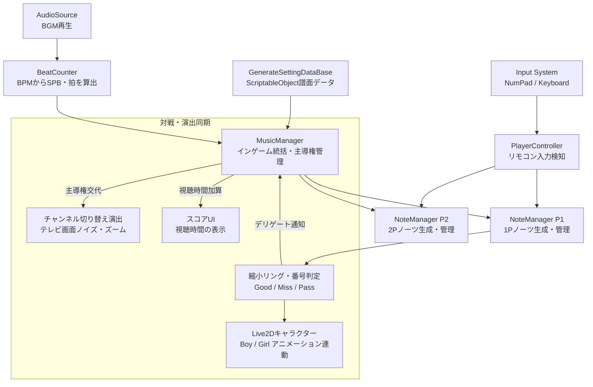

## 1. 企画・開発背景
学校の進級制作展および**東京ゲームショウ（TGS）出展**に向けて開発した、**2人対戦型リズムアクションゲーム**です。

本作は「テレビのリモコンを巡るチャンネル争い」をテーマにしています。プレイヤーはリモコンを模したテンキーや数字キーを操作し、音楽のリズムに合わせて画面に出現する「チャンネル番号ノーツ」をヒット。ノーツを成功させてテレビの**主導権（チャンネルの権利）**を奪い合い、曲が終了した時点でより長くテレビを見ていた（主導権を握っていた）プレイヤーが勝利となります。

プランナー、デザイナー（Live2D・イラスト・サウンド）、プログラマーのチーム開発（約5ヶ月）において、私は**メインプログラマー**として参画し、**リズムゲームコアエンジン（ノーツ生成・判定・BPM同期）、主導権対戦ロジック、非同期チュートリアル（UniTask）、展示用ディスプレイ対応（アスペクト比維持）、およびLive2Dインテグレーション**などの根幹システム全般の設計・実装を担当しました（※UIおよびエフェクト演出アニメーションはもう1名のプログラマーと分担）。

「一般の来場者が短時間でルールを理解し、白熱できる」展示環境を見据え、直感的なルール設計と、連打や途中離脱でもフリーズしない堅牢なフェイルセーフの実現に注力しました。

---

## 2. 技術選定とアーキテクチャ設計
リズムゲームとしての厳密なタイミング制御と、展示会での安定稼働を実現するため、以下の設計方針を採用しました。

### 1. BPM同期とSPB（Second Per Beat）に基づく時間管理
オーディオ再生時刻とフレームレートのズレによる判定崩れを防ぐため、`BeatCounter` を設計。楽曲のBPMから $SPB = 60 / BPM$（1拍あたりの秒数）および $HSPB$（半拍）を算出し、楽曲の再生時間と完全同期させたノーツ生成・小節管理を行いました。

### 2. 判定と演出を切り離すイベント駆動設計（Delegate / Action）
ノーツ判定（Good / Miss）の発生時、`NoteManager` から `MusicManager` や各種エフェクト・アニメーションへ直接依存させず、デリゲート（`getNoteCallBack`, `getMissNoteCallBack`）を介して疎結合に通知。演出担当メンバーがインゲームの判定ロジックに影響を与えることなく自由にエフェクトを組み込める構造としました。

### 3. UniTask + CancellationToken による安全な非同期チュートリアル
展示会ではプレイヤーが途中でプレイを中断したり、チュートリアルをスキップしてタイトルへ戻る操作が頻発します。コルーチンの多重起動や非同期タスクの残留（メモリリーク・NullReference）を防ぐため、**UniTask** と **CancellationTokenSource** を採用し、いつでも安全に処理を巻き取れる状態遷移を構築しました。

---

## 3. コア機能の実装詳細

### 3.1 システム構成図（アーキテクチャ）
リズムゲームの根幹（BPM・ノーツ・判定）と、対戦ロジック（主導権・スコア）、および演出レイヤーの接続構造です。



### 3.2 縮小リング＆番号一致のハイブリッド判定ロジック
ノーツは外枠リング（`_outerFrame`）が時間経過とともに中心（`_body`）に向かって縮小します。プレイヤーがボタンを押した瞬間、**リングのスケール差（距離）によるタイミング判定**と、**ノーツに描かれた数字（1〜9）と押されたキーの一致判定**を同時に行います。

```csharp
// 【NoteController.cs より抜粋】
// ノーツのタイミングおよびボタン番号の判定
public void JudgementNote(int buttonNumber, out JudgementState judgement)
{
    if (_isGetNotPossible) { judgement = JudgementState.None; return; }

    // 1. ボタン番号の一致判定（不一致の場合は即座にMISS）
    if (buttonNumber != _buttonNumber && _isNoneButtonNum == false)
    {
        HideNote();
        judgement = _isKidsNotes ? JudgementState.Pass : JudgementState.MISS;
        DisplayJudgementResult(judgement);
        DeleteThisNote(1.0f);
        return;
    }

    // 2. タイミング判定（外枠と中心ボディの距離が許容範囲内か）
    HideNote();
    float distance = Mathf.Abs(_distance);
    judgement = distance <= _goodJudgmentRange ? JudgementState.Good : JudgementState.MISS;

    // キッズモードであればミスをPass（救済）に変換
    if (_isKidsNotes && judgement == JudgementState.MISS)
        judgement = JudgementState.Pass;

    DisplayJudgementResult(judgement);
    DeleteThisNote(1.0f);
}
```

### 3.3 リアルタイム「主導権（Initiative）」奪取システム
Good判定を出したプレイヤーがテレビの主導権を獲得し、その間リアルタイムに「視聴秒数（スコア）」が蓄積されます。相手がノーツを成功させると即座に主導権が相手に移り、画面にチャンネル切り替えノイズが走ります。

```csharp
// 【MusicManager.cs より抜粋】
// ノーツ成功時のコールバック受取と主導権の移行
public void OnGetNote(PlayerNumberState playerNumber, float correctionValue)
{
    // 主導権を握るプレイヤーを変更
    GivePlayerInitiative(playerNumber);

    // チャンネル切り替えエフェクトを再生
    PlayChannelChangeEffect(playerNumber);
}

private void Update()
{
    // 主導権を握っているプレイヤーの視聴時間をリアルタイム加算
    AdditionInitiativeTime(_initiativePlayerState);
    DisplayScore();
}
```

### 3.4 展示ディスプレイ適応（アスペクト比維持＆Canvas補正）
展示会では会場ごとに異なるモニター解像度（16:9、16:10、4:3など）が使用されます。UIやゲーム画面が歪まないよう、Viewport制御（ピラーボックス/レターボックス生成）とCanvasスケーラーを自動同期させる仕組みを構築しました。

```csharp
// 【AspectKeeper.cs より抜粋】
// 画面解像度に応じてCameraのViewportRectを自動補正（帯入れ処理）
void Update()
{
    var screenAspect = Screen.width / (float)Screen.height;
    var targetAspect = aspectVec.x / aspectVec.y;
    var magRate = targetAspect / screenAspect;

    var viewportRect = new Rect(0, 0, 1, 1);
    if (magRate < 1)
    {
        viewportRect.width = magRate;
        viewportRect.x = 0.5f - viewportRect.width * 0.5f; // 左右に黒帯
    }
    else
    {
        viewportRect.height = 1 / magRate;
        viewportRect.y = 0.5f - viewportRect.height * 0.5f; // 上下に黒帯
    }
    targetCamera.rect = viewportRect;
}
```

---

## 4. 開発トラブルと解決プロセス

### 課題1: 音ゲーとしての入力精度担保と描画負荷の制御
- **発生した問題・背景**:
  開発初期、可変フレームレート環境ではノーツの縮小速度（`Time.deltaTime`）やInput Systemのポーリングタイミングに微妙なバラつきが生じ、曲とノーツのズレや判定の違和感が発生していました。また、展示PCのスペック差による負荷も考慮する必要がありました。
- **解決アプローチ**:
  `GameSettingManager` を導入し、フレームレート上限（`Application.targetFrameRate`）を制御。ミリ秒単位の精度が求められるインゲーム中は **60fps固定** に設定し、タイトルやセレクト画面などの静止パートは **30fps** に抑えることで、低負荷と高精度なリズム判定を両立させました。

---

### 課題2: TGS・展示会場における幅広い来場者への対応（キッズモードの実装）
- **発生した問題**:
  TGSや進級展にはゲーム愛好家だけでなく、低年齢のお子様やゲームに不慣れな来場者も訪れます。初期の「数字を見て同じボタンを押す」仕様では、低学年の子供が瞬時にテンキーの数字を見つけられず、連続ミスで楽しめないという課題がありました。
- **解決アプローチ**:
  短時間で誰でも遊べる「**キッズモード（KidsMode）**」を実装。ノーツから数字の表示を取り除き、どのボタンを押してもタイミングさえ合っていれば必ず成功（Pass/Good）になる救済システムを導入しました。これにより、ファミリー層の来場者からも「小さな子供でも一緒に楽しめた」と好評を得ました。

---

### 課題3: チュートリアル中断時の非同期タスク残留・例外バグ
- **発生した問題**:
  展示ブースでは、来場者がチュートリアルの途中で操作をやめたり、説明をスキップしてタイトル画面に戻る操作（ESCキー）を行うことがあります。コルーチンベースの実装では、画面遷移後も裏でノーツ生成やテキスト送りの処理が動き続け、NullReferenceExceptionや不正な画面遷移が発生しました。
- **解決アプローチ**:
  チュートリアルの進行管理（`TutorialFlowManager`）を **UniTask** へリファクタリング。`CancellationTokenSource` を保持し、スキップやタイトル復帰が走った瞬間にトークンをキャンセル（`_cancellationTokenSource.Cancel()`）して全非同期処理を一括停止・破棄する構造に改修しました。

---

## 5. チーム開発における開発手法とリサーチ

| 開発領域 | 実施内容・工夫 |
| :--- | :--- |
| **システム主導** | メインプログラマーとしてインゲーム・データ・非同期フローの基盤を自ら構築し、演出担当が参加しやすいモジュール分割を推進。 |
| **Live2Dインテグレーション** | Cubism SDKをプロジェクトに導入し、Live2Dキャラクターモデル（男の子・女の子）の描画レイヤー順や状態（Click, Missed, Beat, Win/Lose）に応じたアニメーション遷移を実装。 |
| **展示会向けQA・デバッグ** | ブースの無人放置時に自動でゲーム画面が流れる「オートプレイ機能（`AutoPlayMode`）」を自作し、実機検証とデモ展示を効率化。 |

---

## 6. 学びと今後の展望
- **学び**:
  対戦ゲームにおいて「直感的な勝ち負けの可視化（主導権システム）」がいかにプレイヤーの感情を揺さぶるかを実感しました。また、展示会という特殊な環境下では「壊れないこと（フェイルセーフ）」「誰でも遊べること（アクセシビリティ）」を最優先に考えたアーキテクチャが不可欠であることを学びました。
- **今後の展望**:
  ネットワーク対戦への対応や、MIDIキーボード・独自デバイス（本物のテレビリモコン型コントローラー）との通信連携など、ハードウェアと連動したインタラクティブなゲーム体験の拡張に挑戦したいと考えています。

---

## 7. 操作方法（テンキー・キーボード対戦）

※本作は1台のPCで2人が同時に遊べるキーバインドを採用しています。

| 操作項目 | プレイヤー1（テンキー側） | プレイヤー2（メインキーボード側） |
| :--- | :--- | :--- |
| **チャンネルボタン** | **テンキー 1 〜 9** | **数字キー 1 〜 9** |
| **決定 / スタート** | **テンキー Enter** | **Enter** キー |
| **音量調整（演出）** | **テンキー ＋ / −** | **セミコロン（;） / ハイフン（-）** |
| **タイトルへ戻る** | **ESC** キー | **ESC** キー |
