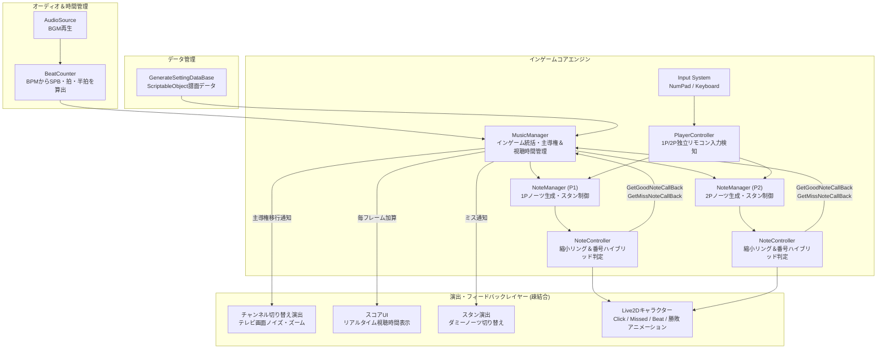
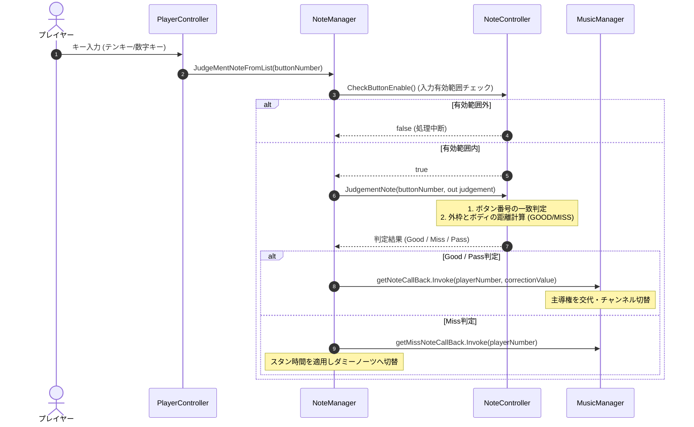
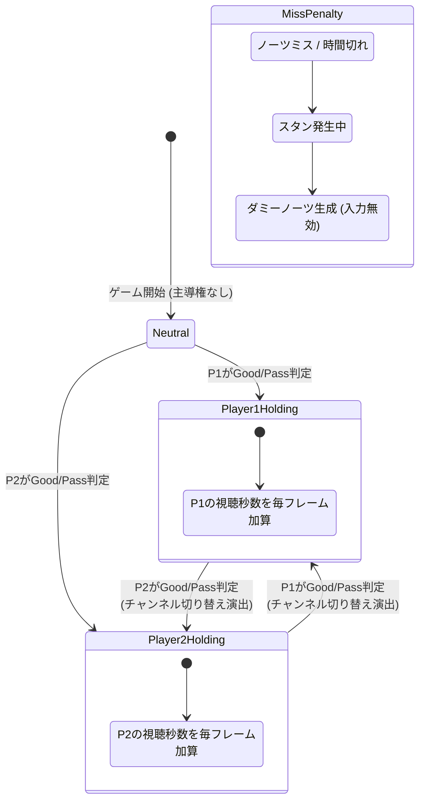
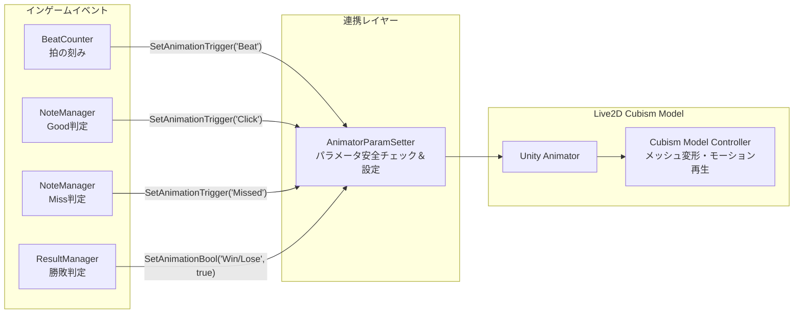
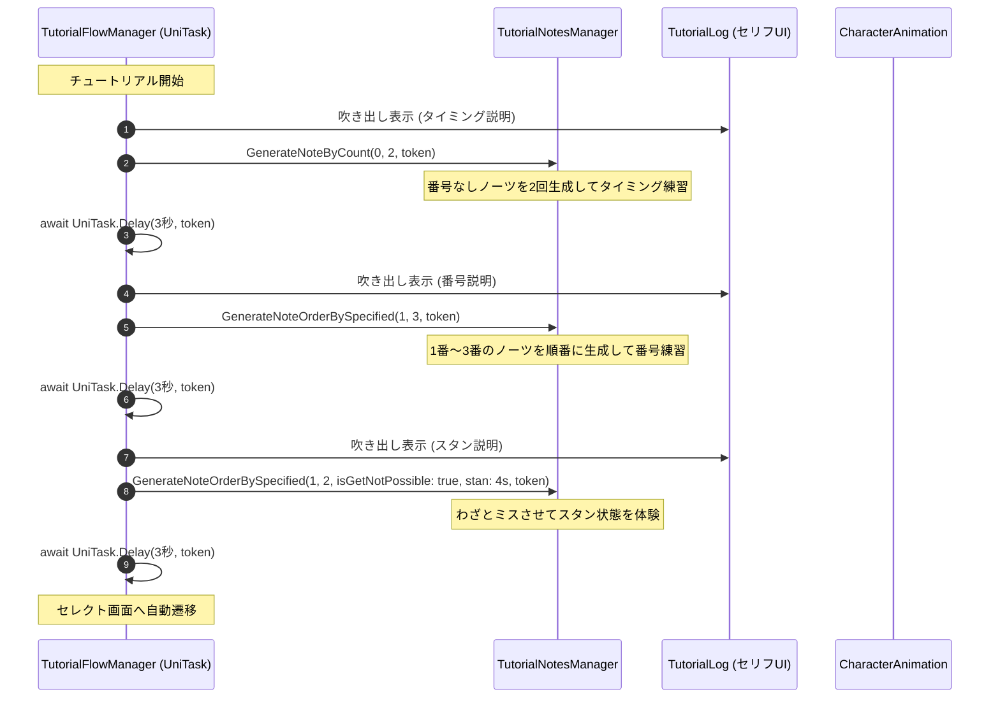
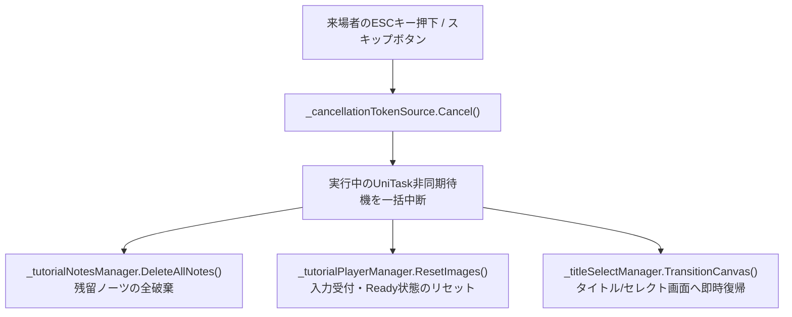
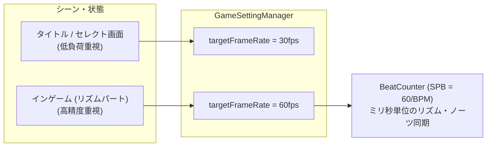
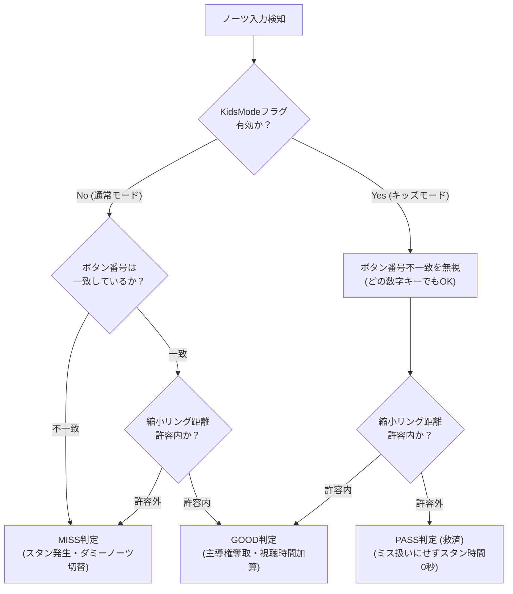

## 1. 作品の概要

### どのような作品か
「テレビのリモコンを巡るチャンネル争い」をテーマにした、 **1台のPCで遊べる2人対戦型リズムアクションゲーム** です。

プレイヤーはリモコンを模したテンキーや数字キーを操作し、楽曲のリズムに合わせて画面に出現する「チャンネル番号ノーツ」をヒットしていきます。ノーツ入力を成功させることでテレビの **主導権（チャンネルの権利）** を奪い合い、曲が終了した時点でより長くテレビを見ていた（主導権を握っていた）プレイヤーが勝利となります。

### 操作方法
1台のPC・キーボードを用いて、向かい合ったり並んだりして2人で対戦できます。

| 操作項目                  | プレイヤー1（テンキー側） | プレイヤー2（メインキーボード側）   |
| :------------------------ | :------------------------ | :---------------------------------- |
| **チャンネルボタン**      | **テンキー 1 〜 9**       | **数字キー 1 〜 9**                 |
| **決定 / スタート**       | **テンキー Enter**        | **Enter** キー                      |
| **音量調整（演出）**      | **テンキー ＋ / −**       | **セミコロン（;） / ハイフン（-）** |
| **タイトルへ戻る / 中断** | **ESC** キー              | **ESC** キー                        |

### 開発背景
学校の進級制作展および **東京ゲームショウ（TGS 2025）出展** に向けて制作しました（開発期間：2025年4月〜2025年9月の約5ヶ月間）。

展示会ブースでの試遊体験を第一に見据え、「一般の来場者が短時間で直感的にルールを理解して白熱できるゲームデザイン」と、「連打や途中離脱、急な操作中断が発生しても絶対にフリーズ・エラー落ちしない堅牢なフェイルセーフ設計」の両立を目指して開発を行いました。

### チーム体制と自分の役割
- **チーム構成** ：プランナー、デザイナー（Live2D・イラスト・サウンド）、プログラマー2名
- **コミット実績** ：総コミット数118件中、 **98コミット（約83%）** を担当
- **自分の役割（メインプログラマー）** ：
  - リズムゲームコアエンジン（ノーツ生成・判定・BPM同期）の設計・実装
  - リアルタイム主導権（Initiative）対戦ロジックおよびスタン制御の実装
  - UniTaskとCancellationTokenを用いた安全な非同期チュートリアル・ストーリー進行基盤の構築
  - Live2D Cubism SDKインテグレーションおよび描画順・アニメーション連動
  - 展示ディスプレイ適応（アスペクト比維持・Canvas補正）およびフレームレート動的制御
  - 幅広い来場者向けのアクセシビリティ機能（KidsMode）や展示デモ用のオートプレイ機能の実装
  - ※もう1名のプログラマーはタイトルロゴアニメーション、UIレイアウト、Win/Loseテキスト演出、判定パーティクルエフェクトなどの演出周りを担当。イベント駆動型のモジュール分割により、2名のプログラマーが干渉せずスムーズに並行開発できる基盤を整えました。

---

## 2. 選定技術と全体のアーキテクチャ設計

### どの技術を使用したか
展示会場での安定動作、厳密なリズム同期、およびリッチな2D表現を実現するため、以下の技術スタックを選定しました。

- **ゲームエンジン** ：Unity 2022.3.56f1 (LTS)
- **言語** ：C#
- **レンダリング** ：Universal Render Pipeline (URP 14.0.11)
- **非同期処理** ：Cysharp UniTask
- **入力管理** ：Unity Input System (1.11.2) - テンキーとメインキーボードの完全分離・同時入力検知
- **2Dアニメーション** ：Live2D Cubism SDK for Unity (CubismCore)
- **データ管理** ：ScriptableObject（楽曲メタデータ、譜面生成データベース、リザルト受け渡し）

### どの設計を採用したか

#### 1. BPM同期とSPB（Second Per Beat）方式によるフレーム非依存の時間管理
楽曲の再生時間とゲーム内時間のズレを防ぐため、 `BeatCounter` を設計。楽曲のBPMから $SPB = 60 / BPM$ （1拍の秒数）および $HSPB = 30 / BPM$ （半拍の秒数）を算出し、オーディオの再生時刻に完全同期させた拍カウントとノーツ生成を行いました。

#### 2. イベント駆動型（Delegate / Action）による判定・対戦・演出の疎結合化
ノーツ判定（Good / Miss / Pass）の発生時、 `NoteManager` から `MusicManager` や各種演出クラスへ直接依存させず、デリゲート（ `GetGoodNoteCallBack`, `GetMissNoteCallBack` ）を介して通知。判定ロジックと演出レイヤーを完全に切り離し、演出担当プログラマーがインゲームのコアロジックを破壊することなく安全にエフェクトを組み込める構造としました。

#### 3. UniTask + CancellationToken による展示向けフェイルセーフ非同期設計
展示ブースでは、来場者がチュートリアルの途中で操作をやめたり、ESCキーでタイトルへ強制復帰したりする操作が頻繁に起こります。コルーチン多重起動やタスクの残留（メモリリーク・NullReferenceException）を完全に防ぐため、 **UniTask** と **CancellationTokenSource** によるライフサイクル管理を徹底しました。



---

## 3. 実装した機能の詳細

### 3.1 BPM同期＆縮小リング・番号一致ハイブリッド判定エンジン

ノーツは外枠リング（ `_outerFrame` ）が中心（ `_body` ）に向かって時間経過とともに縮小します。プレイヤーがボタンを押した瞬間、 **リングのスケール差（距離）によるタイミング判定** と、 **ノーツに描かれた数字（1〜9）と押されたキーの一致判定** を同時に行うハイブリッド判定システムを構築しました。



#### 主要コード抜粋（BeatCounter.cs）
オーディオ再生に合わせてミリ秒単位で拍（Beat）と半拍（SubBeat）を計上します。

```csharp
// 【BeatCounter.cs より抜粋】
// BPMからSPBおよびHSPBを算出し、フレームレートに依存しない正確な拍管理を行う
void Start()
{
    // SPB（1拍あたりの秒数）を計算
    _spb = 60.0f / _bpm;

    // HSPB（半拍あたりの秒数）を計算
    _hspb = 30.0f / _bpm;
}

void Update()
{
    _secCounter += Time.deltaTime;

    // 半拍のカウント
    if (_secCounter > _hspb)
    {
        _subBeat++;
        if (_subBeat >= 4) _subBeat = 0;
    }

    // 1拍のカウント
    if (_secCounter >= _spb)
    {
        _beat++;
        _secCounter = 0;
    }
}
```

#### 主要コード抜粋（NoteController.cs）
ボタン番号の一致チェックと縮小リングの距離チェックを段階的に評価します。

```csharp
// 【NoteController.cs より抜粋】
// 番号一致判定と外枠縮小距離によるハイブリッド判定ロジック
public void JudgementNote(int buttonNumber, out JudgementState judgement)
{
    if (_isGetNotPossible) { judgement = JudgementState.None; return; }

    // 1. ボタン番号の一致判定（不一致の場合は即座にMISS）
    if (buttonNumber != _buttonNumber && _isNoneButtonNum == false)
    {
        HideNote();
        judgement = _isKidsNotes ? JudgementState.Pass : JudgementState.MISS;
        DisplayJudgementResult(judgement);
        DeleteThisNote(1.0f);
        return;
    }

    // 2. タイミング判定（外枠と中心ボディの距離が許容範囲内か）
    HideNote();
    GodDistance = _distance;
    float distance = Mathf.Abs(_distance);
    judgement = distance <= _goodJudgmentRange ? JudgementState.Good : JudgementState.MISS;

    // キッズモードであればミスをPass（救済）に変換
    if (_isKidsNotes && judgement == JudgementState.MISS)
        judgement = JudgementState.Pass;

    DisplayJudgementResult(judgement);
    DeleteThisNote(1.0f);
}
```

---

### 3.2 リアルタイム主導権（Initiative）奪取＆スタン対戦システム

プレイヤーがGood判定を出すと即座にテレビの主導権が移行し、そのプレイヤーの「視聴時間（スコア）」が毎フレーム加算されます。相手がノーツを成功させると主導権が奪い返され、画面に切り替えノイズが走ります。

さらに、ミスしたプレイヤーには難易度に応じた **スタン時間（ペナルティ）** が課され、スタン中は通常ノーツの代わりに「ダミーノーツ」が生成されてボタン入力が無効化される、対戦ゲームとしての駆け引きを実装しました。



#### 主要コード抜粋（MusicManager.cs & NoteManager.cs）

```csharp
// 【MusicManager.cs より抜粋】
// ノーツ成功コールバック受取とリアルタイムスコア（視聴時間）加算
public void OnGetNote(PlayerNumberState playerNumber, float correctionValue)
{
    // 主導権を握るプレイヤーを変更
    GivePlayerInitiative(playerNumber);

    // チャンネル切り替え演出を再生
    PlayChannelChangeEffect(playerNumber);
}

private void Update()
{
    if (!_isPlaying) return;

    // 主導権を握っているプレイヤーの視聴秒数をリアルタイム加算
    AdditionInitiativeTime(_initiativePlayerState);
    DisplayScore();
}
```

```csharp
// 【NoteManager.cs より抜粋】
// ミス時のスタン処理とダミーノーツ生成への切り替え
public GameObject GenerateNote(Vector2 generatePos)
{
    int orderNum = INITIAL_ORDER_IN_LAYER_NUMBER + _genNum * 3 + 1;

    // スタン時であればダミーノーツを生成（操作無効・グレー表示）
    if (_isStopNoteGenerate == true)
    {
        GameObject dummyNote = Instantiate(_dummyNotePrefab, generatePos, Quaternion.identity);
        NoteController noteControllerOfDummyNote = dummyNote.GetComponent<NoteController>();
        noteControllerOfDummyNote.SetIsDummyNotes(true);
        noteControllerOfDummyNote.SetOrderInLayer(orderNum);
        if (_isKidsMode) noteControllerOfDummyNote.SetIsKidsNotes(true);

        _generatedDummyNotes.Add(dummyNote);
        return dummyNote;
    }

    // 通常ノーツの生成
    GameObject note = Instantiate(_notePrefab, generatePos, Quaternion.identity);
    NoteController noteControllerOfNote = note.GetComponent<NoteController>();
    noteControllerOfNote.SetOrderInLayer(orderNum);
    if (_isKidsMode) noteControllerOfNote.SetIsKidsNotes(true);

    _generateNotes.Add(note);
    return note;
}
```

---

### 3.3 Live2D SDKを用いたキャラクターアニメーションの組み込み

Live2D Cubism SDK for Unity（ `CubismCore` ）を導入し、画面手前および奥に配置されたLive2Dキャラクターモデル（男の子・女の子）が、インゲームのビートやノーツ判定結果（Good / Miss）、対戦の勝敗とリアルタイムに連動するアニメーションシステムを実装しました。



#### 主要コード抜粋（AnimatorParamSetter.cs）
Live2DモデルのAnimatorに対し、パラメータの存在チェックを行った上で安全にトリガー・変数を更新するセーフティラッパーを設計しました。

```csharp
// 【AnimatorParamSetter.cs より抜粋】
// Live2DモデルのAnimatorパラメータを安全に更新
public class AnimatorParamSetter : MonoBehaviour
{
    [SerializeField] private Animator _playerAnim;

    public void SetAnimationTrigger(string pramName)
    {
        if (_playerAnim == null) return;

        // 指定パラメータがAnimatorに存在するか検証した上で実行
        var animParameter = Array.Find(_playerAnim.parameters, p => p.name == pramName);
        if (animParameter != null)
        {
            _playerAnim.SetTrigger(pramName);
        }
    }

    public void SetAnimationBool(string pramName, bool value)
    {
        if (_playerAnim == null) return;

        var animParameter = Array.Find(_playerAnim.parameters, p => p.name == pramName);
        if (animParameter != null)
        {
            _playerAnim.SetBool(pramName, value);
        }
    }
}
```

---

### 3.4 チュートリアル向けノーツ生成機構＆UniTask非同期制御

初めて遊ぶ来場者がスムーズに操作を理解できるよう、セリフ進行や説明フェーズに合わせて「タイミングの説明」「番号の一致説明」「スタンペナルティの説明」と段階的にノーツ生成を行うチュートリアル機構を実装しました。



#### 主要コード抜粋（TutorialFlowManager.cs & TutorialNotesManager.cs）

```csharp
// 【TutorialFlowManager.cs より抜粋】
// UniTaskによる段階的チュートリアルの進行管理
public async UniTask PlayTutorialAnimation(CancellationToken token)
{
    // 1. 準備フェーズ
    _tutorialPlayerManager.SetCanPlayerPressEnter(true);
    _tutorialNotesManager.SetCanGenerate(true);
    _tutorialCharacterAnimation.StartSpeakAnimation(true);
    _tutorialLog.SetLogSprite(0);
    await UniTask.Delay(TimeSpan.FromSeconds(0.5f), cancellationToken: token);
    _tutorialPlayerManager.SetCanPlayersInput(true);

    // 2. タイミングの説明（縮小リングの合わせ方を練習）
    await UniTask.Delay(TimeSpan.FromSeconds(2.0f), cancellationToken: token);
    await _tutorialNotesManager.GenerateNoteByCount(0, 2, token: token);
    await UniTask.Delay(TimeSpan.FromSeconds(3.0f), cancellationToken: token);

    // 3. 番号一致の説明（1〜3番のキー入力を練習）
    _tutorialCharacterAnimation.StartSpeakAnimation(false);
    _tutorialLog.SetLogSpriteWithAnimation(1);
    await _tutorialNotesManager.GenerateNoteOrderBySpecified(1, 3, token: token);
    await UniTask.Delay(TimeSpan.FromSeconds(3.0f), cancellationToken: token);

    // 4. スタンの説明（ミス時のペナルティを体験）
    _tutorialCharacterAnimation.StartSpeakAnimation(true);
    _tutorialLog.SetLogSpriteWithAnimation(2);
    await _tutorialNotesManager.GenerateNoteOrderBySpecified(1, 2, true, 4.0f, token);
    await UniTask.Delay(TimeSpan.FromSeconds(3.0f), cancellationToken: token);

    _tutorialNotesManager.SetCanGenerate(false);
    _tutorialCharacterAnimation.StopCharacterAnimation();

    // セレクト画面へ遷移
    _titleSelectManager.TransitionCanvas(GameStatus.GameSceneEnum.Tutorial, GameStatus.GameSceneEnum.Select);
}
```

```csharp
// 【TutorialNotesManager.cs より抜粋】
// 非同期ループによる指定個数・指定番号のノーツ生成
public async UniTask GenerateNoteOrderBySpecified(int startValue, int endValue, bool isGetNotPossible = false, float stanTime = 0.0f, CancellationToken token = default)
{
    if (_canGenerate == false) return;
    _buttonNumber = startValue;
    _time = 3.0f;

    while (_buttonNumber <= endValue)
    {
        _time += Time.deltaTime;

        if (_time >= 3.0f)
        {
            _time = 0.0f;
            // P1・P2へ指定番号のノーツを同時生成
            GameObject noteP1 = _noteManagerPlayer1.GenerateNote(_generatePosP1);
            noteP1.GetComponent<NoteController>().SetButtonNumber(_buttonNumber);
            noteP1.GetComponent<NoteController>().SetIsGetNotPossible(isGetNotPossible);

            GameObject noteP2 = _noteManagerPlayer2.GenerateNote(_generatePosP2);
            noteP2.GetComponent<NoteController>().SetButtonNumber(_buttonNumber);
            noteP2.GetComponent<NoteController>().SetIsGetNotPossible(isGetNotPossible);

            _buttonNumber++;
        }
        await UniTask.Yield(token); // 毎フレーム待機＆キャンセル監視
    }
}
```

---

## 4. 解決した課題

### 課題1: UniTaskによるチュートリアル中断時のタスク残留・例外バグ解決

#### 背景・課題
展示ブースでは、来場者がチュートリアルの途中で操作をやめて離脱したり、ESCキーを押してタイトル画面に戻ったり、説明をスキップする操作が頻繁に発生します。

当初のコルーチンベースの実装では、画面がタイトルに戻った後もバックグラウンドでノーツ生成やテキスト送りの処理が走り続け、 `NullReferenceException` や不正な画面遷移が発生していました。チュートリアルのいかなるタイミングで中断・スキップ操作が行われても、背後で走る非同期タスクを確実に停止し、生成済みノーツやUI状態を瞬時に初期化できる堅牢なフェイルセーフ機構の構築が求められました。

#### 技術的アプローチ
チュートリアルの進行管理（ `TutorialFlowManager` ）を **UniTask** へリファクタリングし、 `CancellationTokenSource` を導入しました。

ESCキー検知時およびスキップ実行時に `_cancellationTokenSource.Cancel()` を呼び出し、実行中の非同期待機（ `UniTask.Delay` やノーツ生成ループ）を一括停止。さらに、残存ノーツの全削除（ `DeleteAllNotes()` ）と入力フラグのリセットを同期的に実行するフェイルセーフ構造に改修しました。

これにより、非同期処理のライフサイクルが画面遷移と完全に一致するようになり、例外エラーの発生率を **0件** に抑制。TGSや進級展の過酷な連続試遊環境下においても、予期せぬ操作によるフリーズを完全に防ぎ、安定稼働を達成しました。

#### 具体的なコードや設計



```csharp
// 【TutorialFlowManager.cs より抜粋】
// ESCキー押下によるタイトル復帰と完全なクリーンアップ
private void ReturnToTitle()
{
    if (_isStartTutorial != true) return;

    // 1. 実行中の非同期タスク（Delay・生成ループ）を一括キャンセル
    _cancellationTokenSource.Cancel();

    // 2. 入力権限とプレイヤー状態のリセット
    _tutorialPlayerManager.SetCanPlayerPressEnter(false);
    _tutorialPlayerManager.ResetCanPlayersEnterPressed();
    _tutorialPlayerManager.ResetImages();

    // 3. 画面上に残ったチュートリアル用ノーツを全削除
    _tutorialNotesManager.DeleteAllNotes();

    // 4. タイトル画面へ安全に画面遷移
    _titleSelectManager.TransitionCanvas(GameStatus.GameSceneEnum.Tutorial, GameStatus.GameSceneEnum.Title);
    _isStartTutorial = false;
}
```

---

### 課題2: BPM同期とフレームレート制御による判定精度と描画負荷の両立

#### 背景・課題
可変フレームレート環境では、ノーツの縮小速度（ `Time.deltaTime` ）やInput Systemのポーリングタイミングに微細なブレが生じ、楽曲とノーツのタイミングに違和感が発生していました。

また、展示会で使用するノートPCや展示機材のスペック差により、常時高負荷で動作させると発熱やサーマルスロットリングによる処理落ちのリスクがありました。インゲーム中におけるミリ秒精度の安定したリズム判定を保証しつつ、メニュー画面などでは余分な描画負荷を抑制してPCの発熱・負荷を抑えることが課題でした。

#### 技術的アプローチ
`BeatCounter` による $SPB = 60 / BPM$ の拍計算によってフレーム非依存の時間基準を確立した上で、シングルトンとして `GameSettingManager` を設計しました。

インゲーム中は `Application.targetFrameRate = 60` でフレームレートを固定して判定精度を担保し、タイトルやセレクト画面などの静止パートでは `30fps` に抑える動的フレームレート制御を導入しました。

これにより、インゲーム中は安定した60fps動作を保ち、判定のブレや入力遅延を解消。「音と入力が気持ちよく同期している」というリズムゲームとしての高い演奏感を実現しました。同時に、長時間の連続稼働でも熱暴走することなく終日安定してブース展示を継続できました。

#### 具体的なコードや設計



```csharp
// 【GameSettingManager.cs より抜粋】
// フレームレート上限の動的制御
public class GameSettingManager : Singleton<GameSettingManager>
{
    public enum EnumFrameRateLimitState
    {
        Thirty = 30,
        Sixty = 60
    }

    private EnumFrameRateLimitState _appFrameRateLimit = EnumFrameRateLimitState.Thirty;

    public void SetAppFrameRateLimit(EnumFrameRateLimitState value)
    {
        _appFrameRateLimit = value;
        Application.targetFrameRate = (int)_appFrameRateLimit;
    }

    void Start()
    {
        SetAppFrameRateLimit(_appFrameRateLimit);
    }
}
```

---

### 課題3: 展示アクセシビリティ向上（KidsModeによる子供・初心者救済）

#### 背景・課題
TGSや学校展には、コアなゲーマーだけでなく低年齢の子供や普段ゲームを遊ばない一般の来場者も多数訪れます。

初期の「数字を見て瞬時に該当するテンキーを押す」仕様では、低学年の子供が手元の数字キーを探している間にノーツが通り過ぎてしまい、ミスが連続してスタンしたまま楽しめずに終わってしまう課題が浮上しました。対戦ゲームとしての白熱感や楽しさを損なうことなく、小さな子供やゲーム初心者でも直感的にリモコン争奪戦を楽しめるアクセシビリティ（救済策）の組み込みが必要でした。

#### 技術的アプローチ
難易度設定に「 **キッズモード（KidsMode）** 」を新設しました。

ノーツから数字表示を排除し、どのボタンを押してもタイミングさえ合っていれば必ず成功判定となる仕様を導入。さらに、タイミングがズレた場合もミスによるスタンペナルティを発生させず「Pass判定」として処理し、スタン時間を0秒（ `STAN_TIME_KIDS = 0.0f` ）に設定することで、絶え間なくボタンを叩いて主導権争いに参加できるようにしました。

これにより、親子連れや兄弟での来場者が「子供でも対等に勝負できて盛り上がれた」と笑顔でプレイする姿が見られ、幅広い年齢層のプレイヤーをブースに惹きつけることに成功しました。

#### 具体的なコードや設計



```csharp
// 【NoteController.cs より抜粋】
// キッズモードにおける救済判定ロジック
if (buttonNumber != _buttonNumber && _isNoneButtonNum == false)
{
    HideNote();
    // キッズノーツであれば番号不一致でもMISSにせずPassに変換
    judgement = _isKidsNotes ? JudgementState.Pass : JudgementState.MISS;
    DisplayJudgementResult(judgement);
    DeleteThisNote(1.0f);
    return;
}

// タイミング判定
float distance = Mathf.Abs(_distance);
judgement = distance <= _goodJudgmentRange ? JudgementState.Good : JudgementState.MISS;

// キッズノーツであればタイミングズレもPassに救済
if (_isKidsNotes && judgement == JudgementState.MISS)
    judgement = JudgementState.Pass;
```

---

## 5. 学びと今後の展望

### 学び
- **ミリ秒単位のリズム判定エンジン設計** ：
  BPMからSPB（Second Per Beat）を逆算し、オーディオ再生時刻と同期させながらフレーム非依存で拍を刻む時間管理技術を深く習得しました。また、可変フレームレートが入力精度に与える影響を検証し、適切なフレームレート固定・制御を行うことの重要性を学びました。
- **UniTaskによる安全な非同期ステート管理** ：
  展示会のように「いつ中断・離脱されるかわからない」過酷な環境下において、コルーチンではなく `UniTask` と `CancellationTokenSource` を用いたライフサイクル制御の堅牢性を実感しました。非同期タスクが残存しないフェイルセーフ設計の勘所を身につけることができました。

### 今後の展望
- **GUIベースの高度な譜面エディタツールの開発** ：
  現状はScriptableObjectベースでノーツ生成パラメータを設定していますが、楽曲波形を見ながらGUI上で直感的にノーツ配置やBPM変更を行えるUnityエディタ拡張ツールの開発に取り組みたいと考えています。
- **独自ハードウェア連携やオンライン対戦への拡張** ：
  キーボード操作だけでなく、マイコンボード（Arduino/Raspberry Pi）を活用して本物のテレビリモコンをUSBコントローラーとして認識させるハードウェア連携や、Netcode for GameObjectsを用いたオンライン対戦への拡張など、大規模かつ発展性のあるゲーム開発へ応用していきたいと考えています。
