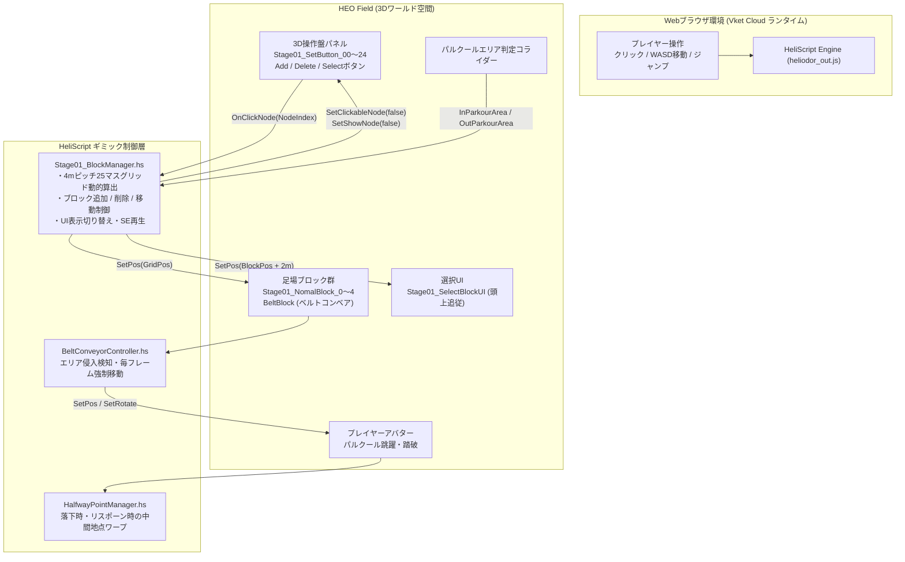
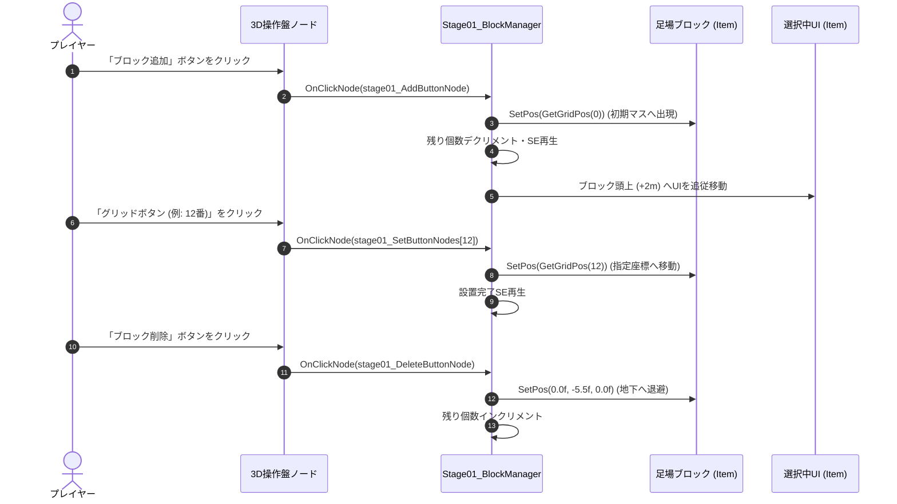
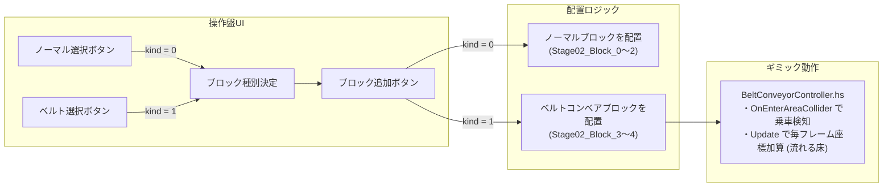
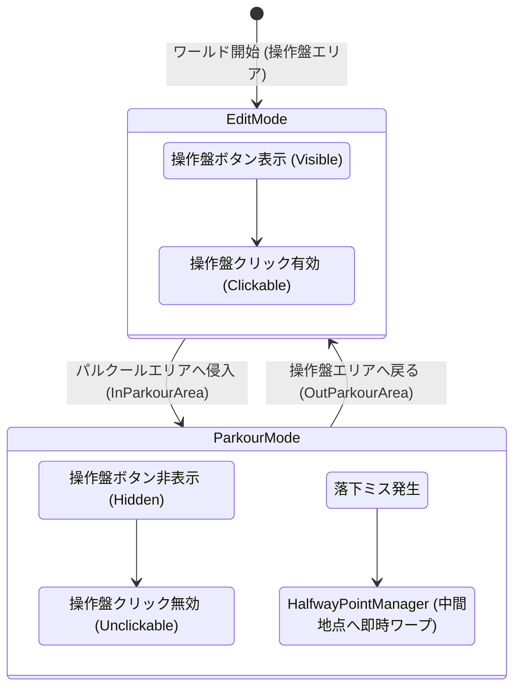
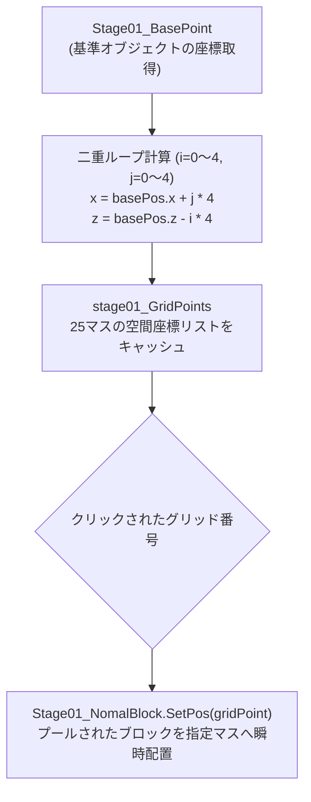
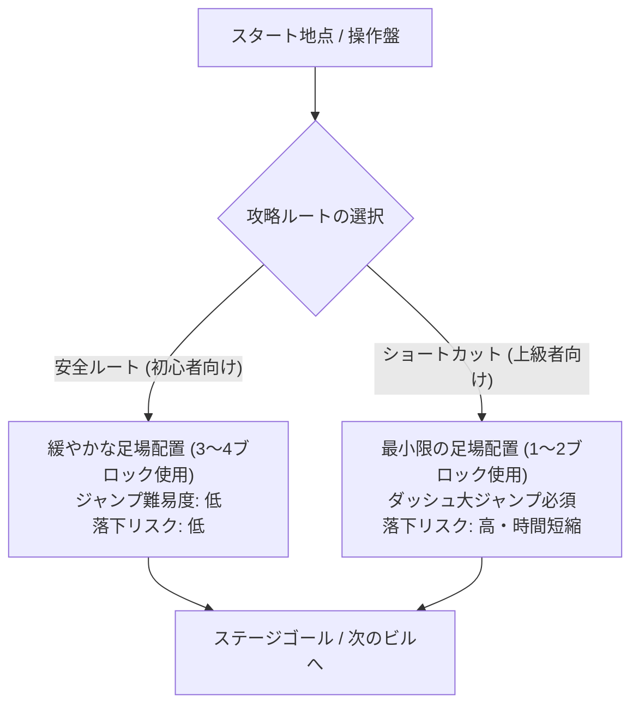
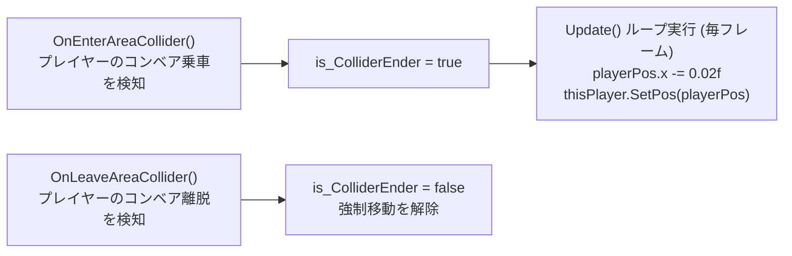

## 1. 作品の概要

### どのような作品か
「プレイヤー自身が足場を作って跳び移り、空中ルートを開拓できる」という創造的体験をテーマにした、 **Webブラウザ上で遊べる3Dパルクール・メタバースワールド** です。

単にあらかじめ用意されたアスレチックを進むのではなく、ワールド内に設置された3D操作盤（5×5のグリッドインターフェース）を通じて、空間上に足場ブロック（ノーマルブロックやベルトコンベアブロック）を自在に出現・再配置させ、自分だけの攻略ルートを組み立てて高層ビルの頂上やゴールを目指します。

### 操作方法
Webブラウザ上でキーボードとマウスを用いて直感的に操作できます。

| 操作項目 | 操作キー / マウス |
| :--- | :--- |
| **移動** | **W, A, S, D** または **方向キー** |
| **ジャンプ** | **Space** キー |
| **操作盤の操作（足場配置・選択・削除）** | **マウスクリック（左クリック）** |
| **視点回転** | **マウスドラッグ** （または右ボタンドラッグ） |
| **ダッシュ** | **Shift** キー（アバター標準機能） |

### 開発背景
企業と学校が連携する **産学提携プロジェクト** において、VR/メタバースプラットフォーム「Vket Cloud」向けに制作しました。

「ブラウザからURLを開くだけで誰でも即座に体験できる手軽さ」と、「プレイヤーの創意工夫によって無数の攻略ルートが生まれるインタラクティブなゲーム性」の両立を目指して開発を行いました。

### チーム体制と自分の役割
- **チーム構成** ：企画ディレクター（自身）、プログラマー（自身）、3Dモデル・テクスチャ制作チームメンバー
- **自分の役割（企画立案・メインプログラマー・ディレクション）** ：
  - ワールド全体の企画立案・ゲームデザイン・レベルデザイン
  - プラットフォーム独自言語「 **HeliScript** 」を用いた動的足場生成ギミック・全ステージ制御スクリプトの設計・実装
  - ベルトコンベア（流れる床）や中間復帰ポイントなどの各種インタラクティブギミックの実装
  - 3Dモデル・UIテクスチャ制作メンバーへの仕様伝達・ノード命名規則定義などの素材制作ディレクション

ステージ構成としては、基本操作を学ぶステージ01（ノーマルブロック配置）から、強制移動ギミックが加わるステージ02〜03（ベルトコンベアブロック）、高層ビル間を渡るステージ04（3階層立体グリッド配置）、さらに限られた足場数で挑む高難易度ステージ（Stage11〜12）へと、徐々にパズルとアクションの深みが増す多面的なステージ展開を設計しました。

---

## 2. 選定技術と全体のアーキテクチャ設計

### どの技術を使用したか
Webブラウザ上で高速・軽量に動作し、URL共有だけで多数のユーザーが即座に体験できるメタバース空間を構築するため、以下の技術スタックを選定しました。

- **開発プラットフォーム** ：Vket Cloud SDK（Unityエディタ上でワールド制作・ビルド）
- **組み込みスクリプト言語** ： **HeliScript** （HIKKY社独自のWebメタバース向け軽量オブジェクト指向言語）
- **データフォーマット** ：HEO（Heliodor Encrypted Object）形式（軽量化・暗号化された3Dモデル・シーン形式）
- **サウンド・エフェクト** ：Vket Cloud標準オーディオノード（配置・選択・削除の各種SE再生）

### どの設計を採用したか

#### 1. HeliScriptによるコンポーネント指向スクリプティング
HeliScriptはUnityのC#コンポーネントに似た `component` 構造を持ちながらも、API体系やライフサイクル、メモリ空間の扱いが独自です。
- `hsItemGet("Stage01")`: ワールド内のHEOアイテムやノードを取得
- `OnClickNode(int NodeIndex)`: 3D空間上の操作盤ボタンがクリックされたイベントを検知
- `hsPlayerGet()`: ワールド内の操作プレイヤーを取得し、座標（ `GetPos` ）や回転（ `SetRotate` ）を制御
- `hsSystemOutput()`: ブラウザのデバッグコンソールへのリアルタイムログ出力

#### 2. 数式ベースの動的グリッド座標生成とインデックスキャッシュ
足場を配置する空間座標（5×5の計25マス）をハードコーディングせず、基準となるベースオブジェクト（ `Stage01_BasePoint` ）のワールド座標から、二重ループを用いて X軸・Z軸方向へそれぞれ 4m ピッチで展開する空間座標リスト（ `stage01_GridPoints` ）を動的に生成・キャッシュしました。

#### 3. エリアコライダー連動によるモード切り替え（フェイルセーフ設計）
プレイヤーが操作盤で足場を置く「編集モード」と、実際に足場へ飛び移る「パルクール挑戦モード」を明確に分離。パルクールエリアへの侵入を検知すると、操作盤ノードのクリック判定と表示を `SetClickableNode(..., false)` / `SetShowNode(..., false)` で一括無効化し、ジャンプ中の誤操作や視界遮りを防ぐ構造としました。



---

## 3. 実装した機能の詳細

### 3.1 動的グリッド算出＆足場配置システム（Stage01_BlockManager）

プレイヤーが操作盤をクリックすることで、空中に最大4つのブロックを自在に配置・編集できる中核システムです。

ベースとなるオブジェクト（ `Stage01_BasePoint` ）を基点として、4m間隔の5×5グリッド空間座標を算出して配列に格納。操作盤の各ノード（追加、削除、選択切り替え、設置先グリッド）のクリックイベントを受け取り、ブロックの配置座標（ `SetPos` ）を更新します。



#### 主要コード抜粋（Stage01_BlockManager.hs）
数式によるグリッド座標の動的生成と、ノードクリックに応じた足場の移動・削除処理です。

```cpp
component Stage01_BlockManager
{
    int selectedBlockNum;              // 選択中のブロック番号
    int blockNumMax;                   // 扱える最大ブロック数 (4)
    int stage01_SetButtonNumMax;       // 設置ボタングリッド数 (24: 0〜24の計25個)
    list<Vector3> stage01_GridPoints;  // 25マスの空間座標リスト
    list<Item> stage01_NomalBlocks;    // 足場ブロックオブジェクトの配列
    Item stage01_SelectBlockUI;        // 選択中ブロックの頭上を示すUI

    public Stage01_BlockManager()
    {
        selectedBlockNum = -1;
        blockNumMax = 4;
        stage01_SetButtonNumMax = 24;

        // 基準座標から4mピッチの5×5グリッド座標を二重ループで動的算出
        stage01_GridPoints = new list<Vector3>();
        Vector3 basePos = stage01_BasePoint.GetPos();
        for(int i = 0; i < 5; i++)
        {
            for(int j = 0; j < 5; j++)
            {
                float x = basePos.x + j * 4.0f;
                float z = basePos.z - i * 4.0f;
                Vector3 gridPoint = makeVector3(x, -0.5f, z);
                stage01_GridPoints.Add(gridPoint);
            }
        }
    }

    public void OnClickNode(int NodeIndex)
    {
        if(is_parkourArea != true)
        {
            // 設置グリッドボタンが押された場合、選択中のブロックを指定マスへ移動
            for(int i = 0; i <= stage01_SetButtonNumMax; i++)
            {
                if(NodeIndex == stage01_SetButtonNodes[i] && selectedBlockNum != -1)
                {
                    Vector3 bPos = GetGridPos(i);
                    stage01_NomalBlocks[selectedBlockNum].SetPos(bPos);
                    blockPutSE.Play();
                }
            }
        }
    }

    // ブロックを地下座標に退避させて削除扱いとする
    public void DeleteBlock(int _blockNum)
    {
        Vector3 deletePos = makeVector3(0.0f, -5.5f, 0.0f);
        stage01_NomalBlocks[_blockNum].SetPos(deletePos);
        is_BlockPut[_blockNum] = false;
        nomalBlockNum++;
    }
}
```

---

### 3.2 複数ブロック種別切替とベルトコンベアギミック（Stage02 & BeltConveyorController）

ステージ02以降では、静止した「ノーマルブロック」だけでなく、プレイヤーを特定の方向へ押し流す「ベルトコンベアブロック」が導入されます。

プレイヤーは操作盤上で配置したいブロック種別（ `selectedBlockKindNum` ）を選択し、それぞれ独立して管理された残り個数の中から空中に配置できます。



#### 主要コード抜粋（BeltConveyorController.hs）
物理演算が制限されたWebメタバース環境において、エリアコライダーと座標加算を組み合わせて安定したベルトコンベアの移動力を実現しています。

```cpp
component BeltConveyorController
{
    bool is_ColliderEnder;
    Player thisPlayer;
    Vector3 playerPos;
    float playerRotate;

    public BeltConveyorController()
    {
        is_ColliderEnder = false;
        thisPlayer = hsPlayerGet();
    }

    public void Update()
    {
        // プレイヤーがコンベア上に乗っている間、毎フレーム座標を移動
        if(is_ColliderEnder == true)
        {
            playerRotate = thisPlayer.GetRotate();
            playerPos = thisPlayer.GetPos();
            playerRotate = 0.0f;
            playerPos.x -= 0.02f; // X軸負方向へ連続移動
            thisPlayer.SetRotate(playerRotate);
            thisPlayer.SetPos(playerPos);
        }
    }

    public void OnEnterAreaCollider()
    {
        is_ColliderEnder = true; // コンベア侵入を検知
    }

    public void OnLeaveAreaCollider()
    {
        is_ColliderEnder = false; // コンベア離脱を検知
    }
}
```

---

### 3.3 パルクールエリア連動の操作盤非活性化＆中間ポイント復帰（フェイルセーフ設計）

プレイヤーが足場ブロックを飛び移るパルクールエリアに足を踏み入れた瞬間、操作盤ボタンの当たり判定（クリック検知）と表示を無効化。パルクールに集中できる視界を確保し、誤って操作盤をクリックして足場が消えてしまう事故を完全に防ぎます。

また、落下時には `HalfwayPointManager` が中間地点の座標を取得し、 `hel_player_Warp` を通じて即座に復帰させます。



#### 主要コード抜粋（Stage01_BlockManager.hs & HalfwayPointManager.hs）

```cpp
// 【Stage01_BlockManager.hs より抜粋】
// パルクールエリア内外での操作盤ノードの表示・クリック制御
public void Update()
{
    if(is_parkourArea)
    {
        // パルクール中は操作盤ノードを非表示・非活性化（誤操作・視界遮りの防止）
        for(int i = 0; i <= stage01_SetButtonNumMax; i++)
        {
            stage01.SetShowNode("Stage01_SetButton_" + string(i), false);
            stage01.SetClickableNode("Stage01_SetButton_" + string(i), false);
        }
    }
    else
    {
        // 編集エリアでは操作盤ノードを表示・活性化
        for(int i = 0; i <= stage01_SetButtonNumMax; i++)
        {
            stage01.SetShowNode("Stage01_SetButton_" + string(i), true);
            stage01.SetClickableNode("Stage01_SetButton_" + string(i), true);
        }
    }
}
```

```cpp
// 【HalfwayPointManager.hs より抜粋】
// 中間スポーン地点の取得とプレイヤーワープ
extern
{
    void hel_player_Warp(float x, float y, float z, float angle);
}

component HalfwayPointManager
{
    Player player;
    Vector3 m_warpPoint;
    float m_rotate;

    public void SetHalfwayPoint(string halfwayPointName)
    {
        Item warpPointItem = hsItemGet(halfwayPointName);
        m_warpPoint = warpPointItem.GetPos();
        m_rotate = warpPointItem.GetWorldRotate().y;
    }

    public void WarpHalfwayPoint()
    {
        player = hsPlayerGet();
        hel_player_Warp(m_warpPoint.x, m_warpPoint.y, m_warpPoint.z, m_rotate);
    }
}
```

---

## 4. 解決した課題

### 課題1: 一次資料解析によるHeliScriptでの動的グリッド計算・オブジェクト制御の実現

#### 背景・課題
「プレイヤー自身が空中に足場を組み立てて進む」というコアコンセプトを実現するにあたり、採用したスクリプト言語「HeliScript」はVket Cloud独自の仕様であり、Web上には技術ブログやQAサイトの情報が一切存在しませんでした。

限られたAPI体系の中で、25箇所もの空間配置先座標をどのように定義・管理し、プレイヤーのクリックに応じてメモリを圧迫せずに軽量かつ即座にブロックを再配置させるかが大きな技術的ハードルでした。

#### 技術的アプローチ
SDKヘッダー定義や公式マニュアルを隅々まで読み解き、APIの挙動を小さな検証スクリプトで1つずつ実証。座標を1点ずつハードコーディングするのではなく、基準オブジェクト（ `Stage01_BasePoint` ）から二重ループで4mピッチの25マス空間座標（ X軸： `basePos.x + j * 4.0f` 、 Z軸： `basePos.z - i * 4.0f` ）を算出し、 `list<Vector3>` にキャッシュする軽量アルゴリズムを構築しました。

さらに、ブロックの生成・破棄（Instantiate/Destroy）を繰り返すとWeb環境でGCスパイクやメモリリークの原因となるため、最大数（4個）のブロックをあらかじめシーンにプールしておき、削除時は地下（ `y = -5.5f` ）にワープさせ、追加時にグリッド座標へ呼び戻す「座標ワープ型オブジェクトプール」を採用しました。

#### 具体的なコードや設計



```cpp
// 【Stage01_BlockManager.hs より抜粋】
// 基準点から4mピッチの5×5グリッド空間座標を動的に生成・キャッシュ
stage01_GridPoints = new list<Vector3>();
Vector3 basePos = stage01_BasePoint.GetPos();
for(int i = 0; i < 5; i++)
{
    for(int j = 0; j < 5; j++)
    {
        float x = basePos.x + j * 4.0f;
        float z = basePos.z - i * 4.0f;
        Vector3 gridPoint = makeVector3(x, -0.5f, z);
        stage01_GridPoints.Add(gridPoint);
    }
}
```

---

### 課題2: ゲームの面白さを向上させるためのルート分岐設計（一本道から2分岐ルートへの拡張）

#### 背景・課題
初期のプロトタイプでは、足場の設置可能エリアやブロック配置の正解が「一直線（一本道）」に設計されており、プレイヤーにとって「開発者が意図した1つの解法をトレースするだけの作業」になってしまうというゲームデザイン上の課題が浮上しました。

パルクールアクションとしての緊張感と、パズルとしての自由な発想を最大限に引き出すため、プレイヤーが自らリスクとリターンを選択できる深みのあるレベルデザインが求められました。

#### 技術的アプローチ
ステージの空間設計を根本から見直し、足場の設置領域を広げるとともに、 **安全ルート（足場が多く必要だが安定して進める）** と、 **高難易度ショートカットルート（要求される足場数は少ないものの、精密なダッシュジャンプが必要）** の2分岐構造へと拡張しました。

限られた最大ブロック数（例：4個）の中で、「安全ルートにブロックを3〜4個すべて使い切って着実に進むか」「ショートカットに2個だけ使い、残りのブロックを別の空中中継地点に温存するか」というリソース管理の駆け引きを創出。さらに、ステージ11〜12などの発展ステージを設けることで、初心者から上級者までが自分なりのルートで攻略を楽しめる設計に昇華させました。

#### 具体的なコードや設計



```cpp
// 【Stage01_BlockManager.hs より抜粋】
// ブロックの追加・削除とリソース（残数）のリアルタイム管理
if(NodeIndex == stage01_AddButtonNode)
{
    for(int i = 0; i <= blockNumMax; i++)
    {
        if(is_BlockPut[i] == false)
        {
            stage01_NomalBlocks[i].SetPos(GetGridPos(0));
            selectedBlockNum = i;
            is_BlockPut[i] = true;
            nomalBlockNum--; // 残りブロック数を減算
            scorePos.y -= 1.0f;
            addBlockSE.Play();
            break;
        }
    }
}
```

---

### 課題3: 物理演算制約下におけるベルトコンベア（強制移動床）の挙動実装

#### 背景・課題
ステージ02以降の新たなギミックとして「乗ると自動で流されるベルトコンベアブロック」を企画しましたが、Vket CloudのWebメタバース環境では、Unity標準のRigidbodyや物理マテリアルによる摩擦力駆動のコンベアが正しく動作しないというプラットフォーム上の制約がありました。

物理エンジンに依存せずに、Webブラウザ上で動作するアバターを滑らかに、かつ確実に一定方向へ押し流す移動ロジックを独自に構築する必要がありました。

#### 技術的アプローチ
コンベアブロック上にトリガーコライダー（AreaCollider）を配置し、HeliScriptのコライダー侵入・離脱イベント（ `OnEnterAreaCollider` / `OnLeaveAreaCollider` ）でプレイヤーの乗車状態をフラグ管理。

フラグが有効な間、コンポーネントの `Update()` ループ内において `hsPlayerGet()` で取得したプレイヤー座標に対し、毎フレーム一定量（ `playerPos.x -= 0.02f` ）を加算して `thisPlayer.SetPos(playerPos)` を実行。物理演算の摩擦力に頼ることなく、Webメタバースランタイム上で滑らかかつ遅延のない強制移動床のシミュレーションを実現しました。

#### 具体的なコードや設計



```cpp
// 【BeltConveyorController.hs より抜粋】
// 毎フレームの座標更新による流れる床の制御
public void Update()
{
    if(is_ColliderEnder == true)
    {
        playerRotate = thisPlayer.GetRotate();
        playerPos = thisPlayer.GetPos();
        playerRotate = 0.0f;
        playerPos.x -= 0.02f; // フレームごとにX座標を強制更新
        thisPlayer.SetRotate(playerRotate);
        thisPlayer.SetPos(playerPos);
    }
}

public void OnEnterAreaCollider()
{
    is_ColliderEnder = true;
}

public void OnLeaveAreaCollider()
{
    is_ColliderEnder = false;
}
```

---

## 5. 学びと今後の展望

### 学び
- **未知の環境・独自言語における一次情報読解力** ：
  技術的な記事やコミュニティQAがWeb上に一切存在しない独自言語「HeliScript」とVket Cloud SDKに対し、公式ドキュメントやヘッダー定義、サンプルコードを徹底的に読み解き、自律的に仕様を理解して実装をやり抜くエンジニアリングの基礎体力を培いました。
- **技術制約をゲームデザインに昇華させる企画力** ：
  プラットフォーム特有の制約（物理演算の制約やWeb軽量化の要請）に直面しても、オブジェクトプールの活用や座標直接制御によって克服。「足場を自ら作る」という企画アイデアを、一本道から2分岐ルートへと発展させることで、技術とゲームデザインの両輪を成立させる重要性を学びました。

### 今後の展望
- **マルチプレイヤー間でのリアルタイム足場同期** ：
  現状はローカルプレイヤーごとの足場操作となっていますが、Node同期やWebソケット通信を活用し、「他プレイヤーが置いた足場を踏み台にして全員で協力して登る」マルチパルクール体験へと拡張したいと考えています。
- **高層ビル群を活かした立体音響・環境演出の強化** ：
  高層ビルの高さや風切り音、天候エフェクトと足場ギミックを連動させ、より没入感の高いWebメタバースワールドの制作に挑戦したいと考えています。
