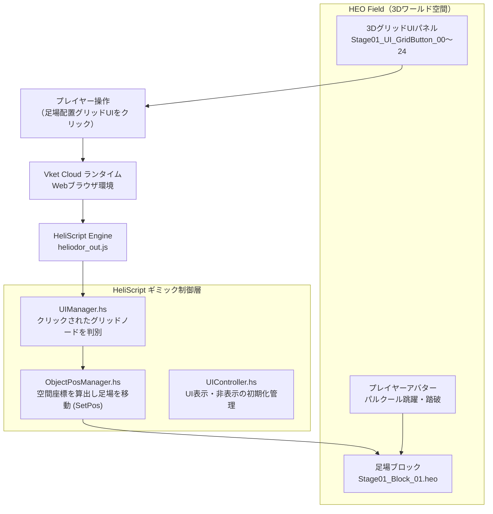

## 1. 企画・開発背景
企業と学校が連携する**産学提携プロジェクト**において、VR/メタバースプラットフォーム「Vket Cloud」向けに制作した**3Dパルクール・メタバースワールド**です。

本作『Builkour（ビルクール）』最大の特徴は、**「プレイヤー自身が足場を作って跳び移り、空中ルートを開拓できる」という創造的パルクール体験**です。
単にあらかじめ用意されたアスレチックを進むのではなく、ワールド内に設置された操作盤（5×5のグリッドインターフェース）を通じて、空間上に足場ブロックを自在に出現・再配置させ、自分だけの攻略ルートを組み立てて高層ビルの頂上やゴールを目指します。

プロジェクトにおいて私は**ワールド全体の企画立案**および**足場生成ギミックのスクリプト実装**を担当しました。3Dモデルやテクスチャなどの素材制作は一部チームメンバーに依頼・分担し、ディレクションとプログラミングの橋渡し役を担いました。

Vket Cloudの開発では、一般的なC#やJavaScriptではなく、プラットフォーム独自の組み込みスクリプト言語 **「HeliScript」** を使用します。ネット上に技術的なTipsやコミュニティのQAがほとんど存在しない環境下で、**「公式ドキュメントや仕様書を丹念に読み解き、試行錯誤を通じて仕様を把握・実装する」**というエンジニアとしての自律的キャッチアップ能力を大きく向上させたプロジェクトです。

---

## 2. 技術選定とアーキテクチャ設計
Webブラウザ上で軽快に動作するメタバース体験と、リアルタイムな足場生成ギミックを両立するため、Vket Cloud SDKの標準規格に準拠した設計を行いました。

### 1. Vket Cloud SDK ＋ HeliScript によるWebメタバース開発
ブラウザからURLを開くだけで数万人が同時アクセス可能なWebベースのメタバース環境をターゲットとしました。Unity上でシーンレイアウトを行い、Vket Cloud SDKを用いて独自のHEO（Heliodor Encrypted Object）形式やアセットバンドルへビルド・出力するパイプラインを採用しました。

### 2. HeliScriptによるコンポーネント指向スクリプティング
Vket Cloud特有の言語である **HeliScript** は、UnityのC#コンポーネントに似た `component` 構造を持ちながらも、API体系やライフサイクル、メモリ空間の扱いが独自です。
- `hsItemGet("World")`: ワールド全体のHEO Fieldアイテムを取得
- `hsPlayerGet()`: 操作プレイヤーのインスタンス取得
- `OnClickNode(int NodeIndex)`: 3Dオブジェクト上の特定ノードがクリックされた際のコールバック検知
- `hsSystemOutput()`: コンソールデバッグログの出力

### 3. 動的足場生成とUI操作の疎結合管理
プレイヤーが自ら足場を組み立てるギミックを実現するため、UI入力とオブジェクト制御を明確に分離しました。
- **`UIManager`**: 25箇所のステージ内グリッドボタン（`Stage01_UI_GridButton_00` 〜 `24`）のノードインデックス取得とクリックイベントのルーティング
- **`ObjectPosManager`**: プレイヤーが選択したグリッド位置に基づき、足場ブロック（`targetObj`）の空間座標をリアルタイムに更新（`SetPos`）
- **`ClickChecker`**: インタラクティブノードのクリック検知とイベント発火検証
- **`UIController`**: ロード完了時（`OnLoaded`）のUIノード非表示制御（`HideNode`）

---

## 3. コア機能の実装詳細

### 3.1 システム構成図（動的足場生成アーキテクチャ）
プレイヤーがグリッドUIをクリックしてから、空間上に足場ブロックが出現・移動するまでの連携フローです。



---

### 3.2 5×5グリッド操作盤による足場配置インターフェース
プレイヤーが直感的に足場を配置できるよう、3D空間内に配置された5×5（計25個）のボタンノードを検知するUIシステムを構築しました。

```cpp
component UIManager
{
    Item    ex_Item;
    Player  ex_player;
    Vector3 Pos;

    // 5x5グリッドUIの各ボタングリッドノードのインデックス
    int device;
    int ex_ItemNodeIndex_00;
    int ex_ItemNodeIndex_01;
    // ...中略...
    int ex_ItemNodeIndex_24;

    public UIManager()
    {
        hsSystemOutput("UIManager Initialized.\n");
        ex_Item = hsItemGet("World");
        ex_player = hsPlayerGet();
        Pos = ex_player.GetPos();

        // 3Dオブジェクト内のノード名を指定してインデックスを一括キャッシュ
        device = ex_Item.GetNodeIndexByName("Stage01_Device_2");
        ex_ItemNodeIndex_00 = ex_Item.GetNodeIndexByName("Stage01_UI_GridButton_00");
        ex_ItemNodeIndex_01 = ex_Item.GetNodeIndexByName("Stage01_UI_GridButton_01");
        // ...中略...
        ex_ItemNodeIndex_24 = ex_Item.GetNodeIndexByName("Stage01_UI_GridButton_24");
    }

    // プレイヤーが操作盤上のノードをクリックした際のイベントハンドラ
    public void OnClickNode(int NodeIndex)
    {
        if (NodeIndex == ex_ItemNodeIndex_00) {
            hsSystemOutput("GridButton 00 Clicked: 足場を対応座標へ配置\n");
            // 選択されたグリッド番号に対応する空中座標へ足場ブロックを再配置
        }
    }
}
```

---

### 3.3 リアルタイム足場座標マネージャー（`ObjectPosManager`）
プレイヤーが選択したルートに応じて、空中に足場ブロック（`targetObj`）を即座にワープ・再配置し、踏破可能な足場を動的に形成します。

```cpp
component ObjectPosManager
{
    public Item targetObj;   // 動的に移動させる足場ブロック
    public Vector3 warpPoint; // 配置先となる空間座標

    public void OnClickNode(int NodeIndex)
    {
        // NULLチェックを行い、足場オブジェクトを指定の空中座標へ移動
        if (targetObj != NULL)
        {
            targetObj.SetPos(warpPoint);
            hsSystemOutput("足場が新たな空間座標へ再配置されました。\n");
        }
    }
}
```

これにより、**「足場を置いて、跳び移り、次の足場をまた自分で作って先へ進む」**という、パズルとアクションが融合した独自のゲームサイクルを実現しました。

---

## 4. 開発トラブルと解決プロセス

### 課題1: 参考資料が極めて乏しい独自言語（HeliScript）でのギミック実現
- **発生した問題・背景**:
  「プレイヤー自身が足場を作る」というギミックを実装したくても、HeliScriptはVket Cloud独自のスクリプト言語であり、インターネット上の技術ブログやStack Overflow等に解決策がほとんど存在しませんでした。
- **解決アプローチ**:
  **公式マニュアル・SDK付属のサンプルコード・ヘッダー定義**を徹底的に読み込み、ノードの検索・イベント取得・座標更新関数の仕様を一から体系化。小さな検証用コンポーネント（`ClickChecker` 等）を作成してブラウザ上のコンソールログ（`hsSystemOutput`）で挙動を1つずつ実証しながら、確実に足場の動的配置ロジックを完成させました。

---

### 課題2: チームメンバーとの素材制作の分担と連携
- **発生した問題**:
  短期間の制作スケジュールの中で、企画設計や足場生成ロジックの実装と並行して、高層ビル群の3DモデルやUIテクスチャを1人で全て制作するのは工数的に不可能でした。
- **解決アプローチ**:
  自身は企画設計と足場生成ギミックの実装に集中し、一部の3Dモデルやテクスチャの制作をチームメンバーに依頼。Vket Cloud SDKが要求するノード命名規則（`Stage01_UI_GridButton_XX` 等）やテクスチャフォーマット（ASTC/ETC2等）の要件を事前に明確に定義して共有し、組み込み時の手戻りを最小限に抑えました。

---

### 課題3: 3Dオブジェクト内のノード参照外れによるギミック不発
- **発生した問題**:
  足場モデルや操作盤モデルの差し替え・リネームが行われた際、`GetNodeIndexByName` が `-1` を返し、クリックしても足場が生成・移動しない問題が発生しました。
- **解決アプローチ**:
  初期化時に各ノードインデックスの取得成否をコンソールに出力するバリデーションを導入。万が一ノード名に不整合があった場合でも、ビルド後のブラウザ開発者ツールから即座にどのノードが参照外れを起こしているか特定できるデバッグ体制を整えました。

---

## 5. 産学提携プロジェクトを通じて得られた知見

企業連携という実践的な開発を通じて、一般的な個人制作とは異なる3つの大きな力を培いました。

| 領域 | 培われた実践能力 |
| :--- | :--- |
| **企画・ゲームデザイン力** | 「足場を自ら作って跳ぶ」という独創的なコアメカニクスを考案し、3D空間の遊びとして落とし込む力 |
| **公式仕様の読解力** | ネットの二次情報に頼らず、一次情報（公式ドキュメント・SDKヘッダー）から仕様を正確に掴み取る力 |
| **ディレクション力** | 自身の企画意図を伝え、要件に合わせた素材制作をメンバーに依頼・統合する協調体制 |

---

## 6. 学びと今後の展望
- **学び**:
  本プロジェクトを通じて、最も汎用的に役立つスキルである**「未知のフレームワークや言語に直面した際の一次ドキュメント読解力」**が飛躍的に向上しました。また、「足場を自ら作る」という企画アイデアを、SDKの制約の中で技術的に成立させた経験は、技術とゲームデザインの両輪を回す大きな自信となりました。
- **今後の展望**:
  HeliScriptによるマルチプレイヤー間の足場同期（他プレイヤーが作った足場を共有して渡る協力プレイ）や、WebRTCを活用したボイスチャット・アバターアクションとの連動など、よりインタラクティブなメタバース体験の拡張に挑戦したいと考えています。

---

## 7. プロジェクト概要

| 項目 | 内容 |
| :--- | :--- |
| **プロジェクト形態** | 産学提携プロジェクト（企業連携） |
| **ゲームコンセプト** | 自分で足場を作って空中ルートを開拓する3Dパルクール |
| **プラットフォーム** | Vket Cloud（Webブラウザ実行） |
| **担当領域** | ワールド企画、動的足場生成ギミック実装、素材制作ディレクション |
| **使用ツール・言語** | Unity、Vket Cloud SDK、HeliScript |
