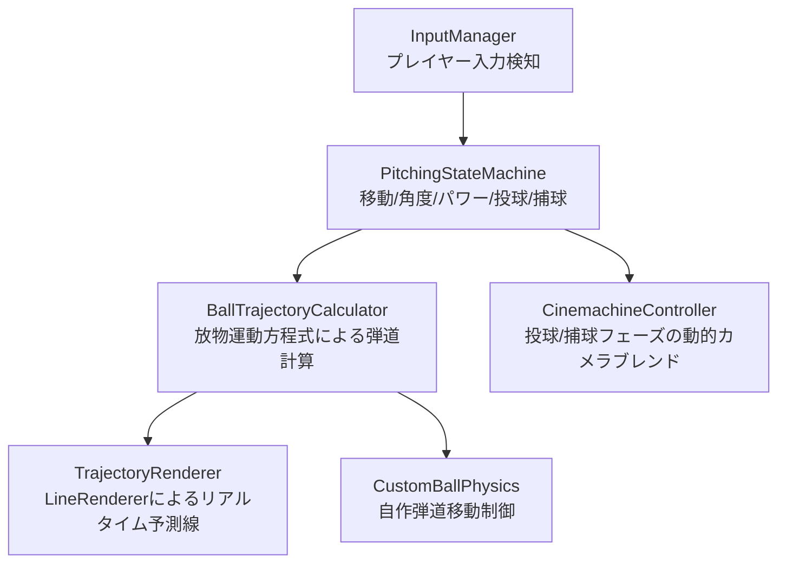

## 1. 企画・開発背景
「野球のキャッチボールにおける、狙った胸元へ正確にボールを投げる爽快感と、飛来するボールをタイミングよくグラブに収める緊張感」を、Webブラウザ上で直感的に楽しめる3Dアクションゲームとして企画しました。

ゲームは**「位置取り → 角度調整 → 投球強さ決定 → 投球 → 相手からの返球を捕球」**という一連のキャッチボールサイクルで進行します。プレイヤーが直感的にボールの軌道をイメージできるよう、リアルタイムな放物線予測と動的なカメラワークの融合に重点を置いて開発しました。

---

## 2. 技術選定とアーキテクチャ
物理演算ゲームではUnity標準の `Rigidbody` を使用するのが一般的ですが、本作品では**「Rigidbodyに依存しない独自の弾道計算システム」**をゼロから設計・実装しました。

### なぜ自作物理演算を採用したか？
1. **予測線と実軌道の100%完全一致**:
   Unityの物理シミュレーションはステップごとの数値積分で行われるため、描画する予測線と実際のボール軌道に微細なズレが生じやすい課題があります。古典力学の放物運動方程式を直接解くことで、予測線と飛翔軌道が完全に一致する決定論的な制御を実現しました。
2. **WebGL環境でのパフォーマンスと安定性**:
   ブラウザ実行環境（WebGL）において物理エンジンのオーバヘッドを削減し、低スペック端末でも安定して60fpsで動作する軽量な設計を目指しました。

---

## 3. コア機能の実装詳細

### 3.1 システム構成図（アーキテクチャ）
投球フェーズの状態管理と、弾道計算モジュール、描画・カメラ演出の責務を明確に分離した設計としています。



### 3.2 自作弾道計算とリアルタイム予測線
重力加速度 $g$、初速度 $\vec{v_0}$、初期位置 $\vec{p_0}$ に対し、時刻 $t$ におけるボール座標 $\vec{p}(t)$ は以下の等加速度運動方程式で表されます。

$$
\vec{p}(t) = \vec{p_0} + \vec{v_0} t + \frac{1}{2} \vec{g} t^2
$$

この閉形式（Closed-form expression）を用いて、投球前のリアルタイム予測線描画と投球後のボール座標更新を同一ロジックで制御しています。

```csharp
using UnityEngine;

/// <summary>
/// Rigidbodyを用いず、数式ベースで弾道を計算・制御するクラス
/// </summary>
public class BallTrajectoryCalculator : MonoBehaviour
{
    [SerializeField] private LineRenderer lineRenderer;
    [SerializeField] private int trajectoryPointCount = 30;
    [SerializeField] private float timeStep = 0.05f;
    private readonly Vector3 gravity = new Vector3(0, -9.81f, 0);

    /// <summary>
    /// 時刻 t における空間座標を算出
    /// </summary>
    public Vector3 CalculatePosition(Vector3 startPos, Vector3 initialVelocity, float time)
    {
        return startPos + initialVelocity * time + 0.5f * gravity * (time * time);
    }

    /// <summary>
    /// 投球前の放物線予測を描画
    /// </summary>
    public void DrawTrajectory(Vector3 startPos, Vector3 initialVelocity)
    {
        lineRenderer.positionCount = trajectoryPointCount;
        for (int i = 0; i < trajectoryPointCount; i++)
        {
            float t = i * timeStep;
            Vector3 point = CalculatePosition(startPos, initialVelocity, t);
            lineRenderer.SetPosition(i, point);
        }
    }
}
```

---

## 4. 開発トラブルと解決プロセス

### 課題1: フレームレート変動による着弾点のズレ
- **発生した問題**:
  初期実装では、毎フレーム `currentVelocity += gravity * Time.deltaTime`、`position += currentVelocity * Time.deltaTime` というオイラー法でボールを前進させていました。しかし、WebGL環境での負荷変動によりフレームレートが落ちた際、積分誤差が蓄積し、**「投球前に表示していた予測線の位置と実際の着弾点がズレる」**という致命的な不具合が発生しました。
- **原因分析**:
  デルタタイムの微小なバラつきによる数値積分の打ち切り誤差が原因でした。
- **解決アプローチ**:
  積分による逐次加算を廃止し、投球開始からの経過時間（`elapsedTime`）を計測して、方程式 $\vec{p}(t)$ に直接代入する絶対時刻参照方式に変更しました。

```csharp
// 【改善後】経過時間の累積のみを行い、常に閉じた方程式から直接座標を計算
void UpdateBallFlight()
{
    elapsedTime += Time.deltaTime;
    // 毎フレームの速度加算ではなく、初期条件と経過時間から一意に座標を決定
    transform.position = trajectoryCalculator.CalculatePosition(launchPosition, launchVelocity, elapsedTime);
}
```
- **効果**:
  フレームレートが30fpsに低下しても、予測線とボールの通過座標が1ミリの狂いもなく完全一致するようになり、プレイヤーの狙い通りの投球感を担保できました。

---

### 課題2: 捕球フェーズ移行時の視点追従とボール見失い
- **発生した問題**:
  投球終了後、相手からの返球を受ける「捕球フェーズ」へ移行する際、カメラが急旋回して飛来してくるボールを見失い、理不尽にボールを落としてしまう問題が発生しました。
- **解決アプローチ**:
  Cinemachineの `State-Driven Camera` を導入し、投球フェーズ（後方追尾）から捕球フェーズ（正面構え）への遷移に0.6秒のスムーズブレンドを設定。さらにボールが頂点高度に達した瞬間から捕球者視点へ先行してカメラを向ける予測ブレンドロジックを実装しました。

---

## 5. AI協調開発と役割分担
本プロジェクトでは、開発速度の最大化とコア設計への集中を目的に、AIツール（Antigravity / MCP）を組み込んだワークフローを採用しました。

| 開発フェーズ | AI（Antigravity / MCP等）の担当領域 | 自身（エンジニア）の担当・判断領域 |
| :--- | :--- | :--- |
| **技術リサーチ** | 放物運動の運動方程式の公式導出、LineRendererの頂点更新API仕様の調査 | ゲームとして気持ちの良い重力倍率・初速係数のチューニング |
| **実装・コード生成** | キーボード入力検知（WASD/スペース）の雛形作成、Cinemachineの初期設定スクリプト | 数値積分誤差を防ぐ閉形式アルゴリズムの設計、ステートマシン構造の決定 |
| **不具合修正** | エラーログの一次解析、タイポやnull参照の検知 | フレームレート低下時に予測線がズレる根本原因の特定と方程式ベースへの根本的リファクタリング |

AIにボイラープレートコードやAPI調査を任せることで、**「ゲームの手触り」「数式設計」「アーキテクチャの妥当性」**といった本質的なゲームプログラミング領域に全リソースを集中させることができました。

---

## 6. 学びと今後の展望
- **学び**:
  物理エンジンを安易に使うのではなく、「自らの手で数式をプログラミングする」ことで、決定論的な挙動制御や予測線との完全一致など、エンジン任せでは得られない高い制御性と最適化が得られることを実感しました。
- **今後の展望**:
  現在は無風状態の真空弾道モデルとなっているため、今後は空気抵抗係数（ドラッグ）やマグヌス効果（回転による揚力・変化球）を取り入れた、より高度な球道シミュレータの実装に挑戦したいと考えています。

---

## 7. 操作方法
相手のグローブを狙って軌道を調整し、テンポよくキャッチボールを続けます。

| 操作キー | 操作内容 |
| :--- | :--- |
| **W / A / S / D** | キャラクターの移動、および投球軌道（上下左右角度）の微調整 |
| **スペースキー** | フェーズ進行（位置決め完了 → 軌道決定 → パワー決定 → 投球） |
| **マウス移動** | 捕球フェーズでのグラブ位置操作（飛来するボールに重ねて自動キャッチ） |
