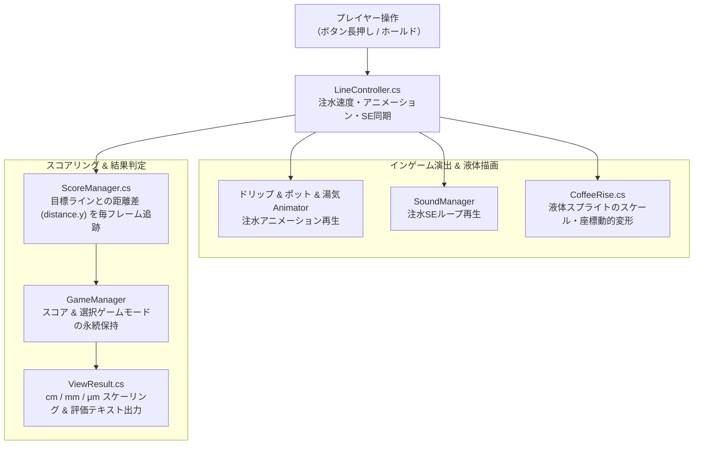

## 1. 企画・開発背景
株式会社FlyPenguinが提供するミニゲーム投稿プラットフォーム**「Minute Games」のβ版**に参加して制作した、**産学提携プロジェクトによる2Dカジュアルゲーム**です。
作品のトレイラー動画を [YouTube Shorts（トレイラー動画）](https://youtube.com/shorts/sb1fTAfvlss?feature=share) にて公開しています。

本作『Just Coffee』は、**「指定された目標ライン（ゴールライン）ぴったりにコーヒーを注ぐ」**という極めてシンプルながら奥深いワンアクションゲームです。
画面上の注ぎボタンを長押ししている間だけポットからお湯が注がれ、カップ内のコーヒーの水位が上昇します。プレイヤーは目測でタイミングを測り、「ここだ！」という瞬間でボタンを離します。

最大の面白さは、選んだコーヒー豆（難易度モード）によって、**誤差の判定単位が「cm」から「mm」、さらには極小の「μm（マイクロメートル）」までシビアになる点**です。
短時間でルールを直感的に理解でき、1プレイ数十秒の中で「あと少しだった！」「ぴったり注げた！」という強いアハ体験とリプレイ性を生み出すゲームデザインを目指しました。

---

## 2. 技術選定とアーキテクチャ設計
プラットフォームである「Minute Games」の特性（Web上で即座に起動し、小気味よく動作する）に合わせ、軽量かつ堅牢なアーキテクチャを構築しました。

### 1. Unity 2D ＋ URP による温かみのあるドット絵表現
レトロで親しみやすいカフェの雰囲気を演出するため、ピクセルアート（ドット絵）によるUI・スプライトを採用。コーヒーポットの傾き、フィルターからのドリップ、立ち上る湯気アニメーションをUnityのアニメーターで緻密に制御しました。

### 2. Singleton パターンによる大域状態管理
- **`GameManager`**: 難易度モード（`c_m`, `m_m`, `micro_m`）の保持と、目標ラインとの絶対誤差スコアのシーン間引き継ぎ
- **`SoundManager`**: ボタン長押しと完全に同期した注水SE（`se_oyu_sosogu`）のループ再生・停止制御
- **`SceneController`**: タイトル → 豆選択 → メイン（注水） → リザルトのステート管理とシームレスな画面遷移

### 3. イベント駆動によるボタンホールド制御
一般的な「クリック（Tap）」ではなく、「押している間注ぎ続ける（Hold）」操作を実現するため、Unity UIのイベントトリガー（Down, Up, Exit）を活用した堅牢な入力パイプラインを設計しました。

---

## 3. コア機能の実装詳細

### 3.1 システム構成図（アーキテクチャ）
プレイヤーの入力から注水演出、リアルタイム水位更新、および精密結果判定までのデータフローです。



---

### 3.2 加速度を伴う注水制御（`LineController.cs`）
ボタンを押している間、単調な等速直線運動ではなく微小な加速度（`_lineSpeed += 0.01f * Time.deltaTime`）を加えることで、「注ぎ始めは慎重に、徐々に勢いが増す」というリアルな注水感覚とプレイヤーへの心地よい緊張感を演出しました。

```csharp
namespace Main
{
    public class LineController : MonoBehaviour
    {
        private float _lineSpeed;
        private bool _isHoldButton = false;

        [SerializeField] private GameObject _coffeeDripFront;
        [SerializeField] private GameObject _coffeePod;
        [SerializeField] private GameObject _yuge;

        void Update()
        {
            if (_isHoldButton)
            {
                // 水位ラインを上昇させ、徐々に注水速度を加速
                this.transform.position += new Vector3(0, _lineSpeed * Time.deltaTime, 0);
                _lineSpeed += 0.01f * Time.deltaTime;

                // ポットの傾き・ドリップ・湯気アニメーションを有効化
                _coffeeDripFrontAnimator?.SetBool("is_Making", true);
                _coffeePodAnimator?.SetBool("is_Making", true);
                _yugeAnimator?.SetBool("is_Making", true);

                // 注水SEのループ再生
                SoundManager.Instance.PlaySe(SoundManager.SeRequestIndex.se_oyu_sosogu);
            }
            else
            {
                // ボタンを離した瞬間に速度リセット・演出停止
                _lineSpeed = 0.0f;
                _coffeeDripFrontAnimator?.SetBool("is_Making", false);
                _coffeePodAnimator?.SetBool("is_Making", false);
                _yugeAnimator?.SetBool("is_Making", false);
                SoundManager.Instance.StopSe();
            }
        }

        public void OnButtonDown() => _isHoldButton = true;
        public void OnButtonUp() => _isHoldButton = false;
        public void OnButtonExit() => _isHoldButton = false; // ボタン外へ指が外れた時のフェイルセーフ
    }
}
```

---

### 3.3 液体の動的スケーリング（`CoffeeRise.cs`）
上昇する水位ライン（`coffeeLine`）の位置に合わせて、カップ底面のデフォルト位置（`COFFEE_DEFALT_POSITION`）を基準に液体スプライトの高さ（`localScale.y`）と中心座標をリアルタイムに計算し、液体がカップを満たしていく様子を美しく描画しました。

```csharp
private void CoffeeRises()
{
    // 底面と水位ラインの距離差分からスプライトのScaleを算出
    Vector3 distance = Functions.PositionDifference(COFFEE_DEFALT_POSITION, coffeeLine.transform.position);
    distance.x = COFFEE_DEFALT_SCALE.x;
    distance.z = COFFEE_DEFALT_SCALE.z;
    transform.localScale = distance;

    // スプライトの中心位置を「底面 + 距離の半分」に補正
    transform.position = COFFEE_DEFALT_POSITION + distance / 2;
}
```

---

### 3.4 μm（マイクロメートル）級の極小誤差スコアリング（`ViewResult.cs`）
選択した難易度モードに応じて、目標ラインと停止位置の距離差を適切な有効桁数で丸め、単位（cm / mm / μm）を付与して結果を出力します。

```csharp
private void ScoreNormalize()
{
    // モードに応じた丸め処理とスケーリング
    if (GameManager.Instance.gameMode is GameManager.GameModeState.c_m)
    {
        GameManager.Instance.score = (float)Math.Round(GameManager.Instance.score, 2);
        GameManager.Instance.score *= 10; // cm換算
    }
    else if (GameManager.Instance.gameMode is GameManager.GameModeState.m_m)
    {
        GameManager.Instance.score = (float)Math.Round(GameManager.Instance.score, 5);
        GameManager.Instance.score *= 10000; // mm換算
    }
    else if (GameManager.Instance.gameMode is GameManager.GameModeState.micro_m)
    {
        GameManager.Instance.score = (float)Math.Round(GameManager.Instance.score, 8);
        GameManager.Instance.score *= 10000000; // μm換算
    }
}

private void ComentTextChange()
{
    _comentText.text = "頑張ろう...";
    if (GameManager.Instance.score >= 5 || GameManager.Instance.score <= -5) return;
    
    _comentText.text = "惜しい！";
    if (GameManager.Instance.score >= 0.04f || GameManager.Instance.score <= -0.04f) return;
    
    _comentText.text = "ぴったり！！";
}
```

---

## 4. 開発トラブルと解決プロセス

### 課題1: ボタンホールド操作における指の画面外スワイプ時の解除漏れ
- **発生した問題・背景**:
  スマホやタッチパッド操作において、ボタンを押したまま指がボタン領域の外へスライドした際、`OnPointerUp`（ButtonUp）が拾われず、指を離しているのにお湯が注ぎ続けられてしまう問題が発生しました。
- **解決アプローチ**:
  Unityの `EventTrigger` を使用し、`PointerUp` に加えて **`PointerExit`（領域離脱）** にもイベントリスナー（`OnButtonExit`）を登録。領域外へ指が外れた瞬間に確実に注水を停止するフェイルセーフを組み込み、誤作動を完全に防止しました。

---

### 課題2: 極小スケール（μm単位）計算時の浮動小数点誤差
- **発生した問題**:
  Unity内部の `float` 型座標演算において、マイクロメートル（$10^{-6}\text{m}$）レベルの極小差分を計算する際、浮動小数点の丸め誤差（`0.000000199999...` のような微小ゴミ）が発生し、リザルト画面の数値表示が汚くなってしまう課題がありました。
- **解決アプローチ**:
  結果表示前の正規化処理（`ScoreNormalize`）において、C#の `Math.Round(score, 8)` を適用して表示有効桁数を厳密にクリッピングした上で、整数倍スケールに引き上げるロジックを設計。綺麗な数値表示と高精度の判定を両立させました。

---

## 5. 産学提携プロジェクトを通じて得られた知見

株式会社FlyPenguinの「Minute Games」β版という、実際の企業プラットフォームへの参加を通じて以下の知見を得ました。

| 開発領域 | 得られた知見・実践力 |
| :--- | :--- |
| **ハイパーカジュアルの設計思想** | 説明不要で0.5秒で理解できるシンプルなルールと、直感的な触り心地（ジュース性）の徹底 |
| **プラットフォーム適応力** | Minute Gamesの規定仕様（画面サイズ、WebGLテンプレート、ロード速度制約）に最適化する実装力 |
| **演出と手応えの連動** | アニメーション（湯気・ドリップ）とサウンドが「押している感覚」を強め、シンプルな操作を楽しい体験に昇華させる力 |

---

## 6. 学びと今後の展望
- **学び**:
  ルールが極限まで削ぎ落とされたミニゲームだからこそ、加速度のカーブやアニメーションの遅延、効果音の鳴り始めといった「1フレームの手触り」が面白さに直結することを深く学びました。
- **今後の展望**:
  コーヒーの種類（豆）ごとの粘度変化（注ぎ速度の変動）や、プレイヤーごとのデイリーランキング、オンライン対戦機能（同時に注ぎ合って誤差を競う）など、より競技性を高めた拡張を構想しています。

---

## 7. ゲーム概要と操作方法

| 項目 | 内容 |
| :--- | :--- |
| **プロジェクト形態** | 産学提携プロジェクト（株式会社FlyPenguin「Minute Games」β版） |
| **ジャンル** | 2Dタイミング・カジュアルアクション |
| **トレイラー動画** | [YouTube Shorts（トレイラー動画）](https://youtube.com/shorts/sb1fTAfvlss?feature=share) |
| **操作方法** | **注水ボタン長押し**: お湯を注ぐ（水位上昇）<br/>**ボタンを離す**: 注水を止める（目標ラインとの誤差で採点） |
| **難易度モード** | **エスプレッソ**: cm級判定（初心者向け）<br/>**カフェラテ**: mm級判定（中級者向け）<br/>**ストレート**: μm級判定（超上級者向け） |
