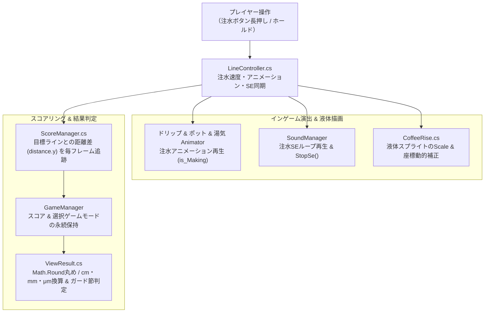
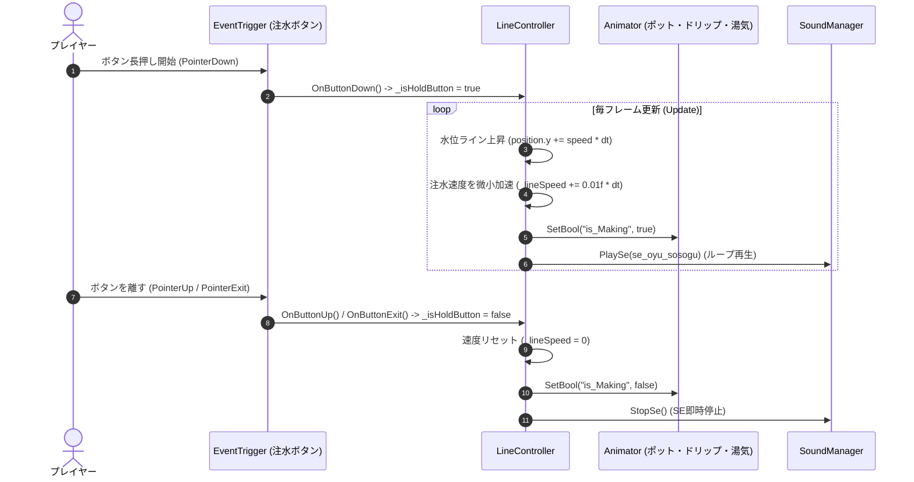
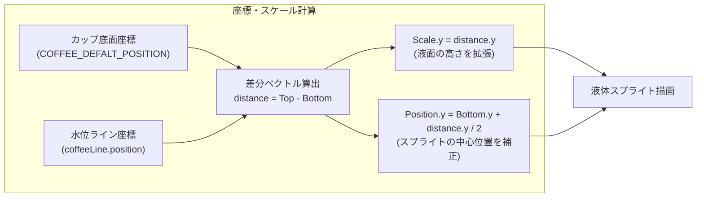
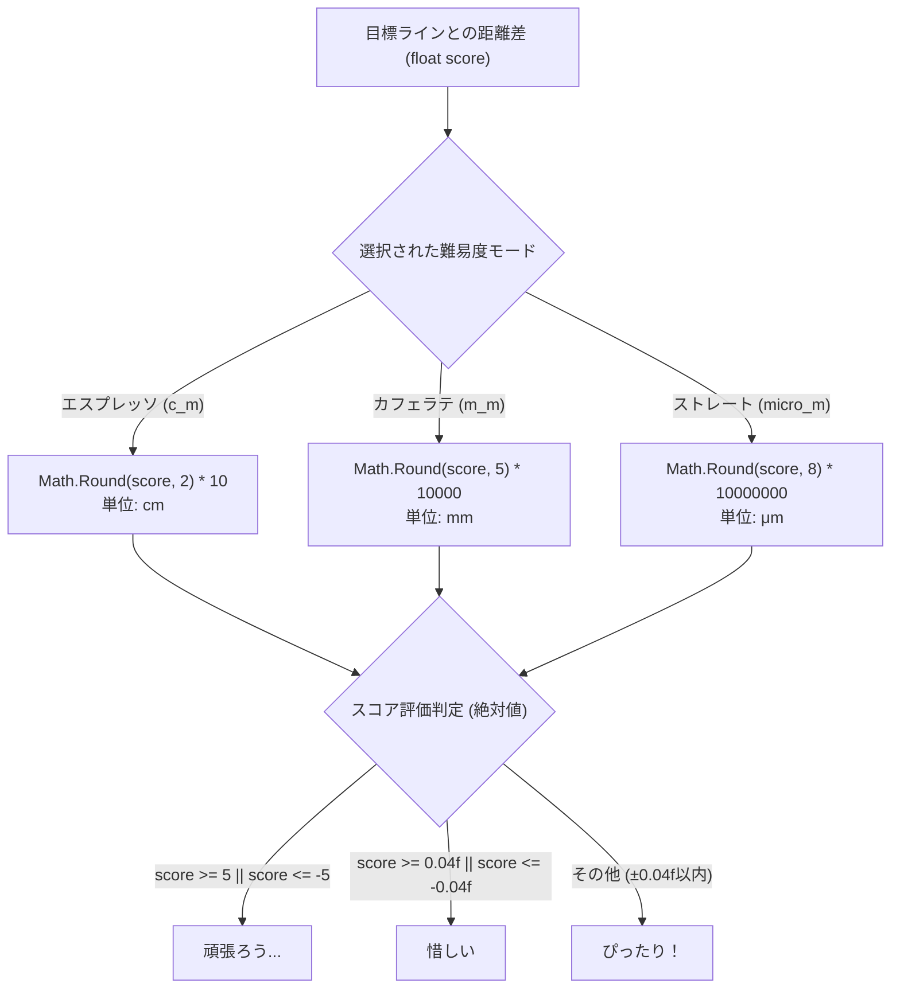
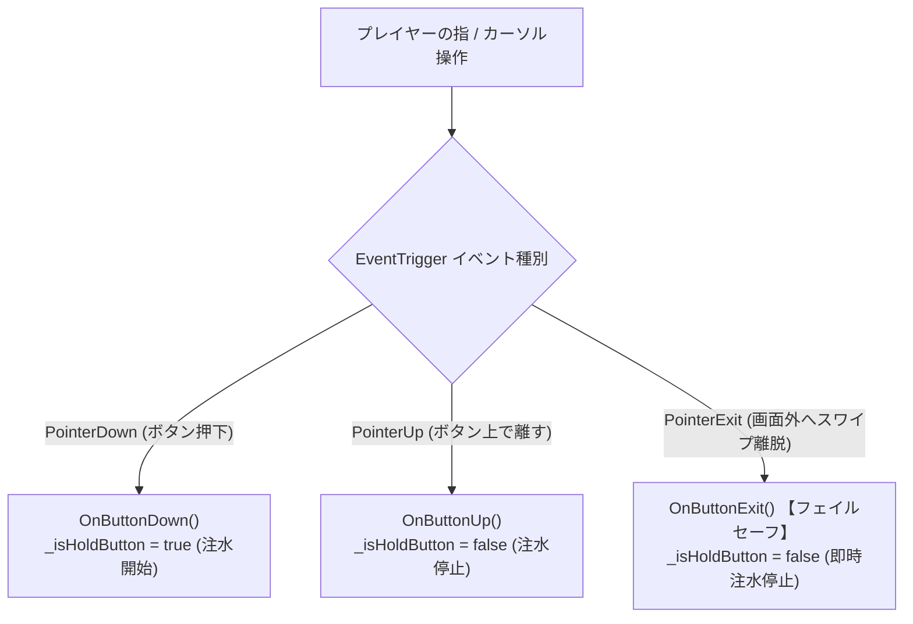
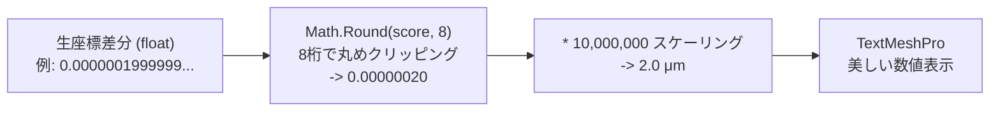

## 1. 作品の概要

### どのような作品か
「指定された目標ライン（ゴールライン）ぴったりにコーヒーを注ぐ」という、 **極めてシンプルながら奥深いワンアクション・カジュアルゲーム** です。

画面上の注水ボタンを長押ししている間だけポットからお湯が注がれ、カップ内のコーヒーの水位が上昇します。プレイヤーは目測でタイミングを測り、「ここだ！」という瞬間でボタンを離します。

最大の面白さは、選んだコーヒー豆（難易度モード）によって、 **誤差の判定単位が「cm」から「mm」、さらには極小の「μm（マイクロメートル）」までシビアになる点** です。1プレイ数十秒の中で「あと少しだった！」「ぴったり注げた！」という強いアハ体験とリプレイ性を生み出すゲームデザインを実現しました。

### 操作方法
PCブラウザ（マウス）およびスマートフォン（タッチ）の両方で直感的に遊べるワンアクション操作を採用しています。

| 操作項目 | 操作方法（マウス / タッチ） |
| :--- | :--- |
| **お湯を注ぐ（水位上昇）** | **画面中央の注水ボタンを長押し（ホールド）** |
| **注水を止める（判定）** | **ボタンから指 / カーソルを離す** |
| **豆の選択（難易度切替）** | **左右の矢印ボタンをクリック / タップ** |
| **決定 / シーン遷移** | **各画面のボタンをクリック / タップ** |

### 開発背景
株式会社FlyPenguinが提供するミニゲーム投稿プラットフォーム **「Minute Games」のβ版** に参加して制作した、 **産学提携プロジェクトによる2Dカジュアルゲーム** です。

作品のトレイラー動画を [YouTube Shorts（トレイラー動画）](https://youtube.com/shorts/sb1fTAfvlss?feature=share) にて公開しています。

「Web上で即座に起動し、説明不要で0.5秒で理解できるカジュアルさ」と、「プレイヤーが何度も挑戦したくなる心地よい緊張感・手触り」の両立を目指して開発を行いました。

### チーム体制と自分の役割
- **チーム構成** ：プランナー、デザイナー、プログラマー（自身）
- **コミット実績** ：リポジトリ全11コミット中、 **10コミット（90%以上）** を担当
- **自分の役割（メインプログラマー）** ：
  - 注水制御（ボタンホールド検知・微小加速度制御）の実装
  - ポットの傾き・ドリップ・湯気アニメーションおよび注水SEのリアルタイム完全同期
  - 底面基準による液体スプライトの動的スケーリング・位置補正ロジックの実装
  - 難易度に応じた浮動小数点丸めとμm級スコアリング・リザルト判定の実装
  - リリース直前のバグ修正（正負誤差判定のリファクタリング、SE停止制御、フェイルセーフ設計）
  - ※デザイナーが制作したドット絵素材とアニメーションを受け取り、Unity 2D上で組み込み・演出調整を完遂しました。

---

## 2. 選定技術と全体のアーキテクチャ設計

### どの技術を使用したか
Webブラウザ上で高速に起動し、低負荷かつ心地よい操作感を実現するため、以下の技術スタックを選定しました。

- **ゲームエンジン** ：Unity 2022.3.20f1 (LTS)
- **言語** ：C#
- **レンダリング** ：Universal Render Pipeline (URP) 2D
- **入力管理** ：Unity UI EventTrigger（PointerDown, PointerUp, PointerExit）
- **状態管理** ：Singleton パターン（ `GameManager` , `SoundManager` ）
- **テキスト描画** ：TextMeshPro

### どの設計を採用したか

#### 1. Unity 2D ＋ URP による温かみのあるドット絵表現
レトロで親しみやすいカフェの雰囲気を演出するため、ピクセルアート（ドット絵）によるUI・スプライトを採用。コーヒーポットの傾き、フィルターからのドリップ、立ち上る湯気アニメーションをUnityのアニメーターで緻密に連動させました。

#### 2. Singleton パターンによる大域状態管理
- `GameManager` ：選択された難易度モード（ `c_m` , `m_m` , `micro_m` ）の保持と、目標ラインとの絶対誤差スコアのシーン間引き継ぎ
- `SoundManager` ：ボタン長押しと完全に同期した注水SE（ `se_oyu_sosogu` ）のループ再生および一括停止制御（ `StopSe` ）
- `SceneController` ：タイトル → 豆選択 → メイン（注水） → リザルトのステート管理とシームレスな画面遷移

#### 3. イベント駆動によるボタンホールド制御
一般的なクリック（Tap）ではなく、「押している間注ぎ続ける（Hold）」操作を実現するため、Unity UIの `EventTrigger` （Down, Up, Exit）を活用した堅牢な入力パイプラインを設計しました。



---

## 3. 実装した機能の詳細

### 3.1 加速度を伴う注水制御＆アニメーション・SE同期（LineController.cs）

ボタンを押している間、単調な等速直線運動ではなく微小な加速度（ `_lineSpeed += 0.01f * Time.deltaTime` ）を加えることで、「注ぎ始めは慎重に、徐々に勢いが増す」というリアルな注水感覚とプレイヤーへの心地よい緊張感を演出しました。

同時に、注水フラグ（ `_isHoldButton` ）に合わせてポットの傾き、ドリップ、湯気アニメーション、および注水SEをフレーム単位で完全同期させています。



#### 主要コード抜粋（LineController.cs）

```csharp
// 【LineController.cs より抜粋】
// 微小加速度を伴う注水制御と演出アニメーション・SEの同期
namespace Main
{
    public class LineController : MonoBehaviour
    {
        private float _lineSpeed;
        private bool _isHoldButton = false;

        [SerializeField] private GameObject _coffeeDripFront;
        [SerializeField] private GameObject _coffeePod;
        [SerializeField] private GameObject _yuge;

        private Animator _coffeeDripFrontAnimator;
        private Animator _coffeePodAnimator;
        private Animator _yugeAnimator;

        private void Awake()
        {
            _coffeeDripFrontAnimator = _coffeeDripFront.GetComponent<Animator>();
            _coffeePodAnimator = _coffeePod.GetComponent<Animator>();
            _yugeAnimator = _yuge.GetComponent<Animator>();
        }

        void Update()
        {
            if (_isHoldButton)
            {
                // 水位ラインを上昇させ、微小な加速度を加算
                this.transform.position += new Vector3(0, _lineSpeed * Time.deltaTime, 0);
                _lineSpeed += 0.01f * Time.deltaTime;

                // ポットの傾き・ドリップ・湯気アニメーションを一括有効化
                _coffeeDripFrontAnimator?.SetBool("is_Making", true);
                _coffeePodAnimator?.SetBool("is_Making", true);
                _yugeAnimator?.SetBool("is_Making", true);

                // 注水SEをループ再生
                SoundManager.Instance.PlaySe(SoundManager.SeRequestIndex.se_oyu_sosogu);
            }
            else
            {
                // ボタン解除時に速度リセット・演出停止
                _lineSpeed = 0.0f;
                _coffeeDripFrontAnimator?.SetBool("is_Making", false);
                _coffeePodAnimator?.SetBool("is_Making", false);
                _yugeAnimator?.SetBool("is_Making", false);

                // SEを一括停止
                SoundManager.Instance.StopSe();
            }
        }

        public void OnButtonDown() => _isHoldButton = true;
        public void OnButtonUp() => _isHoldButton = false;
        public void OnButtonExit() => _isHoldButton = false; // 画面外離脱時のフェイルセーフ
    }
}
```

---

### 3.2 底面基準の液面動的スケーリング（CoffeeRise.cs）

上昇する水位ライン（ `coffeeLine` ）の位置に合わせて、カップ底面のデフォルト位置（ `COFFEE_DEFALT_POSITION` ）を基準に液体スプライトの高さ（ `localScale.y` ）と中心座標をリアルタイムに計算し、液体がカップを満たしていく様子を自然に描画しました。



#### 主要コード抜粋（CoffeeRise.cs）

```csharp
// 【CoffeeRise.cs より抜粋】
// 底面と水位ラインの距離差分からスプライトのScaleとPositionを補正
namespace MainScene
{
    public class CoffeeRise : MonoBehaviour
    {
        private Vector3 COFFEE_DEFALT_POSITION { get { return new Vector3(0, -3.9f, 0); } }
        private Vector3 COFFEE_DEFALT_SCALE { get { return new Vector3(6, 0, 1); } }
        public GameObject coffeeLine;

        void Update()
        {
            CoffeeRises();
        }

        private void CoffeeRises()
        {
            // 1. 底面と水位ラインの距離差分からScaleを算出
            Vector3 distance = Functions.PositionDifference(COFFEE_DEFALT_POSITION, coffeeLine.transform.position);
            distance.x = COFFEE_DEFALT_SCALE.x;
            distance.z = COFFEE_DEFALT_SCALE.z;
            transform.localScale = distance;

            // 2. スプライトの中心位置を「底面 + 距離の半分」に補正
            distance = Functions.PositionDifference(COFFEE_DEFALT_POSITION, coffeeLine.transform.position);
            transform.position = COFFEE_DEFALT_POSITION + distance / 2;
        }
    }
}
```

---

### 3.3 μm（マイクロメートル）級の極小誤差スコアリング＆評価判定（ViewResult.cs）

選択された難易度モード（エスプレッソ: cm、カフェラテ: mm、ストレート: μm）に応じて、目標ラインと停止位置の距離差を適切な有効桁数で丸め、単位を付与して結果を出力します。

評価テキスト判定（ `ComentTextChange` ）では、ガード節（早期リターン）を用いて絶対値（±5、±0.04f）による厳密な評価を行っています。



#### 主要コード抜粋（ViewResult.cs）

```csharp
// 【ViewResult.cs より抜粋】
// モードに応じた丸め処理・スケーリングと早期リターン評価
private void ScoreNormalize()
{
    if (GameManager.Instance.gameMode is GameManager.GameModeState.c_m)
    {
        GameManager.Instance.score = (float)Math.Round(GameManager.Instance.score, 2);
        GameManager.Instance.score *= 10;
    }
    else if (GameManager.Instance.gameMode is GameManager.GameModeState.m_m)
    {
        GameManager.Instance.score = (float)Math.Round(GameManager.Instance.score, 5);
        GameManager.Instance.score *= 10000;
    }
    else if (GameManager.Instance.gameMode is GameManager.GameModeState.micro_m)
    {
        GameManager.Instance.score = (float)Math.Round(GameManager.Instance.score, 8);
        GameManager.Instance.score *= 10000000;
    }
}

private void ComentTextChange()
{
    _comentText.text = "頑張ろう...";

    // 誤差が ±5 以上であれば終了
    if (GameManager.Instance.score >= 5) return;
    if (GameManager.Instance.score <= -5) return;
    _comentText.text = "惜しい";

    // 誤差が ±0.04f より大きければ終了
    if (GameManager.Instance.score >= 0.04f) return;
    if (GameManager.Instance.score <= -0.04f) return;

    // ±0.04f 以内の極小誤差で「ぴったり！」
    _comentText.text = "ぴったり！";
}
```

---

## 4. 解決した課題

### 課題1: ボタンホールド操作における画面外スワイプ時の解除漏れ防止（PointerExitフェイルセーフ）

#### 背景・課題
スマートフォンやトラックパッド、マウス環境において、プレイヤーが注水ボタンを押したまま指やカーソルをボタン領域の外へスライド（スワイプ）させた際、通常の `OnPointerUp` （ボタンを離すイベント）が検知されないという入力トラブルが発生しました。

これにより、プレイヤーが指を離しているにもかかわらずお湯が注ぎ続けられ、カップからコーヒーが溢れて強制的にゲームオーバーになってしまうという、ワンアクションゲームとして致命的な操作性の不具合が生じていました。

#### 技術的アプローチ
Unityの `EventTrigger` コンポーネントを活用し、通常の `PointerDown` （押下）と `PointerUp` （解除）に加え、 **PointerExit（カーソル・指の領域離脱）** にもイベントリスナー（ `OnButtonExit` ）を登録しました。

ボタンの矩形領域から指やポインターがわずかでも外れた瞬間に、即座に `_isHoldButton = false` を設定して注水速度をリセットし、アニメーションとSEを同期停止させるフェイルセーフを構築。あらゆるデバイスでの直感的なタッチ・ドラッグ操作において、意図しない注水継続を完全に防止しました。

#### 具体的なコードや設計



```csharp
// 【LineController.cs より抜粋】
// EventTriggerリスナーによるフェイルセーフ実装
public void OnButtonDown()
{
    _isHoldButton = true;
}

public void OnButtonUp()
{
    _isHoldButton = false;
}

// ボタンの外側に指が外れた瞬間に安全に注水を停止
public void OnButtonExit()
{
    _isHoldButton = false;
}
```

---

### 課題2: 極小スケール（μm単位）計算時の浮動小数点誤差と表示正規化

#### 背景・課題
本作の最難関モード「ストレート（マイクロメートル級）」では、目標ラインと水位ラインの停止座標差分を `10^-6 m` （マイクロメートル）単位まで厳密に測定します。

しかし、Unityの内部演算で使用される単精度浮動小数点（ `float` ）では、座標の引き算を繰り返す過程で微小な丸め誤差（イプシロン）が生じ、リザルト画面で「 `0.00000019999999μm` 」のような視認性の悪い数値が表示されてしまう課題が発生しました。

#### 技術的アプローチ
スコアの表示前処理（ `ScoreNormalize` ）において、C#の標準数学関数 `Math.Round` を採用。モードごとに必要な有効桁数（cm: 2桁、mm: 5桁、μm: 8桁）を明示的に指定して浮動小数点ノイズを厳密にクリッピングした上で、整数倍スケール（10倍、10,000倍、10,000,000倍）を乗算するアルゴリズムを設計しました。

これにより、マイクロメートル単位の極微小な差分演算を行いながらも、UI上には常に美しく整った数値を描画し、プレイヤーが自分の記録を明瞭に把握できる高精度な判定システムを成立させました。

#### 具体的なコードや設計



```csharp
// 【ViewResult.cs より抜粋】
// Math.Roundによる有効桁数クリッピングとスケーリング
private void ScoreNormalize()
{
    if (GameManager.Instance.gameMode is GameManager.GameModeState.c_m)
    {
        GameManager.Instance.score = (float)Math.Round(GameManager.Instance.score, 2);
        GameManager.Instance.score *= 10; // cm換算
    }
    else if (GameManager.Instance.gameMode is GameManager.GameModeState.m_m)
    {
        GameManager.Instance.score = (float)Math.Round(GameManager.Instance.score, 5);
        GameManager.Instance.score *= 10000; // mm換算
    }
    else if (GameManager.Instance.gameMode is GameManager.GameModeState.micro_m)
    {
        GameManager.Instance.score = (float)Math.Round(GameManager.Instance.score, 8);
        GameManager.Instance.score *= 10000000; // μm換算
    }
}
```

---

### 課題3: 正負の誤差判定リファクタリングとSE残留バグ修正

#### 背景・課題
初期実装では、結果判定処理（ `ComentTextChange` ）においてモード別の条件分岐が重複しており、さらに正の誤差（注ぎすぎ）と負の誤差（注ぎ足りない）に対する不等号の評価順が不完全であったため、注ぎ足りない場合に「惜しい」や「ぴったり！」が正しく判定されないバグが存在していました。

また、ボタンを素早く連打したりリトライを繰り返した際に、注水SE（ `se_oyu_sosogu` ）が停止されずにシーン遷移後も鳴り続けたり、複数の `AudioSource` で音が重複して音割れを起こす問題が発生していました。

#### 技術的アプローチ
1. **絶対値ガード節による判定リファクタリング** ：
   `ViewResult.cs` の評価処理において、モードごとの重複コードを全廃。スコアの絶対値（ `score >= 5 || score <= -5` 、 `score >= 0.04f || score <= -0.04f` ）を用いた早期リターン構造へとリファクタリングし、オーバー・アンダー双方の誤差に対して等しく正確なフィードバックを返せるように改修しました。
2. **SoundManagerへのSE一括停止制御の実装** ：
   `SoundManager.cs` に全 `AudioSource` を走査して停止する `StopSe()` メソッドを追加。さらに `PlaySe()` 内に `audioSource.isPlaying` による二重再生ガードを導入し、ボタン解除時や画面遷移ボタン押下時に明示的に呼び出すことで、SEの残留・重複バグを根本解決しました。

#### 具体的なコードや設計

```csharp
// 【ViewResult.cs より抜粋】
// 早期リターンによる正負誤差の正確な評価
private void ComentTextChange()
{
    _comentText.text = "頑張ろう...";

    // 正負どちらでも 5 以上離れていれば「頑張ろう...」
    if (GameManager.Instance.score >= 5) return;
    if (GameManager.Instance.score <= -5) return;
    _comentText.text = "惜しい";

    // 正負どちらでも 0.04f より大きければ「惜しい」
    if (GameManager.Instance.score >= 0.04f) return;
    if (GameManager.Instance.score <= -0.04f) return;

    // ±0.04f 以内であれば「ぴったり！」
    _comentText.text = "ぴったり！";
}
```

```csharp
// 【SoundManager.cs より抜粋】
// 二重再生防止ガードと全SE一括停止メソッド
public void PlaySe(SeRequestIndex index)
{
    var audioSource = GetAudioSource(_seAudioSources);
    if (audioSource == null) return;
    if (audioSource.isPlaying) return; // 二重再生防止ガード

    audioSource.clip = _seAudioClips[(int)index];
    audioSource.Play();
}

public void StopSe()
{
    // 全てのSE用AudioSourceを安全に一括停止
    for (int index = 0; index < _seAudioSources.Length; index++)
    {
        if (_seAudioSources[index].isPlaying) _seAudioSources[index].Stop();
    }
}
```

---

## 5. 学びと今後の展望

### 学び
- **小さなゲームに求められる堅牢な品質管理** ：
  浮動小数点演算における微細な丸め誤差（ `Math.Round` によるクリッピング）や、UI EventTriggerの `PointerExit` による画面外離脱フェイルセーフ、さらにはオーディオのライフサイクル制御（ `StopSe` ）など、極めてシンプルなワンアクションゲームだからこそ、細部の不具合が体験を損なわないための「厳密な品質管理」の重要性を深く学びました。
- **1フレームの手触りが生むジュース性（Juiciness）** ：
  加速度を加えた注水スピードカーブ、ポットの傾きや湯気のドリップアニメーション、そして注水音の完全同期など、視覚と聴覚のフィードバックが揃うことで、単なるボタン操作が「コーヒーを淹れる心地よさ」へと昇華することを実感しました。

### 今後の展望
- **より大規模な物理・タイミングゲームへの応用** ：
  本作で培ったミリ秒・極小単位の精密判定ロジックや入力フェイルセーフ設計を活かし、より複雑な物理シミュレーションを伴うタイミングアクションや、高度なリズムゲーム開発へと応用していきたいと考えています。
- **ゲーム性の拡張** ：
  コーヒー豆の種類に応じた注水速度・粘度のバリエーション化や、オンラインランキング、同時に注ぎ合ってミリ秒・μmの精度を競い合うリアルタイムオンライン対戦機能の実装に挑戦したいと考えています。
