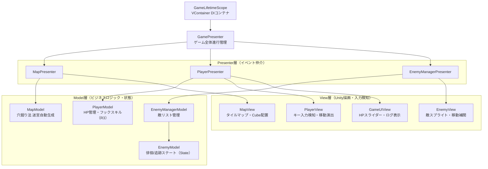

## 1. 企画・開発背景
学校の授業において**「1週間でゲームを完成させる」**という短期集中カリキュラムの中で制作した、**ターン制2Dローグライクゲーム**です。
ブラウザ上で手軽に遊べるWebGL版を [GitHub Pages（ゲームプレイページ）](https://junya005.github.io/games/LilyAndMysteryLabyrinth/index.html) にて公開しています。

プレイヤーは怪盗の少女「リリィ」を操作し、挑戦するたびに構造が変わる不思議な迷宮へ潜入。ダンジョン内に落ちている「脱出の鍵」を拾い、壁で塞がれた扉を開けて脱出を目指します。本作最大の特徴は、**「1歩進むごとにHPが1減少する」という徹底したリソース管理**です。最短ルートで鍵を探しに行くか、HPを消費してでも宝箱（回復アイテム等）を回収しに行くか、常に一手一手の選択を迫られます。

わずか1週間という極限のタイムリミットを克服するため、**AIエージェント（MCPサーバー・ペアプログラミング）をフル活用して定型実装を最大効率化**。短期間でありながら、本格的なアーキテクチャ（VContainer + MVP）と「穴掘り法」による迷宮自動生成を破綻なく実装しました。

さらに初期完成後の**2週間のブラッシュアップ期間**において、単色キューブだった空間に「古代レンガ調の壁・床テクスチャ」を貼り、怪盗らしさを演出する「ワイヤーフック移動スキル」、およびダンジョン内を徘徊・追跡する「エネミーAI」を追加実装しました（※なお、敵を無力化する対敵アイテムは期間内に実装が間に合わず、今後の課題として見送るスコープ判断を行いました）。

---

## 2. 技術選定とアーキテクチャ設計
短期開発と拡張性を両立させるため、Unityの現代的な設計パターンとリアクティブプログラミングを全面的に採用しました。

### 1. VContainer ＋ MVP（Model-View-Presenter）アーキテクチャ
DIコンテナとして **VContainer**（`GameLifetimeScope`）を導入し、ゲーム内の全コンポーネントを疎結合に管理。ロジック（Model）、描画・演出（View）、イベント仲介（Presenter）を明確に3層分離することで、コードの可読性を保ち、AIエージェントへの指示出し（プロンプト分割）も極めてスムーズに行える構造としました。

### 2. R3（Reactive Extensions）によるリアクティブな状態同期
HPの増減、プレイヤーのグリッド座標、スキルのクールダウン管理には **R3** の `ReactiveProperty` を採用。Model側の値が更新されると、Presenterを通じてUI（HPゲージ・ログ）が自動的に再描画されるリアクティブパイプラインを構築しました。

### 3. Stateパターンによるゲームループ・敵AIのステートマシン化
ゲーム全体のフェーズ（生成中、プレイ中、ゲームオーバー）やエネミーの自律思考（徘徊、追跡）には **Stateパターン**（`IGameState`, `IEnemyState`）を採用。複雑な分岐条件（if文のネスト）を排除し、状態遷移をクリーンに整理しました。

---

## 3. コア機能の実装詳細

### 3.1 システム構成図（アーキテクチャ）
VContainerによるDI基盤、MVP構造、およびStateパターンの連携図です。



### 3.2 穴掘り法（Dig法）による迷宮自動生成
奇数サイズのグリッドに対し、外壁からランダム方向に2マスずつ掘り進める「穴掘り法」を実装。さらに単調な一本道を避けるため、ランダムな部屋（5×5〜8×8）を掘り抜き、部屋の壁際（境界線）に脱出扉を自動配置するアルゴリズムを構築しました。

```csharp
// 【MapModel.cs より抜粋】
// 穴掘り法と部屋生成によるランダムダンジョン構築
public void Generate(int width, int height)
{
    Width = width;
    Height = height;
    _gridData = new int[width, height];

    // 1. 全て壁で初期化し、外枠を通路に設定
    InitializeWalls(width, height);

    // 2. 穴掘り法により迷路の通路を開通
    Dig(1, 1);

    // 3. ランダムな部屋（4〜7部屋）をくり抜く
    int roomCount = Random.Range(4, 8);
    for (int i = 0; i < roomCount; i++)
    {
        int roomWidth = Random.Range(5, 9);
        int roomHeight = Random.Range(5, 9);
        int roomX = Random.Range(1, (Width - roomWidth) / 2) * 2 + 1;
        int roomY = Random.Range(1, (Height - roomHeight) / 2) * 2 + 1;

        for (int x = roomX; x < roomX + roomWidth; x++)
        {
            for (int y = roomY; y < roomY + roomHeight; y++)
            {
                _gridData[x, y] = FLOOR;
                // 部屋の境界線を扉配置の候補地として登録
                if (x == roomX || x == roomX + roomWidth - 1 || y == roomY || y == roomY + roomHeight - 1)
                    RoomWallPositions.Add(new Vector2Int(x, y));
            }
        }
    }
}
```

### 3.3 怪盗スキル：ワイヤーフック移動（`HookMove`）
通常移動では1歩ごとにHPが1減る（`DecreaseHP()`）というシビアな環境の中、怪盗らしさを活かすスキルとして実装。**クールダウン制（5ターン経過で再使用可能）で、HPを一切消費せずに離れたマスへ一瞬で移動**できます。

```csharp
// 【PlayerModel.cs より抜粋】
// HPを消費せずにクールダウンで移動する怪盗スキル
public void HookMove(Vector2Int newPos)
{
    if (_hookCooldown.Value > 0) return;

    _gridPosition.Value = newPos;
    _hookCooldown.Value = HookMaxCooldown; // クールダウン開始（5ターン）
    
    // フック移動自体はHPを消費せず、クールダウンのみを1減衰
    TickCooldown();
}

public void Move(Vector2Int newPos)
{
    _gridPosition.Value = newPos;
    DecreaseHP();   // 通常移動は1歩ごとにHP消費
    TickCooldown(); // ターンの進行
}
```

### 3.4 徘徊（Wander）と視線追跡（Chase）のエネミーAI
ブラッシュアップ期間に追加されたエネミーは、Stateパターンにより2つの行動を自律的に切り替えます。普段はダンジョンをランダムに徘徊し、**プレイヤーが視界内（`VisionRange`）に入り、かつ壁で遮られていない（Line of Sightが通っている）瞬間**に追跡ステートへとシフトします。

```csharp
// 【EnemyWanderState.cs より抜粋】
// 視界チェックと徘徊ロジック
public void Execute()
{
    Vector2Int playerPos = _playerModel.GridPosition.CurrentValue;
    Vector2Int currentPos = _enemyModel.GridPosition.CurrentValue;
    float distance = Vector2Int.Distance(currentPos, playerPos);

    // プレイヤーが視界に入り、壁の遮蔽がなければ追跡ステートへ遷移
    if (distance <= _enemyModel.VisionRange && _mapModel.HasLineOfSight(currentPos, playerPos))
    {
        _enemyModel.ChangeState(new EnemyChaseState(_enemyModel, _playerModel, _mapModel));
        return;
    }

    // 周囲4マスの歩行可能タイルからランダムに移動
    MoveRandomAdjacent(currentPos);
}
```

---

## 4. 開発トラブルと解決プロセス

### 課題1: 1週間という短期納期での工数枯渇リスク
- **発生した問題・背景**:
  授業課題として「1週間」という非常に短い期間でゲームを動く形にまとめ上げる必要があり、ゼロからView・Presenter・Modelのボイラープレートやデータバインディングを手作業で書いていると、アルゴリズムの検証に割く時間が足りなくなる危機がありました。
- **解決アプローチ**:
  **AIエージェント（MCPサーバー・ペアプログラミング）** を積極的に導入。アーキテクチャの雛形、データモデルのプロパティ定義、ViewとUIの接続といった定型的なコーディングをAIに分担させ、自身は「穴掘り法アルゴリズムの調整」や「HP減少のゲームバランス検証」というコア領域に集中しました。

---

### 課題2: 1歩1HP減少によるプレイヤーストレスの緩和
- **発生した問題**:
  初期バージョンでは運悪く鍵が遠くに生成された際、理不尽に餓死（HP切れ）してしまうケースがあり、プレイヤーに無力感を与えていました。
- **解決アプローチ**:
  ブラッシュアップ期間において、リソース消費を回避できる「ワイヤーフック移動スキル」を導入。さらに迷宮内にランダム配置される宝箱から回復薬を入手できるようにし、「HPを削って宝箱を取りに行くリスク・リターン」を成立させました。

---

### 課題3: 開発期間に応じたスコープマネジメント
- **発生した問題**:
  ブラッシュアップ期間中、追跡してくる敵に対して「スタンボムや煙幕で足止めする対敵アイテム」の構想がありましたが、実装・テスト期間が不足していました。
- **解決アプローチ**:
  納期内に中途半端なバグを含む機能を出すことを避け、「対敵アイテム」の実装をスパッと見送り、敵の視界判定（Line of Sight）とフックスキルの挙動安定化にリソースを集中させました。これにより、期間内に安定した完成度でブラッシュアップ版を仕上げることができました。

---

## 5. AIエージェントとの協調開発プロセス

本プロジェクトは、AIを単なる質問ツールとしてではなく、**開発プロセスを加速させる「実戦的な開発パートナー」として組み込んだ先駆的な試み**です。

| 開発領域 | 人間（エンジニア）の担当 | AIエージェントの担当 |
| :--- | :--- | :--- |
| **アーキテクチャ選定** | VContainer + MVPパターンの決定、ディレクトリ構成の策定 | 各クラスのインターフェース雛形・ボイラープレートの生成 |
| **アルゴリズム開発** | 穴掘り法・部屋生成のルール設計、バグ調査・テスト | 座標計算ヘルパーメソッドの実装、データ構造の提案 |
| **品質・リファクタリング** | ゲームフィール・バランス調整、スコープの取捨選択 | 変数命名の統一、不要参照の整理、R3プロパティバインド |

---

## 6. 学びと今後の展望
- **学び**:
  AIエージェントを適切にマネジメントすることで、1週間という短期間でも破綻のないアーキテクチャ（VContainer/MVP）を構築できることを実証しました。また、限られた時間の中で「何を実装し、何を削るか」というスコープ管理の重要性を深く学びました。
- **今後の展望**:
  ブラッシュアップで見送った「対敵アイテム（煙幕・スタンボム）」の追加や、視覚的な暗闇（Fog of War）による探索緊張感の向上、さらなるフロア階層の拡張に挑戦したいと考えています。

---

## 7. 操作方法（PC WebGL）

本作はブラウザ（キーボード）で操作します。

| 操作項目 | キーボード操作 | 備考 |
| :--- | :--- | :--- |
| **プレイヤー移動** | **W / A / S / D** キー | 上下左右へ1マス移動（1歩ごとにHPが1減少） |
| **怪盗フックスキル** | **F** キー | HPを消費せず直線上のマスへワープ（クールダウン: 5ターン） |
| **アイテム使用** | **スペース** キー | アイテムウィンドウの開閉 |
| **扉を開く** | **扉の方向へ移動** | 「鍵」を所持している状態で扉マスへ進むとクリア |
| **宝箱・アイテム取得** | **対象マスへ侵入** | 通過することで自動的に入手 |
