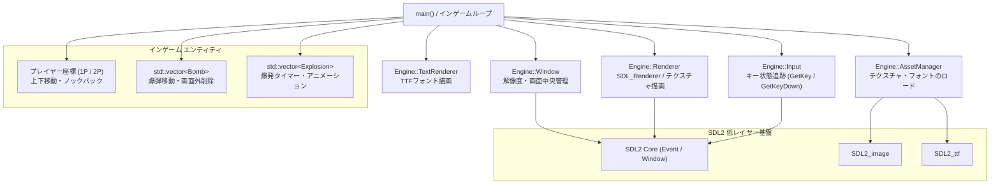

## 1. 企画・開発背景
学校の企画選択授業（ハッカソン形式）において、**「飛ばす」**というテーマ企画を選択して制作した、**C++ / SDL2による2人対戦型2Dアクションゲーム**です。

本作は、画面左右に分かれた2人のプレイヤー（1P・2P）が上下に移動しながら相手に向かって爆弾を投げ合い、相手を画面外へノックバックさせてリングアウト（場外脱落）を狙う対戦ゲームです。
普段はUnityなどの商用ゲームエンジンをメインに扱っていますが、本作ではあえてゲームエンジンに依存せず、マルチメディアライブラリ **SDL2（Simple DirectMedia Layer 2）を初めて採用**。ウィンドウの生成、イベントポーリング、自作Inputクラス、2Dテクスチャ描画、AABB矩形当たり判定、フォント描画まで、ゲームを動かす根底のアーキテクチャをすべてゼロからC++で構築しました。なお、本作のキービジュアルとなる爆弾のスプライト（ドット絵）は自身で自作したものを使用しています。

---

## 2. 技術選定とアーキテクチャ設計
低レイヤーなC++環境において開発効率と保守性を担保するため、以下のツールチェーンおよびクラス設計を採用しました。

### 1. モダンC++（C++23）と CMake ＋ vcpkg パイプライン
ビルドシステムには業界標準の **CMake** を採用し、外部ライブラリの依存関係管理には **vcpkg（マニフェストモード `vcpkg.json`）** を導入。SDL2、SDL2_image、SDL2_ttf、glad、imgui、assimp といった複数のクロスプラットフォームライブラリの依存解決・リンクを自動化しました。

### 2. SDL2 エコシステムの活用
- **SDL2**: ウィンドウ生成、グラフィックスデバイス初期化、キーボードイベント取得
- **SDL2_image**: PNGスプライトテクスチャのロード（自作爆弾ドット絵、プレイヤー、爆発エフェクト、背景）
- **SDL2_ttf**: TrueTypeフォント（`Galindo-Regular.ttf`）を用いたリアルタイムテキスト描画（勝敗・プレイヤーラベル）

### 3. 自作ミニゲームエンジン（`Engine` 名前空間）への責務分離
初期実装では `main.cpp` に集中していた初期化・描画・入力処理をリファクタリングし、ゲームロジックから独立した再利用可能なミニエンジンとして再構成しました。
- **`Engine::Window`**: ウィンドウの生成、破棄、解像度管理、画面中央座標の算出
- **`Engine::Renderer`**: `SDL_Renderer` のラップ、画面クリア、テクスチャの通常描画および水平反転（Flip）描画
- **`Engine::Input`**: 毎フレームのキー状態ポーリングと押下瞬間検知
- **`Engine::AssetManager`**: テクスチャおよびフォントの一括ロードとキャッシュ管理
- **`Engine::TextRenderer`**: TTFフォントを用いたテキスト描画パイプライン

---

## 3. コア機能の実装詳細

### 3.1 システム構成図（アーキテクチャ）
自作の `Engine` 基盤と、`main.cpp` で動作するインゲームロジック（エンティティ・判定・ゲームループ）の分離構造です。



---

### 3.2 自作入力システム（`Engine::Input`）
SDL2の生のイベント（`SDL_PollEvent`）とキーボード状態配列を抽象化し、Unityライクに扱える入力クラスを設計しました。

```cpp
namespace Engine {
    class Input {
    public:
        void BeginFrame() {
            // フレーム開始時に押下瞬間フラグをリセット
            m_key_downs.clear();
        }

        void ProcessEvent(const SDL_Event& e) {
            // キーが押された瞬間のイベントを記録
            if (e.type == SDL_KEYDOWN && e.key.repeat == 0) {
                m_key_downs[e.key.keysym.sym] = true;
            }
        }

        // 押し続け判定（長押し移動用）
        bool GetKey(SDL_Scancode scancode) const {
            return m_keyboard_state[scancode] != 0;
        }

        // 押した瞬間判定（爆弾投擲用）
        bool GetKeyDown(SDL_Keycode keycode) const {
            auto it = m_key_downs.find(keycode);
            return (it != m_key_downs.end()) && it->second;
        }
    };
}
```

この設計により、プレイヤーの長押し移動（`GetKey(SDL_SCANCODE_W)`）と、1回押しによる爆弾投擲（`GetKeyDown(SDLK_e)`）を明確に制御できるようにしました。

---

### 3.3 爆弾投擲・AABB衝突判定・ノックバック物理
「飛ばす」というテーマを表現するため、爆弾が命中した際の座標強制加算によるノックバックとリングアウト判定を実装しました。

```cpp
// 爆弾とプレイヤーのAABB矩形当たり判定およびノックバック処理
for (auto it = bomb_list.begin(); it != bomb_list.end();) {
    // 1P（左側プレイヤー）への被弾判定（右向きに進む爆弾は当たらない）
    if (x <= it->x + it->width && x + 200 >= it->x &&
        y <= it->y + it->height && y + 142 >= it->y &&
        !it->is_move_right)
    {
        x -= 10; // 後方へノックバック

        int ex_x = it->x;
        int ex_y = it->y;
        it = bomb_list.erase(it);
        explosion_list.emplace_back(Explosion(ex_x - 114, ex_y - 87, 227, 174, 500));
    }
    // 2P（右側プレイヤー）への被弾判定
    else if (x2 <= it->x + it->width && x2 + 200 >= it->x &&
             y2 <= it->y + it->height && y2 + 142 >= it->y &&
             it->is_move_right)
    {
        x2 += 10; // 後方へノックバック

        int ex_x = it->x;
        int ex_y = it->y;
        it = bomb_list.erase(it);
        explosion_list.emplace_back(Explosion(ex_x - 114, ex_y - 87, 227, 174, 500));
    }
    else {
        ++it;
    }
}

// 画面外へのリングアウト判定
if (x <= -200) {
    is_match_end = true;
    is_winner_p1 = false; // 2P勝利
}
if (x2 >= WINDOW_WIDTH) {
    is_match_end = true;
    is_winner_p1 = true;  // 1P勝利
}
```

---

## 4. 開発トラブルと解決プロセス

### 課題1: 初めてのSDL2・マルチライブラリ導入におけるビルドエラー
- **発生した問題・背景**:
  SDL2に加え、SDL2_image、SDL2_ttf、glad、imguiなど多数のC/C++ライブラリを組み込むにあたり、手動リンクではインクルードパスの不整合やDLL未配置による実行時エラーが頻発しました。
- **解決アプローチ**:
  **vcpkg（マニフェストモード `vcpkg.json`）** と **CMake** の連携設定を構築。ビルド後にアセット（フォント・画像）を実行ファイル階層へ自動コピーする `add_custom_command` を記述し、ワンクリックで依存ライブラリの解決とアセット配置が完了する環境を整備しました。

---

### 課題2: `main.cpp` 肥大化に伴う可読性と保守性の低下
- **発生した問題**:
  短期間のハッカソン開発だったため、初期はウィンドウ生成、レンダラー初期化、イベントループ、入力判定がすべて `main.cpp` に同居し、コードの見通しが悪化していました。
- **解決アプローチ**:
  開発中盤で共通処理の**リファクタリング（Pull Request #21）**を敢行。汎用的なグラフィックス・入力・ウィンドウ処理を `engine/` ディレクトリ配下にクラス化（`Window`, `Renderer`, `Input`, `TextRenderer`, `AssetManager`）して切り出しました。これにより、`main.cpp` はゲーム固有のルール（座標更新・当たり判定・勝敗条件）のみに専念できるクリーンな構成となりました。

---

### 課題3: 1Pと2Pのリングアウト判定の非対称性と勝敗バグ
- **発生した問題**:
  開発初期、1Pの画面左端判定（負のオフセット `x <= -200`）と2Pの画面右端判定（画面幅 `x2 >= WINDOW_WIDTH`）の基準値の違いにより、1Pが被弾して画面外に出てもゲーム終了が検知されない不具合が発生しました。
- **解決アプローチ**:
  スプライトの原点座標系と描画幅（200px）を再計算し、スプライトが完全に画面外へ消えた瞬間に試合終了フラグが立つよう判定式を修正（コミット `75dddad`）。勝敗判定の信頼性を担保しました。

---

## 5. Unityとの比較と得られた知見

商用エンジン（Unity）と低レイヤーC++ライブラリ（SDL2）の双方を経験したことで、ゲーム開発における技術的視野が大きく広がりました。

| 開発要素 | Unity での開発 | C++ / SDL2（本作）での開発 |
| :--- | :--- | :--- |
| **ゲームループ** | `Update()`, `FixedUpdate()` で自動駆動 | `while(!is_quit)` 内でイベント取得・更新・描画を手動制御 |
| **入力検知** | `Input.GetKey()` / Input System | `SDL_PollEvent` と `SDL_GetKeyboardState` を自作クラスでラップ |
| **描画パイプライン** | SpriteRenderer が描画順やバッチングを自動管理 | バッファクリア（`SDL_RenderClear`）から Present までを手動順序制御 |
| **当たり判定** | BoxCollider2D / Rigidbody2D（物理エンジン） | AABB（矩形交差判定式）を数式から直接実装 |

---

## 6. 学びと今後の展望
- **学び**:
  ゲームエンジンが水面下で行っている「イベント駆動の仕組み」「レンダリングパイプラインのライフサイクル」「メモリとテクスチャの明示的解放」を肌感覚で理解できました。この経験は、Unity等のハイレベル環境でパフォーマンスチューニングやアーキテクチャ設計を行う上での強力な基盤となっています。
- **今後の展望**:
  本作の土台である `Template_GameDev_OpenGL` の構成を活かし、OpenGL（glad/assimp）を直接叩いた3Dメッシュレンダリングやシェーダープログラミング、固定デルタタイムによる物理演算の安定化にも挑戦したいと考えています。

---

## 7. 操作方法（PC 2人ローカル対戦）

同一キーボードで2人対戦を行います。

| プレイヤー | 移動操作 | 爆弾投擲 | 勝利条件 |
| :--- | :--- | :--- | :--- |
| **1P（左側・赤文字）** | **W** キー（上移動）<br/>**S** キー（下移動） | **E** キー | 相手（2P）に爆弾を当てて画面右端へ押し出す |
| **2P（右側・青文字）** | **↑** キー（上移動）<br/>**↓** キー（下移動） | **テンキー 1** キー | 相手（1P）に爆弾を当てて画面左端へ押し出す |
