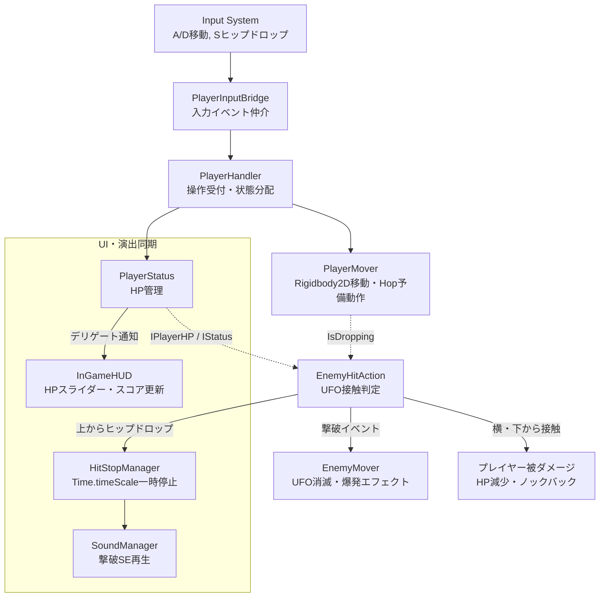

## 1. 企画・開発背景
専門学校2年目に制作した、**完全個人制作の2Dカジュアルアクションゲーム**です。
フリーゲーム投稿サイト **[unityroom（ゲーム公開ページ）](https://unityroom.com/games/star_drop)** にてWebGL版を公開しています。

プレイヤーは宇宙空間を浮遊するキャラクターを操作し、ステージ内に落ちてくる星（スター）を集めながら、画面端から飛来してプレイヤーや星を吸い上げようとするUFOを、ジャンプからの**ヒップドロップ**で踏み潰して撃退し、ハイスコアを目指します。

プログラミングのみならず、**ドット絵スプライト・UI・ロゴなどのグラフィック全般、およびピコピコとしたレトロな効果音（SE）に至るまで、すべての素材を自作**して1つのゲーム世界観を完結させました。

シンプルなルールでありながら、アクションゲームとしての「手触りの良さ・爽快感（Game Feel）」を徹底的に追求し、初心者でも直感的に楽しめる作品として仕上げました。

---

## 2. 技術選定とアーキテクチャ設計
個人制作でありながらコードの肥大化（God Object化）を避け、拡張性と保守性を両立させるため、以下の設計方針を採用しました。

### 1. SOLID原則に基づくインターフェース分離設計
プレイヤー、エネミー、アイテムの各アクターが互いに具象クラスで直接依存しないよう、`Interfaces/` ディレクトリ配下に責務ごとのインターフェース（`IPlayer`, `IPlayerHP`, `IPlayerHandle`, `IMover`, `IItem` など）を細かく定義。
例えばエネミー側の当たり判定クラス（`EnemyHitAction`）は、プレイヤーの具象クラスではなく `IPlayerHP` および `IPlayerPropertys` のみを参照してダメージやヒップドロップ判定を行います。

### 2. アクションの手触り（Juice / フィール）の追求
「敵を踏み潰す気持ちよさ」を最大化するため、単に落下速度を上げるだけでなく、以下の2つの工夫を導入しました：
- **予備動作（Hop処理）**: ヒップドロップ入力の瞬間、一瞬ふわりと上に小さく飛び上がってから急降下させることで、メリハリと勢いを演出。
- **ヒットストップ (`HitStopManager`)**: UFOを撃破した瞬間にゲーム時間を極小時間（0.2秒）停止させ、強烈な打撃感と手応えを表現。

### 3. イベント駆動による状態・UI同期
プレイヤーのHP変動・枯渇通知にはデリゲートイベント（`emptyHPEventHandler` など）を採用。マネージャーやスライダーUI（`DisplayValueSlider`）がポーリングすることなく、値の変化時のみリアクティブに更新される構造としました。

---

## 3. コア機能の実装詳細

### 3.1 システム構成図（アーキテクチャ）
インターフェースによる疎結合なアクター連携、ヒットストップ、およびマネージャー層の接続構造です。



### 3.2 ヒップドロップの予備動作（Hop）と物理落下制御
下キー（Sキー）が入力された瞬間、いきなり真下に落とすのではなく、コルーチン `Hop()` を介して上方向へ一瞬のインパルスを加え、その直後に急降下させることで、ジャンプアクション特有の「溜め」の気持ちよさを生み出しています。

```csharp
// 【PlayerMover.cs より抜粋】
// 下入力検知時に予備動作コルーチンを開始
private void Update()
{
    if (_moveValue.y < -0.1f && _moveValue.x < Mathf.Abs(0.5f))
    {
        if (!_isDropping)
        {
            _isDropping = true;
            _coroutine = StartCoroutine(Hop());
            SoundManager.Instance.PlaySE(AudioNameConstants.SE_DROP);
        }
    }
    else
    {
        if (_isDropping)
        {
            _isDropping = false;
            StopCoroutine(_coroutine);
        }
    }
}

// 一瞬ふわりと浮き上がってから急降下させる予備動作
private IEnumerator Hop()
{
    _playerRb.AddForce(Vector2.up * 10.0f, ForceMode2D.Impulse);
    yield return new WaitForSeconds(0.1f);
    _playerRb.AddForce(Vector2.down * 10.0f, ForceMode2D.Impulse);
}
```

### 3.3 ヒットストップによる打撃感の創出（`HitStopManager`）
UFO撃破時に `Time.timeScale` を `0.0f` に設定。通常の `WaitForSeconds` では時間が止まっているため復帰できなくなる問題を防ぐため、実時間で計測する `WaitForSecondsRealtime` を使用して安全にゲーム進行を再開させます。

```csharp
// 【HitStopManager.cs より抜粋】
// 時間停止と実時間待機によるヒットストップ
public class HitStopManager : Singleton<HitStopManager>
{
    [SerializeField]
    private float _duration = 0.2f;

    public void StartHitStop(float duration = 0.0f)
    {
        StartCoroutine(HitStopCoroutine(duration));
    }

    private IEnumerator HitStopCoroutine(float duration)
    {
        float targetDuration = duration > 0.0f ? duration : _duration;
        Time.timeScale = 0.0f; // ゲーム内時間を完全停止
        yield return new WaitForSecondsRealtime(targetDuration); // 実時間で待機
        Time.timeScale = 1.0f; // 通常速度に復帰
    }
}
```

### 3.4 上下接触判定による撃破と被ダメージの分岐
プレイヤーとUFOの接触時、Y座標の相対位置（`collision.transform.position.y >= this.transform.position.y`）と、ヒップドロップ中フラグ（`GetIsDropping()`）の双方を検証。上からの落下攻撃のみを「撃破」として判定し、それ以外の衝突はプレイヤーの被ダメージとして厳密に振り分けています。

```csharp
// 【EnemyHitAction.cs より抜粋】
void OnTriggerEnter2D(Collider2D collision)
{
    if (collision.gameObject.CompareTag("Player"))
    {
        if (collision.transform.root.TryGetComponent<Player>(out var playerComponent))
        {
            // 上からの接触かつヒップドロップ中であればUFOを撃破
            if (collision.transform.position.y >= this.transform.position.y)
            {
                if (!playerComponent.GetIsDropping()) return;

                HitStopManager.Instance?.StartHitStop();
                enemyHitPlayerEventHandler?.Invoke();
                GetComponent<Collider2D>().enabled = false;
                SoundManager.Instance.PlaySE(AudioNameConstants.SE_UFO_IMPACT);
            }
            else
            {
                // 横や下からの接触はプレイヤーの被ダメージ
                playerComponent.TakeDamage(40);
            }
        }
    }
}
```

---

## 4. 開発トラブルと解決プロセス

### 課題1: ヒップドロップ落下速度と左右慣性の干渉
- **発生した問題・背景**:
  初期実装では、斜め下を入力した際に左右の移動ベクトルと下方向の落下ベクトルが合算され、予期せぬ方向へ猛スピードで斜め滑り落ちてしまうバグが発生しました。
- **解決アプローチ**:
  `FixedUpdate` において、左右移動の入力ベクトルとヒップドロップの降下処理を明確に分離。ヒップドロップ中はX軸の入力値をマスクし、さらに最高速度制限（`_speedLimit`）を設けることで、ブレのない垂直落下と安定した操作性を確立しました。

---

### 課題2: ヒットストップ中の非同期処理・アニメーションのフリーズ
- **発生した問題**:
  ヒットストップ導入時、`Time.timeScale = 0` によってUIのアニメーション（DOTween）や演出コルーチンまで一緒に固まってしまい、操作不能になったような違和感が生じました。
- **解決アプローチ**:
  UI演出や画面フェードには `SetUpdate(true)`（タイムスケール非依存モード）を指定し、コルーチンの待機には `WaitForSecondsRealtime` を徹底。ゲーム内の物理・アクション時間のみを止め、UIやフィードバック演出は滑らかに動き続けるよう調整しました。

---

### 課題3: 完全個人制作におけるアセットの統一感維持
- **発生した問題**:
  外部の無料素材を組み合わせると、ドット絵の解像度（PPU: Pixels Per Unit）やカラーパレット、効果音の質感がバラバラになり、ゲーム全体としてチープな印象を与えてしまう懸念がありました。
- **解決アプローチ**:
  キャラクター、UFO、星、ロゴ、UIに至るまですべてのドット絵素材を自作し、解像度とトーン＆マナーを統一。SEもレトロなチップチューン風サウンドで自作・統一することで、作品全体に一貫したポップで懐かしい世界観を構築しました。

---

## 5. 個人開発における工夫とunityroom公開
本作品は、ゲーム制作の全工程（企画・プログラミング・アート・サウンド・公開）を1人で完結させたプロジェクトです。

| 制作領域 | 実施内容・工夫 |
| :--- | :--- |
| **アーキテクチャ** | 個人開発でもコードを疎結合に保つため、インターフェース（`IPlayer`, `IItem` 等）を活用した設計を徹底。 |
| **素材の内製** | ドット絵スプライト、フォント装飾、ピコピコ系SEをすべて自作し、独自の世界観を統一。 |
| **unityroom公開** | WebGLビルド特有の描画・ロード負荷を最適化し、ブラウザ上で誰でもすぐに遊べる環境を実現。 |

---

## 6. 学びと今後の展望
- **学び**:
  ゲームの面白さは複雑なルールだけでなく、「予備動作」や「ヒットストップ」といったわずかコンマ数秒のフィードバック（手触り）の積み重ねで劇的に向上することを体感しました。また、素材をすべて自作してunityroomで一般公開したことで、プレイヤーからの反応を直に得る喜びと、リリースまでやり切る完遂力を培いました。
- **今後の展望**:
  UFOの種類増加（弾を撃ってくるUFOや高速移動するUFO）や、コンボシステムによるスコア倍率の導入、オンラインランキング機能の実装など、ゲームとしての深みをさらに拡張していきたいと考えています。

---

## 7. 操作方法（PC WebGL / unityroom）

本作はブラウザ（キーボード）で快適にプレイできます。

| 操作項目 | キーボード操作 | 備考 |
| :--- | :--- | :--- |
| **左右移動** | **A / D** キー | 左右に移動して星を集める |
| **ヒップドロップ** | **S** キー | 一瞬ホップした後に急降下し、UFOを踏み潰す |
| **文字送り / 決定** | **任意のキー** | タイトルや遊び方説明画面のページ送り |
