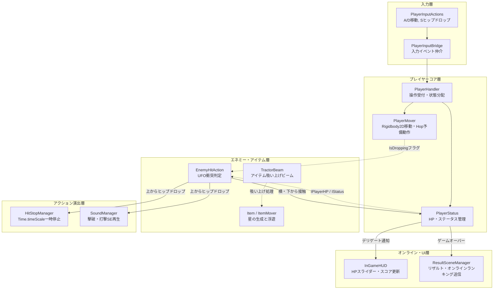
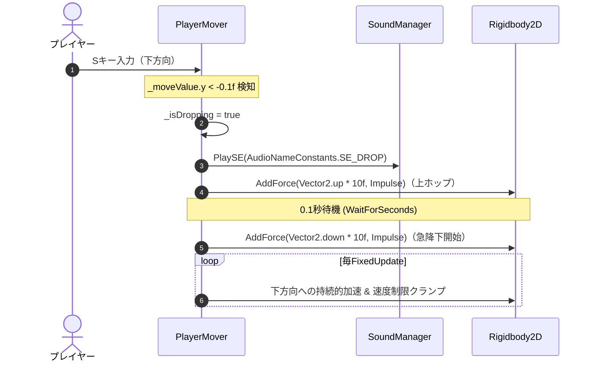
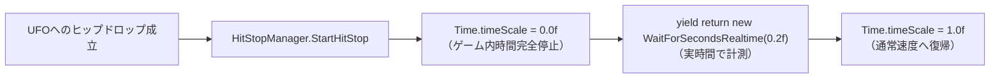
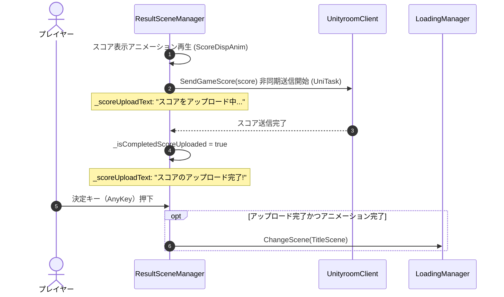

## 1. 作品の概要

### どのような作品か
専門学校2年目に制作した、**完全個人制作の2Dカジュアルアクションゲーム** です。
フリーゲーム投稿サイト **[unityroom（ゲーム公開ページ）](https://unityroom.com/games/star_drop)** にてWebGL版を公開しています。

プレイヤーは宇宙空間を浮遊するキャラクターを操作し、ステージ内に落ちてくる星（スター）を集めながら、画面端から飛来してプレイヤーや星を吸い上げようとするUFOを、ジャンプからの **ヒップドロップ** で踏み潰して撃退し、ハイスコアを目指します。

### 操作方法
本作はブラウザ（PCキーボード）で手軽かつ快適にプレイできます。

| 操作項目               | キーボード操作 | 備考                                            |
| :--------------------- | :------------- | :---------------------------------------------- |
| **左右移動**           | **A / D** キー | 左右に慣性移動して星を集める                    |
| **ヒップドロップ**     | **S** キー     | 一瞬小さくホップした後に急降下し、UFOを踏み潰す |
| **クレジット表示切替** | **Esc** キー   | タイトル画面でクレジットパネルを開閉            |
| **ページ送り / 決定**  | **任意のキー** | タイトルや遊び方説明画面、リザルトの決定        |

### 開発背景
ゲームプログラミングの基礎習得と並行して、シンプルなルールの中にアクションゲームとしての「手触りの良さ・爽快感（Game Feel / Juice）」をどこまで詰め込めるかをテーマに掲げて開発しました。また、外部アセットに頼ることなく、ドット絵スプライトやレトロなピコピコ効果音（SE）を含めたゲーム全体のトーン＆マナーを自らの手で統一・完結させることを目指しました。

### チーム体制と自分の役割
**完全個人制作**（企画・設計・プログラミング・アート・サウンド・Web公開まで全工程を単独担当）

主な担当領域：
- **ゲームロジックおよび物理アクション制御の実装**（`PlayerMover`, `EnemyHitAction`, `HitStopManager`）
- **SOLID原則に基づくインターフェース分離設計**（`IPlayer`, `IPlayerHP`, `IPlayerHandle`, `IItem` など）
- **WebGL向けオンラインランキング連携機能の実装**（UniTaskを用いたunityroom API連携）
- **グラフィック全般の内製**（プレイヤー、UFO、星、ロゴ、各種UIのドット絵スプライト制作）
- **レトロサウンド（SE）の制作**（BGM選定、レトロゲーム風効果音の自作）
- **unityroomへのWebGLビルド公開および実機検証**

---

## 2. 選定技術と全体のアーキテクチャ設計

### どの技術を使用したか
- **ゲームエンジン**: Unity（WebGL 向けビルド）
- **言語**: C#
- **物理演算**: Rigidbody2D（慣性移動、ホップ予備動作、速度減衰、速度制限）
- **UI・演出アニメーション**: DOTween, TextMeshPro
- **非同期処理・通信**: **UniTask**, unityroom-client-unity（WebGL環境でのオンラインランキング通信）
- **オーディオ**: Unity AudioSource, 自作効果音（SE）

### どの設計を採用したか
個人制作の小規模ゲームであっても、コードが1つのクラスに集中して肥大化（God Object化）することを防ぎ、拡張性と保守性を両立させるため、**SOLID原則（特に単一責任の原則とインターフェース分離の原則）に基づいた疎結合アーキテクチャ** を設計・採用しました。



この疎結合設計により、以下の利点を獲得しました：
1. **責務の明確化**: プレイヤーの移動（`PlayerMover`）、ステータス（`PlayerStatus`）、入力受け付け（`PlayerHandler`）が分離されているため、落下速度の調整や当たり判定の仕様変更が他コンポーネントに影響を与えません。
2. **インターフェースによる安全な参照**: `EnemyHitAction` や `ItemHitAction` は、プレイヤーの具象クラスではなく `IPlayerHP` や `IPlayerPropertys` などの必要最小限のインターフェースのみを参照するため、アクター間の循環参照を完全に防止できました。

---

## 3. 実装した機能の詳細

### 3.1 ヒップドロップの予備動作（Hop）と物理落下制御（`PlayerMover.cs`）

ただ単に下キーを押した瞬間に落下させるだけでは、アクションゲームとしての「勢い」や「重み」が感じられません。そこで、下キー（Sキー）が入力された瞬間、コルーチン `Hop()` を介して **一瞬ふわりと上に飛び上がってから急降下させる予備動作** を導入しました。



```csharp
// 【PlayerMover.cs より抜粋】
// ヒップドロップの入力検知とホップ予備動作
private void Update()
{
    // 下方向の入力があり、かつ斜め入力でない場合にヒップドロップを発動
    if (_moveValue.y < -0.1f && _moveValue.x < Mathf.Abs(0.5f))
    {
        if (!_isDropping)
        {
            _isDropping = true;
            _coroutine = StartCoroutine(Hop());
            SoundManager.Instance.PlaySE(AudioNameConstants.SE_DROP);
        }
    }
    else
    {
        if (_isDropping)
        {
            _isDropping = false;
            StopCoroutine(_coroutine);
        }
    }
}

// 一瞬上に小さく飛び上がってから真下へ叩き落とす予備動作コルーチン
private IEnumerator Hop()
{
    _playerRb.AddForce(Vector2.up * 10.0f, ForceMode2D.Impulse);
    yield return new WaitForSeconds(0.1f);
    _playerRb.AddForce(Vector2.down * 10.0f, ForceMode2D.Impulse);
}
```

---

### 3.2 ヒットストップによる打撃感の創出（`HitStopManager.cs`）

UFOを踏み潰した瞬間に強烈なインパクトを与えるため、ゲーム全体の時間をわずかな実時間（0.2秒）だけ完全停止させる **ヒットストップ機構** を実装しました。



```csharp
// 【HitStopManager.cs より抜粋】
// 時間停止と実時間待機によるヒットストップ
public class HitStopManager : Singleton<HitStopManager>
{
    [SerializeField]
    private float _duration = 0.2f;

    public void StartHitStop(float duration = 0.0f)
    {
        StartCoroutine(HitStopCoroutine(duration));
    }

    private IEnumerator HitStopCoroutine(float duration)
    {
        float targetDuration = duration > 0.0f ? duration : _duration;
        Time.timeScale = 0.0f; // ゲーム内時間を完全停止（物理演算・敵の動きを静止）
        yield return new WaitForSecondsRealtime(targetDuration); // タイムスケール停止下でも実時間で計測
        Time.timeScale = 1.0f; // 通常速度に復帰
    }
}
```

---

### 3.3 unityroom オンラインランキング連携と非同期スコア送信（`ResultSceneManager.cs`）

WebGL版をプレイしてくれた世界中のユーザー同士で競い合えるよう、**unityroom のオンラインランキングAPIへの非同期スコア送信機能** を設計・実装しました。



```csharp
// 【ResultSceneManager.cs より抜粋】
// UniTask を用いたオンラインランキングへのスコア非同期送信と遷移ガード
public class ResultSceneManager : MonoBehaviour
{
    private const int SCORE_BOARD_ID = 1;

    [SerializeField] private TextMeshProUGUI _scoreUploadText;
    private bool _isCompletedScoreDispAnim = false;
    private bool _isCompletedScoreUploaded = false;

    private IEnumerator ResultSequence()
    {
        yield return ScoreDispAnim();
        var score = ScoreManager.Instance == null ? 0 : ScoreManager.Instance.Score;
        yield return SendGameScore(score); // スコア送信の完了を待機
        _isCompletedScoreUploaded = true;
    }

    // 非同期でスコアをunityroomサーバーへ送信
    public async UniTask SendGameScore(float scoreValue)
    {
        UnityroomClient client = new()
        {
            HmacKey = GetSecretKey()
        };

        await client.Scoreboards.SendAsync(new()
        {
            ScoreboardId = SCORE_BOARD_ID,
            Score = scoreValue
        });

        Debug.Log("スコアの送信が完了しました！");
        client.Dispose();
    }

    private void Update()
    {
        // スコア表示とアップロードの双方が完了している場合のみ次シーンへの遷移を許可
        if (Input.anyKeyDown && CheckInputSpetialKeys()
            && _isCompletedScoreDispAnim && _isCompletedScoreUploaded)
        {
            LoadingManager.Instance.ChangeScene(_nextSceneName);
        }

        // 送信ステータスを画面上にリアルタイム表示
        if (_isCompletedScoreUploaded)
        {
            _scoreUploadText.text = "スコアのアップロード完了!";
        }
        else
        {
            _scoreUploadText.text = "スコアをアップロード中...";
        }
    }
}
```

---

## 4. 解決した課題

### 課題1: ヒップドロップ時の落下速度と左右慣性の干渉・斜め滑り防止

#### 背景・課題
初期実装では、プレイヤーが「斜め下」を入力した際、水平方向の移動ベクトルとヒップドロップの垂直落下ベクトルが加算され、キャラクターが斜め下方向へ猛スピードで滑り落ちてしまう不具合が発生しました。
これにより、UFOを真上から狙い澄まして踏み潰すことが極めて困難になり、アクションの手触りが著しく損なわれていました。

#### 技術的アプローチ
物理更新サイクル（`FixedUpdate`）における入力の分離と速度クランプを徹底しました：
1. **水平軸の切り離し**: ヒップドロップ判定時（`_isDropping == true`）は、移動用ベクトル `moveValue` のY成分を破棄し、垂直落下力のみを `AddForce` で加えるようにロジックを分離。
2. **自然な速度減衰**: `_playerRb.velocity *= 0.9f` を毎フレーム適用し、浮遊キャラクター特有の心地よい慣性停止を実現。
3. **軸別最高速度リミッター**: 水平・垂直それぞれの速度が規定値（`_speedLimit`）を超えないよう、`Mathf.Sign` を用いてベクトルの各軸を数学的にクランプ。

#### 具体的なコードや設計

```csharp
// 【PlayerMover.cs より抜粋】
// 水平移動とヒップドロップの分離、および速度クランプ処理
private void FixedUpdate()
{
    if (_playerRb == null) return;

    // ヒップドロップの挙動と分けるため、移動用入力のy軸を切り離す
    Vector2 moveValue = new Vector2(_moveValue.x, 0.0f);

    // 速度減衰（自然に停止させるための摩擦シミュレーション）
    _playerRb.velocity *= 0.9f;

    // ヒップドロップ中は真下へ持続的な落下力を付与
    if (_isDropping)
    {
        _playerRb.AddForce(Vector2.down * _moveSpeed * _dropSpeedRate);
    }
    else
    {
        _playerRb.AddForce(moveValue * _moveSpeed);
    }

    // X軸・Y軸それぞれの最高速度をクランプし、斜め滑りや異常加速を防止
    if (Mathf.Abs(_playerRb.velocity.x) > _speedLimit)
    {
        float limitValueX = Mathf.Sign(_playerRb.velocity.x) * _speedLimit;
        _playerRb.velocity = new Vector2(limitValueX, _playerRb.velocity.y);
    }

    if (Mathf.Abs(_playerRb.velocity.y) > _speedLimit)
    {
        float limitValueY = Mathf.Sign(_playerRb.velocity.y) * _speedLimit;
        _playerRb.velocity = new Vector2(_playerRb.velocity.x, limitValueY);
    }
}
```

---

### 課題2: ヒットストップ中のUI・アニメーションフリーズ防止

#### 背景・課題
打撃感を演出するために導入したヒットストップ（`Time.timeScale = 0.0f`）において、物理シミュレーションだけでなく、UIのアニメーション（DOTween）や画面演出用のコルーチンまでもが完全にフリーズしてしまい、ゲームが一瞬クラッシュしたかのような違和感をプレイヤーに与える問題が発生しました。

#### 技術的アプローチ
ゲーム内の「物理・アクション時間」と「演出・UI時間」を完全に分離するルールを徹底しました：
1. **実時間待機への切り替え**: `HitStopManager` のコルーチン待機処理において、タイムスケールに依存する `WaitForSeconds` を全廃し、実時間を計測する `WaitForSecondsRealtime` を採用。
2. **Tweenアニメーションの非依存化**: UIやスコア演出などのDOTween処理に対し、`SetUpdate(true)`（`isIndependentUpdate: true`）を指定することで、ゲーム内時間が停止していてもUIのアニメーションや点滅ループが途切れることなく滑らかに動作し続ける環境を構築しました。

#### 具体的なコードや設計

```csharp
// 【HitStopManager.cs より抜粋】
// タイムスケール完全停止下でも安全にカウントできる実時間待機
private IEnumerator HitStopCoroutine(float duration)
{
    float targetDuration = duration > 0.0f ? duration : _duration;
    Time.timeScale = 0.0f; // 物理・ゲーム時間を停止
    yield return new WaitForSecondsRealtime(targetDuration); // 実時間で待機
    Time.timeScale = 1.0f; // 通常速度に復帰
}
```

```csharp
// 【BlinkingAnimation.cs より抜粋】
// UIの点滅ループアニメーションをタイムスケール非依存で安全に実行
private void Start()
{
    if (TryGetComponent<TextMeshProUGUI>(out var textMeshProUGUIComponent))
    {
        _textMeshProUGUI = textMeshProUGUIComponent;
        tween = _textMeshProUGUI.DOFade(0.0f, _fadeDuration)
                                .SetLoops(-1, loopType: LoopType.Yoyo)
                                .SetUpdate(true) // タイムスケール停止中もアニメーションを維持
                                .OnStepComplete(() => StartCoroutine(AnimStop(_stopTime)));
    }
}
```

---

### 課題3: WebGL環境におけるオンラインランキング送信中の誤遷移防止と非同期シーケンス制御

#### 背景・課題
unityroom でのWebGL公開にあたり、リザルト画面でスコアをサーバーへ送信するオンラインランキング連携を実装しました。
しかし、WebGLブラウザ環境ではネットワーク通信のレイテンシが環境によって大きく変動します。初期実装のままでは、スコア送信のHTTPリクエストが完了する前にプレイヤーが決定キーを連打してタイトル画面へ遷移してしまい、**スコアの送信が中断・欠損してしまう致命的な不具合** が発生するリスクがありました。

#### 技術的アプローチ
`UniTask` による非同期通信の完了待機と、入力遷移ガード節を組み合わせた堅牢なシーケンス制御を構築しました：
1. **非同期アップロード待機**: `ResultSequence` において、スコア送信処理（`SendGameScore`）の完了を待機してから完了フラグ（`_isCompletedScoreUploaded = true`）を立てる。
2. **多重条件遷移ガード**: リザルト画面の `Update` において、演出完了フラグ（`_isCompletedScoreDispAnim`）とアップロード完了フラグ（`_isCompletedScoreUploaded`）の両方が揃わない限り、キー入力を一切受け付けない厳密なガード節を設置。
3. **視覚的フィードバック**: 「スコアをアップロード中...」から「スコアのアップロード完了!」へのテキスト動的切り替えを行い、通信状況をプレイヤーへ明示。

#### 具体的なコードや設計

```csharp
// 【ResultSceneManager.cs より抜粋】
// 通信完了を待機し、完了フラグが立つまでシーン遷移を完全ガード
private IEnumerator ResultSequence()
{
    yield return ScoreDispAnim(); // スコア演出待機
    var score = ScoreManager.Instance == null ? 0 : ScoreManager.Instance.Score;
    yield return SendGameScore(score); // UniTask非同期通信の完了を待機
    _isCompletedScoreUploaded = true;  // 送信成功フラグを点灯
}

private void Update()
{
    // アニメーション完了かつスコア送信完了の双方を満たさない限り遷移をブロック
    if (Input.anyKeyDown && CheckInputSpetialKeys()
        && _isCompletedScoreDispAnim && _isCompletedScoreUploaded)
    {
        LoadingManager.Instance.ChangeScene(_nextSceneName);
    }

    // プレイヤーに現在の通信状態をテキストで明示
    _scoreUploadText.text = _isCompletedScoreUploaded
        ? "スコアのアップロード完了!"
        : "スコアをアップロード中...";
}
```

この実装により、回線速度が遅い環境や激しいキー連打が発生しても、スコアの確実な登録とスムーズなシーン遷移が両立できるようになりました。

---

## 5. 学びと今後の展望

### 学び
- **「手触り（Game Feel）」の重要性**:
  予備動作（Hop）やヒットストップといった、わずか0.1〜0.2秒単位の物理・時間フィードバックの微調整が、アクションゲームの爽快感を何倍にも引き上げることを実感しました。
- **全工程の単独完遂力**:
  企画、C#プログラミング、ドット絵アート、レトロSE制作、そしてunityroomへのWebGL公開とオンラインランキング実装に至るまで、全工程を1人で完結させたことで、ゲーム制作全体のワークフローとリリースまでやり切る強い完遂力を培いました。
- **WebGL特有の非同期設計**:
  ブラウザ環境特有の通信ラグやタイムスケール停止への配慮など、プラットフォーム特性に合わせた堅牢なコード設計の知見を得ることができました。

### 今後の展望
- **敵バリエーションとゲームバランスの拡張**:
  弾を撃ってくるUFOやフェイントをかけるUFOなど、行動パターンの異なる敵種族の追加、および連続撃破によるコンボ倍率システムの導入を検討しています。
- **モバイル・タッチ操作への最適化**:
  スマートフォンブラウザでも快適に遊べるよう、バーチャルパッドやスワイプによるヒップドロップ操作への対応を推進していきたいと考えています。
