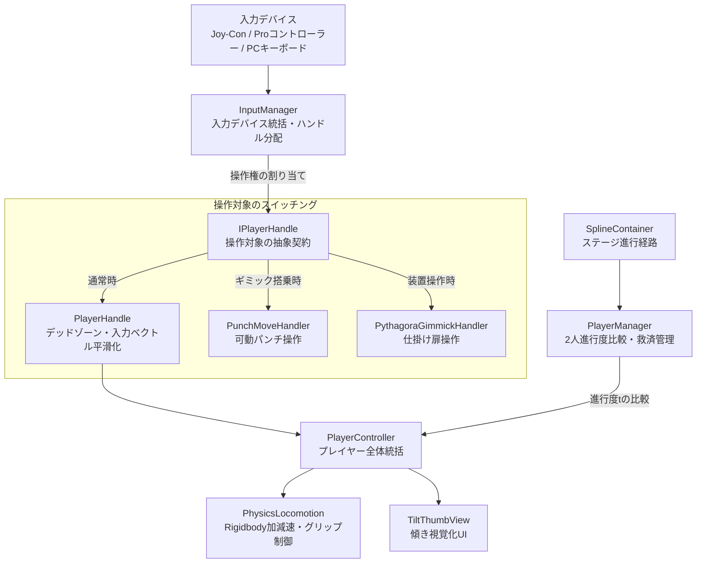

## 1. 企画・開発背景
進級制作展および**東京ゲームショウ（TGS）出展**に向けて開発した、**Nintendo Switch向け 2人協力型体感3Dアクションゲーム**です。

プレイヤーはおもちゃのキャラクターを操作し、コントローラー（Joy-Con / Proコントローラー）を傾ける直感的なジャイロ操作でステージを駆け抜け、仕掛けを動かしながら、2人の息を合わせてゴールを目指します。

プランナー・デザイナー・プログラマー合同の長期チーム制作（約4ヶ月）において、私は**プログラマー**として参画し、主に**プレイヤーの入力制御・物理ロコモーション・アクション・傾きUI演出・2人進行同期（PlayerManager）の設計・実装、および各種ギミックモジュールの作成**を担当しました（※ステージ全体やゲームループへの最終的な統合はリードプログラマーと連携して実施）。

TGS出展という「見知らぬ一般ユーザーが短時間で直感的に遊ぶ」展示環境を見据え、体感操作ならではのダイナミックな気持ちよさと、連打や想定外の操作でも絶対に破綻しない堅牢なゲームプレイの実現に注力しました。

---

## 2. 技術選定とアーキテクチャ設計
チーム開発において、複数デバイス（Joy-Con / Proコントローラー / PCデバッグ）への柔軟な対応と、2人協力プレイならではの同期・救済システムを実現するため、以下の設計方針を採用しました。

### 1. 入力ハンドラの抽象化設計（`IPlayerHandle` パターン）
入力検知層（`IPlayerInput`）と操作受取層（`IPlayerHandle`）をインターフェースで完全に分離。
`InputManager` を中心に据えることで、コントローラーの差異（Joy-Con / プロコン / キーボード）を完全に吸収するとともに、プレイヤーだけでなくステージ上の可動パンチやピタゴラギミックへもシームレスに操作権を委譲できる拡張性の高い設計としました。

### 2. Unity Spline を用いた2人の進行判定と救済テレポート
2人協力ゲームでは、一方のプレイヤーが進みすぎてもう一方が画面外に取り残されるとゲーム進行が破綻します。
単なる2点間の直線距離比較（`Vector3.Distance`）ではカーブや立体交差のあるステージで誤判定が発生するため、**ステージの進行経路に沿ったスプライン曲線（Unity Spline）上のパラメータ $t$ を比較**することで、どちらが真に「前」にいて「後ろ」にいるかを数学的に判定し、安全に後方プレイヤーを救済テレポートさせる仕組みを構築しました。

### 3. 体感操作を支えるフィードバック（傾きUI演出）
ジャイロ操作は手元の微細な傾きが移動に直結するため、プレイヤーが「自分が今どれくらい傾けているか」を視覚的に把握できないと操作ストレスに繋がります。これを解消するため、リアルタイムに入力ベクトルを可視化する円形サムUI（`TiltThumbView`）を設計・実装しました。

---

## 3. コア機能の実装詳細

### 3.1 システム構成図（アーキテクチャ）
入力抽象化層、2人の進行管理（Spline連携）、プレイヤー制御、およびUI演出の全体構造です。



### 3.2 入力抽象化とプロコン対応の仕組み
`InputManager` は現在の入力検知コンポーネント（`IPlayerInput`）から値を取得し、プレイヤー番号ごとに登録された `IPlayerHandle` へ分配します。

```csharp
/// <summary>
/// 入力値をプレイヤーのハンドルに渡す統括クラス（抜粋）
/// </summary>
public class InputManager : SingletonMonoBehaviour<InputManager>
{
    public Dictionary<int, IPlayerHandle> CurrentHandles { get; private set; } = new Dictionary<int, IPlayerHandle>();
    public IPlayerInput CurrentInput { get; private set; }

    private void Update()
    {
        if (CurrentInput == null) return;

        foreach (var handle in CurrentHandles)
        {
            ExecuteSetInputValues(handle.Key, handle.Value);
        }
    }

    private void ExecuteSetInputValues(int playerIndex, IPlayerHandle playerHandle)
    {
        // Joy-Con / プロコン / キーボードの差異を意識せず、統一インターフェースを通じて伝達
        playerHandle.SetMoveInput(CurrentInput.MoveInputVector[playerIndex]);
        playerHandle.SetJumpInput(CurrentInput.JumpInput[playerIndex]);
        playerHandle.SetBrakeInput(CurrentInput.BrakeInput[playerIndex]);
        playerHandle.SetChargeDushInput(CurrentInput.ChargeDushInput[playerIndex]);
        playerHandle.SetInteractInput(CurrentInput.InteractInput[playerIndex]);
    }
}
```

### 3.3 Unity Spline を用いた進行度判定とテレポート救済
直線距離ではなく、スプライン曲線上の最寄点パラメータ $t$（0.0〜1.0）を比較することで、曲がりくねったコースでも正確に前後関係を判定します。

```csharp
// 【PlayerManager.cs より抜粋】
// ステージ進行スプライン上の最寄点パラメータ t を取得して比較
SplineUtility.GetNearestPoint(_splineContainer.Spline, _player1Body.transform.position,
                              out var p1NearestPoint, out var t1);
SplineUtility.GetNearestPoint(_splineContainer.Spline, _player2Body.transform.position,
                              out var p2NearestPoint, out var t2);

_nearestPoints[_player1Controller.PlayerIndex] = t1;
_nearestPoints[_player2Controller.PlayerIndex] = t2;

/// <summary>
/// 進行スプラインに沿って「後ろに取り残されているプレイヤー」を取得
/// </summary>
public PlayerController GetPlayerControllerInBack()
{
    if (_splineContainer == null) return _player2Controller;

    // パラメータ t が小さい（手前にいる）方を後ろと判定
    if (_nearestPoints[_player1Controller.PlayerIndex] > _nearestPoints[_player2Controller.PlayerIndex])
    {
        return _player2Controller;
    }
    return _player1Controller;
}
```

### 3.4 傾き入力フィードバック（`TiltThumbView`）
ジャイロによる入力ベクトルを相対座標変換し、プレイヤーの画面上UIへ遅延なく反映させることで、体感操作の直感性を高めました。

```csharp
// 【TiltThumbView.cs より抜粋】
void Update()
{
    if (_targetThumbRectTransform == null || _playerController == null) return;

    // 現在のプレイヤー入力ベクトルを取得
    Vector2 targetInputValue = InputManager.Instance.CurrentInput.MoveInputVector[_playerController.PlayerIndex];

    // 入力値に応じて円形UIを最大半径内で移動させ、手元の傾きを視覚化
    Vector2 targetPosition = _initTargetAnchordPos + targetInputValue * _maxRadius;
    _targetThumbRectTransform.anchoredPosition = targetPosition;
}
```

---

## 4. 開発トラブルと解決プロセス

### 課題1: Proコントローラー操作への対応と入力受け取り層の改修
- **発生した問題・背景**:
  開発初期はJoy-Conの操作を前提にゲーム側の挙動ロジックを組んでいましたが、TGS出展や操作性の選択肢を広げるため「Proコントローラー（プロコン）でも快適に遊べるようにしたい」という要望が出ました。しかし、ゲーム側の入力受け取りクラス（`PlayerHandle` 等）が特定の入力仕様に依存していたため、プロコン接続時にスティックやボタンの挙動に不整合が発生しました。
  （※コントローラーのハードウェア通信部分は専任メンバーが担当しており、自身は一部デバッグに協力しつつ、ゲームロジック側の入力分配・受け取り層の改修に専念しました。）
- **解決アプローチ**:
  受け取った入力値をゲーム側の各アクション（移動・ダッシュ・ブレーキ・ジャイロ操作等）へ仲介するハンドラ層を改修し、コントローラーの種別を問わず統一された入力値（`Vector2` の移動ベクトルやボタン状態）として各コンポーネントへ正しく渡せるようコードを修正しました。
- **効果**:
  プロコンでもJoy-Conと同様に違和感なくスムーズにキャラクターを動かせるようになり、プレイヤー1・2が異なるコントローラーを接続してプレイする展示環境にも柔軟に対応できました。

---

### 課題2: プレイヤー死亡・スタン時の入力残留バグ
- **発生した問題**:
  プレイヤーが崖から落下して死亡した際や、敵・障害物に当たってスタンした際、直前に押していた「ブレーキ」や「ダッシュ」の入力フラグが内部で解除されず、**リスポーンした瞬間にキャラクターが勝手に急加速・暴走してしまう**深刻なバグが発生しました。
- **原因分析**:
  入力状態を保持する `PlayerHandle` 側のフラグが、死亡・スタンといった外部の状態遷移イベントと非同期になっており、キー離脱イベント（Release）を受け取れないままリスポーンしていたことが原因でした。
- **解決アプローチ**:
  死亡・スタン移行時に、強制的に全入力フラグをクリアし、入力をマスキング（無効化）するリセット処理を実装。また、壁接触時にモデルの向きが急反転するバグも同時に修正しました。

```csharp
// 【PlayerController.cs / PlayerHandle.cs より抜粋】
// 状態変化時に全入力状態を安全にリセット
public void ResetInputValues()
{
    _moveInput = Vector2.zero;
    _jumpInput = false;
    _brakeInput = PlayerInputState.Idle;
    _chargeDushInput = PlayerInputState.Idle;
    _interactInput = false;
}
```

---

### 課題3: ジャンプボタン連打によるアニメーション多重再生
- **発生した問題**:
  TGSなどの展示会では、プレイヤーがボタンを激しく連打することが想定されます。初期実装では、ジャンプボタンを連打するとジャンプアニメーションが最初から何度もリスタートし、モーションがガクガクと不自然に途切れる問題が発生しました。
- **解決アプローチ**:
  Animatorのステート判定および接地判定（`_checkGround.IsGrounded`）を厳密化。空中滞空時およびジャンプ遷移中（クールタイム中）のジャンプ入力をガードし、連打されても1回の跳躍アニメーションが自然に完結するように排他制御を行いました。

```csharp
// 【PlayerController.cs より抜粋】
// 接地状態かつジャンプ入力時のみ跳躍を実行し、入力フラグを即座に消費
if (jumpInput)
{
    _physicsJump.Execute();
    _chargeDush.CancelChargeDush();
    _jumpInput = false; // 連打による二重発火を即座に防止

    if (_checkGround.IsGrounded)
        _playerView.PlaySoundsOneShot(PlayerSounds.SoundType.Jump);
}
```

---

## 5. チーム開発における開発手法とリサーチ
本プロジェクトでは、コードの自動生成に過度に依存せず、**チーム内での仕様すり合わせやUnityの基礎設計原則（SOLID原則）に基づき、自らの手で堅牢なコードを構築**しました。

| 開発領域                     | 実施内容・工夫                                                                                                                                          |
| :--------------------------- | :------------------------------------------------------------------------------------------------------------------------------------------------------ |
| **アーキテクチャ設計**       | 他メンバー（ギミック担当・ステージ担当）が独立して作業できるよう、インターフェース（`IPlayerHandle`, `IInteractable`）を用いた疎結合な設計を自ら主導。  |
| **技術リサーチ**             | Unity Input Systemの設定やC#の設計パターン、エラー解決時の検索において、**Google AI Mode（AI要約）** を活用して一次情報の要点をスピーディに把握・検証。 |
| **品質保証（QA・デバッグ）** | 展示会での試遊を想定し、連打・同時押し・想定外の壁衝突などあらゆるエッジケースを洗い出してバグを徹底的に修正。                                          |

---

## 6. 学びと今後の展望
- **学び**:
  TGS出展という目標があったことで、「動けばいいコード」ではなく、「見知らぬユーザーがどんな操作をしても絶対に破綻しない堅牢な入力・状態管理」の重要性を痛感しました。また、インターフェースで契約を結ぶ設計によって、チーム内での並行作業が劇的にスムーズになることを身をもって学びました。
- **今後の展望**:
  実機プロファイリングによるCPU/GPU負荷の最適化や、メモリ管理（GC Allocの削減）など、コンソールゲーム開発に求められるパフォーマンスチューニングの知見をさらに深めていきたいと考えています。

---

## 7. 操作方法（Joy-Con横持ち / PCデバッグ）

※本作はNintendo Switchの**Joy-Con横持ち（おすそわけプレイ）**による直感的な体感操作を採用しています。

| 操作項目 | Joy-Con横持ち操作 | PCデバッグ操作 |
| :--- | :--- | :--- |
| **キャラクター移動** | **コントローラーの傾き（ジャイロ）** | **W / A / S / D** キー |
| **ジャンプ** | **下ボタン**（L側: ◀ / R側: B） | **スペース** キー |
| **ブレーキ** | **SL / SR** ボタン | **S** または **Shift** キー |
| **チャージダッシュ** | **左ボタン長押し → 離す**（L側: ▲ / R側: Y） | **E** キー長押し → 離す |
| **ギミック操作** | **右ボタン**（L側: ▼ / R側: A） | **F** キー |
| **ジャイロ姿勢リセット** | **上ボタン**（L側: ▶ / R側: X） | **R** キー |
