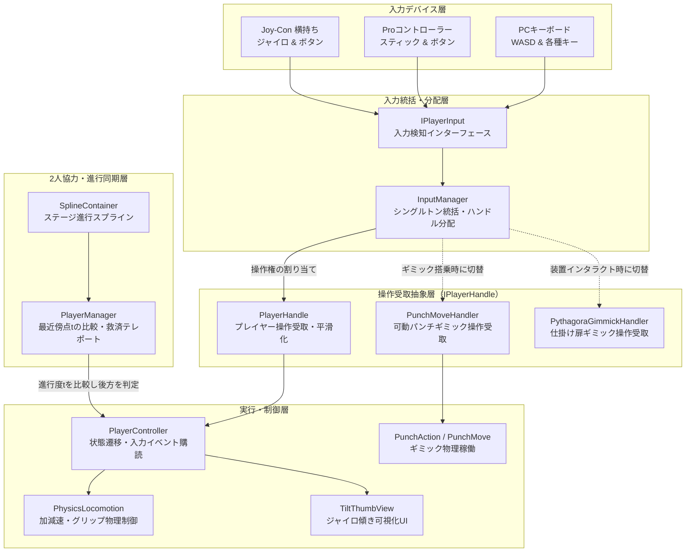
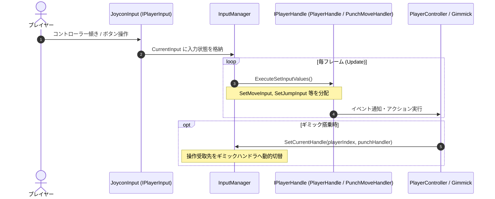
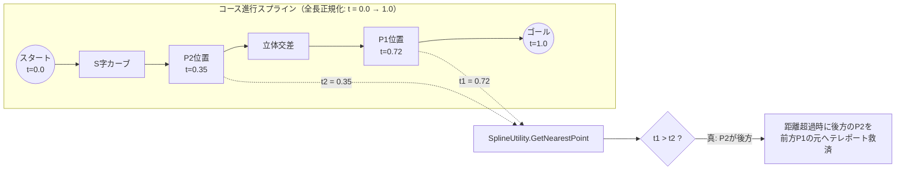

## 1. 作品の概要

### どのような作品か
進級制作展および **東京ゲームショウ（TGS）出展** に向けて開発した、**Nintendo Switch向け 2人協力型体感3Dアクションゲーム** です。

プレイヤーはおもちゃのキャラクターを操作し、コントローラー（Joy-Con / Proコントローラー）を傾ける直感的なジャイロ操作でステージを駆け抜け、仕掛けを動かしながら、2人の息を合わせてゴールを目指します。

### 操作方法
本作はNintendo Switchの **Joy-Con横持ち（おすそわけプレイ）** による直感的な体感操作を採用しています。また、PCデバッグおよびProコントローラー接続にも完全対応しています。

| 操作項目                 | Joy-Con横持ち操作                            | PCデバッグ操作              |
| :----------------------- | :------------------------------------------- | :-------------------------- |
| **キャラクター移動**     | **コントローラーの傾き（ジャイロ）**         | **W / A / S / D** キー      |
| **ジャンプ**             | **下ボタン**（L側: ◀ / R側: B）              | **Space** キー              |
| **ブレーキ**             | **SL / SR** ボタン                           | **S** または **Shift** キー |
| **チャージダッシュ**     | **左ボタン長押し → 離す**（L側: ▲ / R側: Y） | **E** キー長押し → 離す     |
| **ギミック操作**         | **右ボタン**（L側: ▼ / R側: A）              | **F** キー                  |
| **ジャイロ姿勢リセット** | **上ボタン**（L側: ▶ / R側: X）              | **R** キー                  |

### 開発背景
TGS出展という「見知らぬ一般ユーザーが短時間で直感的に遊ぶ」展示環境を見据え、体感操作ならではのダイナミックな気持ちよさと、激しい連打や想定外の操作でも絶対に破綻しない堅牢なゲームプレイの実現に注力しました。

### チーム体制と自分の役割
2026年4月から9月にかけての約5ヶ月間、プランナー・デザイナー・プログラマー合同の大規模チーム（Gitリポジトリ全体で1,100コミット以上）において、私は **プログラマー** として参画しました（全133コミットを担当、プログラマー陣中第2位のコントリビューション）。

主な担当領域は以下の通りです：
- **入力検知・抽象化ハンドラ層の設計・実装**（`InputManager`, `IPlayerHandle`, `IPlayerInput`）
- **物理ロコモーション・アクション制御**（`PhysicsLocomotion`, `ChargeDush`, `VelocityBrake`）
- **Unity Spline を用いた2人の進行度同期・救済テレポートシステム**（`PlayerManager`）
- **ジャイロ入力フィードバックUI演出**（`TiltThumbView`）
- **ステージギミック操作権の委譲モジュール作成**（可動パンチ、ピタゴラ仕掛け扉など）
- **展示会向けのエッジケース検証・堅牢化デバッグ**（連打対策、入力残留バグ解消、当たり判定正常化）

---

## 2. 選定技術と全体のアーキテクチャ設計

### どの技術を使用したか
- **ゲームエンジン**: Unity（Nintendo Switch 向けビルド）
- **言語**: C#
- **ステージ進行・数学的幾何計算**: **Unity Spline Package**（曲線上の最寄点パラメータ計算による進行度比較）
- **物理演算**: Rigidbody（加減速・摩擦・すり抜け防止の物理挙動制御）
- **入力制御**: JoyconLib & Unity Input（複数デバイス差異の吸収）
- **アニメーション・演出**: Animator, DOTween, UniTask

### どの設計を採用したか
チーム開発において、複数デバイス（Joy-Con / Proコントローラー / PCデバッグ）への柔軟な対応と、プレイヤーのみならずステージギミックへの操作権委譲、さらに2人プレイならではの同期・救済システムを実現するため、**「入力検知層」と「操作受取層」をインターフェースで完全分離する抽象化アーキテクチャ** を設計・採用しました。



この疎結合アーキテクチャにより、以下の恩恵を得ることができました：
1. **デバイス依存の完全排除**: ゲームロジック側は `IPlayerHandle` を通じて正規化された `Vector2` 移動ベクトルやボタンイベントを受け取るため、ハードウェアごとの差分を意識せずに済みます。
2. **操作権のシームレスな移譲**: プレイヤーがギミックに乗った際、`InputManager.Instance.SetCurrentHandle()` を呼び出すだけで、キャラクターの操作を即座に停止し、可動パンチや仕掛け扉の操作へと切り替えることができます。

---

## 3. 実装した機能の詳細

### 3.1 入力抽象化とギミック操作権委譲（`InputManager` & `IPlayerHandle`）



`InputManager` は、接続された入力デバイスから値を取得し、プレイヤー番号ごとに登録された `IPlayerHandle` へ分配します。ギミック操作時にも同じインターフェースを利用することで、コードの重複を防ぎ、柔軟な操作切り替えを実現しました。

```csharp
// 【InputManager.cs より抜粋】
// 入力検知層と操作受取層を仲介し、操作権を動的に分配する統括クラス
public class InputManager : SingletonMonoBehaviour<InputManager>
{
    // 各プレイヤーに現在割り当てられている操作ハンドル
    public Dictionary<int, IPlayerHandle> CurrentHandles { get; private set; } = new Dictionary<int, IPlayerHandle>();
    public IPlayerInput CurrentInput { get; private set; }
    private Dictionary<int, IPlayerHandle> _defaultHandle = new Dictionary<int, IPlayerHandle>();

    private void Update()
    {
        if (CurrentInput == null) return;

        var currentHandles = new Dictionary<int, IPlayerHandle>(CurrentHandles);
        foreach (var handle in currentHandles)
        {
            ExecuteSetInputValues(handle.Key, handle.Value);
        }
    }

    /// <summary>
    /// 入力値をプレイヤーのハンドルに渡します
    /// </summary>
    private void ExecuteSetInputValues(int playerIndex, IPlayerHandle playerHandle)
    {
        playerHandle.SetMoveInput(CurrentInput.MoveInputVector[playerIndex]);
        playerHandle.SetJumpInput(CurrentInput.JumpInput[playerIndex]);
        playerHandle.SetBrakeInput(CurrentInput.BrakeInput[playerIndex]);
        playerHandle.SetBrakeInputRelesed(CurrentInput.BrakeReleaseInput[playerIndex]);
        playerHandle.SetChargeDushInput(CurrentInput.ChargeDushInput[playerIndex]);
        playerHandle.SetChargeDushInputRelesed(CurrentInput.ChargeDushReleaseInput[playerIndex]);
        playerHandle.SetInteractInput(CurrentInput.InteractInput[playerIndex]);
    }

    /// <summary>
    /// 現在の操作ハンドルを動的に切り替えます（ギミック搭乗時などに利用）
    /// </summary>
    public void SetCurrentHandle(int playerIndex, IPlayerHandle handle)
    {
        if (handle == null) return;
        CurrentHandles[playerIndex] = handle;
    }

    /// <summary>
    /// 操作ハンドルをデフォルト（プレイヤー自身）に戻します
    /// </summary>
    public void ResetHandle(int playerIndex)
    {
        if (CurrentHandles.ContainsKey(playerIndex) && _defaultHandle.ContainsKey(playerIndex))
        {
            CurrentHandles[playerIndex] = _defaultHandle[playerIndex];
        }
    }
}
```

---

### 3.2 Unity Spline を用いた2人の進行度判定と救済テレポート（`PlayerManager.cs`）

2人協力ゲームにおいて、片方のプレイヤーがコースに取り残された際の救済システムは必須です。しかし、単なる直線距離比較（`Vector3.Distance`）では、つづら折りのカーブや立体交差のあるステージにおいて「後ろにいるはずのプレイヤーが、直線距離だけ見ると前方に判定されてしまう」という重大な誤判定が発生します。

これを解決するため、**コース進行経路に沿ったスプライン曲線（Unity Spline）上の最近傍点パラメータ `t`（0.0〜1.0）を取得・比較する数学的アプローチ** を採用しました。



```csharp
// 【PlayerManager.cs より抜粋】
// Unity Spline を用いた2人のコース進行度比較と救済テレポート処理
public class PlayerManager : MonoBehaviour
{
    [SerializeField, Tooltip("ステージの進行経路を示したSpline Container")]
    private SplineContainer _splineContainer;

    [SerializeField, Tooltip("テレポートが発動するプレイヤー間の距離")]
    private Vector3 _teleportDistance = new Vector3(15.0f, 15.0f, 15.0f);

    private Dictionary<int, float> _nearestPoints = new Dictionary<int, float>();

    private void Update()
    {
        if (_splineContainer != null)
        {
            // プレイヤー1・2のワールド座標をスプライン上のパラメータ t（進行度）へ変換
            SplineUtility.GetNearestPoint(_splineContainer.Spline, _player1Body.transform.position,
                                            out var player1NearestPoint, out var t1);
            _nearestPoints[_player1Controller.PlayerIndex] = t1;

            SplineUtility.GetNearestPoint(_splineContainer.Spline, _player2Body.transform.position,
                                            out var player2NearestPoint, out var t2);
            _nearestPoints[_player2Controller.PlayerIndex] = t2;
        }

        if (!UseTeleport || _player1Controller.IsTeleporting || _player2Controller.IsTeleporting) return;

        // プレイヤー間の離間距離を判定し、規定値を超えた場合に救済を発動
        Vector3 distance = GetPlayerDicetance();
        if (distance.x > _teleportDistance.x || distance.y > _teleportDistance.y || distance.z > _teleportDistance.z)
        {
            PlayerController backPlayer = GetPlayerControllerInBack();
            Vector3 frontPlayerPos = GetPlayerPosInFront();

            // 後方に取り残されたプレイヤーを前方のプレイヤー座標へ安全に移送
            backPlayer.Teleport(frontPlayerPos);
        }
    }

    /// <summary>
    /// スプライン進行パラメータ t を比較し、後ろにいるプレイヤーを特定
    /// </summary>
    public PlayerController GetPlayerControllerInBack()
    {
        if (_splineContainer == null) return _player2Controller;

        // パラメータ t が小さい方を「後方」と数学的に判定
        if (_nearestPoints[_player1Controller.PlayerIndex] > _nearestPoints[_player2Controller.PlayerIndex])
        {
            return _player2Controller;
        }
        return _player1Controller;
    }
}
```

---

### 3.3 傾き入力フィードバックUI演出と物理ロコモーション（`TiltThumbView.cs` & `PhysicsLocomotion.cs`）

ジャイロ操作は手元の微細な傾きが移動速度・旋回に直結するため、プレイヤーが「自分が今どれくらい傾けているか」を画面上で直感的に把握できないと大きなストレスになります。

これを解消するため、リアルタイムに入力ベクトルを円形UIの相対座標へ射影する `TiltThumbView` を設計・実装しました。

```csharp
// 【TiltThumbView.cs より抜粋】
// コントローラーの傾きベクトルをリアルタイムにサムUIの位置へ反映
public class TiltThumbView : MonoBehaviour
{
    [SerializeField] private RectTransform _targetThumbRectTransform;
    [SerializeField] private float _maxRadius = 50.0f;
    private PlayerController _playerController;
    private Vector2 _initTargetAnchordPos;

    private void Update()
    {
        if (_targetThumbRectTransform == null || _playerController == null) return;

        // 現在のプレイヤー入力ベクトル（ジャイロ / スティック）を取得
        Vector2 targetInputValue = InputManager.Instance.CurrentInput.MoveInputVector[_playerController.PlayerIndex];

        // 入力値に応じて円形UIを中心から最大半径内で変位させ、手元の傾きを視覚化
        Vector2 targetPosition = _initTargetAnchordPos + targetInputValue * _maxRadius;
        _targetThumbRectTransform.anchoredPosition = targetPosition;
    }
}
```

---

## 4. 解決した課題

### 課題1: プレイヤー死亡時の入力残留（リスポーン時暴走）解消と低速衝突時の頭部向き補正

#### 背景・課題
展示会プレイのテスト中、プレイヤーが崖から落下・死亡した際、直前にホールドしていた「ブレーキ」や「チャージダッシュ」の入力状態が内部で解除されず、**リスポーンした瞬間にキャラクターが意図せず急加速・暴走してしまう** 深刻なバグが発生しました。

また同時に、壁に接触して物理速度がゼロに近づいた際、速度ベクトル（`_rb.linearVelocity`）のみに基づいて頭部の向きを計算していたため、モデルの首が正面や想定外の方向へガクガクと急反転し、プレイヤーに不自然な印象を与える問題も併発していました。

#### 技術的アプローチ
コードベースの検証とデバッグの結果、以下の2つの根本原因を突き止めました：
1. **入力離脱イベントのマスキング**: `PlayerHandle` において、死亡時に `_enableInputs` フラグが `false` に設定されたことで、キーやボタンを「離した」判定（`SetBrakeInputRelesed`, `SetChargeDushInputRelesed`）のガード節でイベントが途中で破棄され、ホールド状態がリセットされないまま残っていた。
2. **低速域での向き計算の特異点**: 速度が極小の際、わずかな物理反発ベクトルによって向きが不安定になる。

これに対し、以下の二重の改修を行いました：
- **離脱イベントの常時通過と明示的停止**: 入力無効化中であってもボタン離脱イベントは常に受け取れるようガードを撤廃し、死亡遷移時に `_velocityBrake.StopBraking()` および `_chargeDush.CancelChargeDush()` を明示的に呼び出して全アクションを停止。
- **入力優先ハイブリッド頭部回転計算**: `CharacterHeadView` に速度境界値（`_applyPlayerInputValue`）を導入。速度が境界値以上の場合は実際の進行速度から向きを計算し、壁衝突などの低速停止時はプレイヤーの入力ベクトル（スティック/ジャイロ）を採用して向きを維持するハイブリッド制御を実装。

#### 具体的なコードや設計

```csharp
// 【PlayerController.cs より抜粋】
// 死亡時に各アクションを安全に停止し、入力を確実にクリア
public void ExecuteDeath()
{
    // ... 前略 ...
    _playerView.EnableMesh(false);
    _playerHandle.DisableInput();

    // 死亡時にブレーキ・チャージダッシュを強制停止し、状態残留を防止
    _velocityBrake.StopBraking();
    _chargeDush.CancelChargeDush();
    _physicsLocomotion.Stop();
    // ... 後略 ...
}
```

```csharp
// 【CharacterHeadView.cs より抜粋】
// 壁衝突などの低速時でも頭の向きが破綻しないハイブリッド計算
private void Update()
{
    Vector3 currentVelocity = _rb.linearVelocity;
    Quaternion rotation = Quaternion.identity;

    // 壁で止まった際、速度値のみに依存すると想定外の方向を向くため、
    // 速度が小さい場合はプレイヤーの入力ベクトルを優先して向きを算出
    if (Mathf.Abs(currentVelocity.magnitude) >= _applyPlayerInputValue * 3.0f * 3.0f ||
        _currentMoveInputValue == Vector2.zero)
    {
        rotation = CalculateHeadRot(new Vector2(currentVelocity.x, currentVelocity.z));
    }
    else
    {
        rotation = CalculateHeadRot(new Vector2(_currentMoveInputValue.x, _currentMoveInputValue.y));
    }

    // ... 前傾姿勢の計算と回転の反映 ...
}
```

---

### 課題2: ジャンプボタン連打によるアニメーション多重再生の完全防止

#### 背景・課題
TGSなどの展示会環境では、見知らぬ来場者が興奮してボタンを激しく連打することが日常的に発生します。

初期実装では、ジャンプボタンが押されたイベント（`OnJumpInput`）をトリガーにして直接 `_playerView.SetAnimTrigger("Jump")` を発行していました。その結果、プレイヤーが空中でボタンを連打したり着地直前に連打したりすると、ジャンプモーションが最初から何度もリスタートし、キャラクターのアニメーションがガクガクと激しくコマ飛びする見た目の破綻が生じていました。

#### 技術的アプローチ
単なるタイマーやクールタイムによる制御では、連打に対する操作レスポンスが鈍くなり、体感ゲーム特有の軽快さが損なわれるリスクがありました。

そこで、**「ボタンが押された瞬間」ではなく「物理的に地面から離れた瞬間（離地イベント）」にアニメーションを発動させる** という、物理挙動と演出の完全連動アプローチを考案・採用しました。
接地検知コンポーネント `CheckGround` に離地イベント（`OnAirborne`）を新設し、ボタン入力時はジャンプ力付与のフラグ管理のみを行い、物理演算によってキャラクターが実際に宙に浮いた瞬間にのみジャンプアニメーショントリガーを引く設計に切り替えました。

#### 具体的なコードや設計

```csharp
// 【PlayerController.cs より抜粋】
// ボタン押下時ではなく、物理的に地面から離れた離地イベントでアニメーションをトリガー
void Start()
{
    // ... 略 ...

    // 接地状態から離地した瞬間にのみジャンプアニメーションを発火
    _checkGround.OnAirborne += () =>
    {
        _playerView.SetAnimTrigger("Jump");
    };

    SubscribeInputProcess();
}

// 以前のボタン入力時の直接トリガー呼び出しを撤廃し、連打による多重再生を物理レベルで根絶
private void SubscribeInputProcess()
{
    _playerHandle.OnJumpInput += (jumpInput) =>
    {
        if (jumpInput)
        {
            _jumpInput = true;
            // 【修正前】_playerView.SetAnimTrigger("Jump"); ← 連打で多重発火していたため撤廃
        }
    };
}
```

この改修により、どれほど高速にジャンプボタンを連打されても、物理的に着地して再び飛び立つまでは絶対にアニメーショントリガーが引かれなくなり、極めて自然で滑らかな跳躍モーションが維持されるようになりました。

---

### 課題3: スタン判定が透明トリガーや床に誤反応する問題の解消

#### 背景・課題
障害物や壁への衝突時にキャラクターをスタン（気絶）させる `PlayerFrontalWallCollisionDetector` において、ステージ上に配置されたチェックポイントやエリア遷移などの透明なトリガーコライダー（`isTrigger == true`）を通過した際にも、なぜかプレイヤーが急停止してスタンしてしまう重大な不具合が発生しました。

さらに、坂道や段差の境界において、壁ではなく床面に接触しているにもかかわらずスタンが誤発動する現象も確認されました。

#### 技術的アプローチ
衝突検出ロジックを詳細に検証したところ、2つの論理矛盾を発見しました：
1. **トリガー除外の欠如**: Raycastがすべてのコライダーに反応しており、判定用の非接触トリガーまで巻き込んでいた。
2. **壁判定ベクトルの逆転・誤設定**: 衝突面の法線判定において `Vector3.Dot(hit.normal, Vector3.up) > 0.99f` と記述されており、本来「垂直な壁（法線が水平方向）」を判定すべきところを、「法線が真上を向いている床面」を壁と誤認する判定式になっていた。

これらを解消するため、以下の3段階のフィルタリングを構築しました：
- **`LayerMask` によるフィルタリング**: Raycast対象をステージの物理壁レイヤーに限定。
- **`hit.collider.isTrigger == false` のガード節追加**: 透明なトリガーコライダーとの接触を完全に無視。
- **厳密な壁法線判定**: 法線と上方向の内積の絶対値が `0.1f` 未満（`Mathf.Abs(Vector3.Dot(hit.normal, Vector3.up)) < 0.1f`）であること、すなわち「法線がほぼ真横を向いている垂直な壁」との衝突である場合のみスタンを成立させる幾何学的判定に修正。

#### 具体的なコードや設計

```csharp
// 【PlayerFrontalWallCollisionDetector.cs より抜粋】
// 透明トリガーの除外と、厳密な法線内積計算による垂直壁衝突判定
public class PlayerFrontalWallCollisionDetector : MonoBehaviour
{
    public bool IsCollition { get; private set; }
    private Rigidbody _rb;

    [Header("パラメーター")]
    [SerializeField, Tooltip("対象レイヤー")]
    private LayerMask _targetLayer;

    [SerializeField, Tooltip("壁までの判定の長さを設定してください")]
    private float _rayDistance = 1.0f;

    private void FixedUpdate()
    {
        Vector3 velocity = _rb.linearVelocity;
        Vector3 velocityXZ = new Vector3(velocity.x, 0, velocity.z);

        bool isHorizontal = false;

        // レイヤーマスクを指定して前方へRayを照射
        if (Physics.Raycast(this.transform.position, velocityXZ.normalized, out var hit, _rayDistance, _targetLayer))
        {
            // トリガーコライダー（透明な判定エリア）を除外
            if (hit.collider.isTrigger == false)
            {
                // 法線と上方向の内積の絶対値が0.1未満（＝法線が水平に近い、垂直な壁面）である場合のみ壁と判定
                isHorizontal = Mathf.Abs(Vector3.Dot(hit.normal, Vector3.up)) < 0.1f;
            }
        }

        IsCollition = isHorizontal;
    }
}
```

この修正によって透明トリガーのすり抜けと垂直な壁への衝突のみが正確に弁別され、ギミック配置やチェックポイントの自由度が大幅に向上しました。

---

## 5. 学びと今後の展望

### 学び
- **展示会出展に求められる堅牢性**:
  TGS出展という「見知らぬ一般ユーザーがあらゆる想定外の操作（激しい連打、同時押し、画面外離脱など）を行う」過酷な環境を経験したことで、単に正常系が動くだけのコードではなく、「どんなエッジケースでも破綻しないフェイルセーフ設計」の重要性を深く学びました。
- **インターフェースによる抽象化と疎結合の威力**:
  入力検知と受取を `IPlayerHandle` で分離したことで、Joy-Con / Proコントローラーの切り替えやギミックへの操作権委譲が極めてシンプルに実現できました。複数人での大規模開発において、インターフェースで契約を結ぶ設計がいかに並行作業の生産性を高めるかを実感しました。
- **数学的幾何計算（Unity Spline）の実践**:
  3D空間における「進行度」を単なる直線距離ではなくスプライン曲線上のパラメータとして扱うことで、立体的で複雑なコース設計でも揺らぎのない高精度な同期システムを構築できました。

### 今後の展望
- **コンソール実機プロファイリングと最適化**:
  Nintendo Switch実機上でのフレームレート安定化に向けて、物理演算の更新頻度やRaycastの最適化、メモリ割り当て（GC Alloc）の極小化といったコンソール特有のパフォーマンスチューニング技術をさらに深求していきます。
- **体感操作のゲームデザインへのフィードバック**:
  ジャイロや触覚フィードバック（HD振動）を活用した、より没入感が高く心地よい体感インタラクションの設計に今後も挑戦していきたいと考えています。
