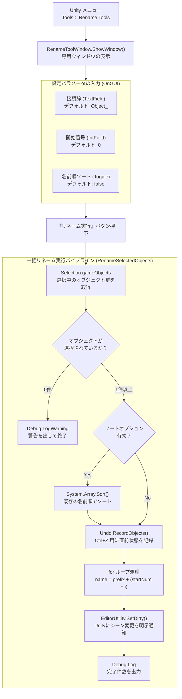

## 1. 企画・開発背景
Unityにおける**エディタ拡張プログラミングとUPM（Unity Package Manager）パッケージ開発の学習**、自身の制作活動で恒常的に活用できる**実用ツールの開発**、および**GitHub Releasesによるバージョン管理・配布機能の習得**を目的として制作した研究的開発プロジェクトです。

3D/2Dゲーム制作やレベルデザインの現場では、ステージ上に配置した多数の障害物や敵、ギミックオブジェクトを複製（Duplicate）して配置する作業が頻繁に発生します。しかし、Unityのデフォルト機能では `GameObject (1)`, `GameObject (2)` ... といった冗長な連番名が付与され、これらを手動で1つずつリネームするのは極めて時間がかかり、命名規則の不統一や管理コストの増大を招く要因となっていました。

そこで、**「Unityエディタ内で選択した複数オブジェクトに対して、指定の接頭辞と連番をワンクリックで一括適用できるツール」**を設計・開発しました。単に文字列を置き換えるだけでなく、ヒエラルキーの順序性を担保する名前順ソート機能や、誤操作時に即座に復元できる完全なUndo/Redo対応、シーン保存漏れを防ぐDirty通知など、エディタ拡張ならではの安全性と操作性を徹底的に追求しました。

---

## 2. 技術選定とアーキテクチャ設計
個人開発にとどまらず、将来的にチーム開発や他のUnityプロジェクトへもワンタッチで導入できるよう、Unity公式のパッケージ規格に準拠した設計を行いました。

### 1. Unity Editor GUI（EditorWindow / EditorGUILayout）
ユーザーが作業を中断することなく素早く呼び出せるよう、Unityのトップメニュー（`Tools > Rename Tools`）から独立ウィンドウとして起動するフローティングUI（`EditorWindow`）を採用しました。`EditorGUILayout` を用いて、接頭辞（Prefix）、開始番号、ソートオプションをミニマルかつ直感的に設定できるレイアウトを構築しています。

### 2. UPM（Unity Package Manager）準拠のパッケージ構造
単なるAssetsフォルダ内のスクリプトとして完結させるのではなく、UPMパッケージ規格（`com.junya005.rename-tools`）に準拠したディレクトリ構造と `package.json` を設計しました。これにより、Unity Package Managerの「Add package from git URL...」を通じて、どのUnityプロジェクトにも外部依存なしで直接インポートできる高いポータビリティを実現しました。

### 3. 非破壊操作と安全性の保証（Undo & SetDirty）
エディタ拡張において最も重要な「ユーザーの既存データを破壊しない」という原則を遵守するため、リネーム実行前に `Undo.RecordObjects` を呼び出し、`Ctrl+Z` で一瞬で直前の状態にロールバックできる設計としました。また、変更をUnityのシリアライズ機構に明示的に伝える `EditorUtility.SetDirty` を組み込み、保存漏れによるデータ消失を完全に防止しています。

---

## 3. コア機能の実装詳細

### 3.1 システム構成図（処理フロー）
エディタメニューからの呼び出しから、選択オブジェクトの取得、ソート判定、Undo記録、リネーム適用、およびシーンDirty通知に至る処理パイプラインです。



---

### 3.2 エディタウィンドウのライフサイクルとUI構築（`RenameToolWindow.cs`）
`EditorWindow` を継承し、`[MenuItem("Tools/Rename Tools")]` 属性を付与することで、Unityエディタの標準メニューシステムに統合しています。

```csharp
using UnityEditor;
using UnityEngine;

/// <summary>
/// 選択オブジェクトの一括リネームを行うエディターウィンドウ。
/// </summary>
public class RenameToolWindow : EditorWindow
{
    private string _prefix = "Object_";
    private int _startNumber = 0;
    private bool _isNameSortOption = false;

    // UnityメニューのTools/Rename Toolsからウィンドウを開くためのエントリーポイント
    [MenuItem("Tools/Rename Tools")]
    public static void ShowWindow()
    {
        // 将来的な初期設定の拡張に備え、返り値を保存
        var window = GetWindow<RenameToolWindow>("Rename Tool");
    }

    private void OnGUI()
    {
        // 視認性を上げるため、EditorStyles.boldLabelを指定
        GUILayout.Label("一括リネームツール", EditorStyles.boldLabel);

        _prefix = EditorGUILayout.TextField("接頭辞", _prefix);
        _startNumber = EditorGUILayout.IntField("開始番号", _startNumber);
        _isNameSortOption = EditorGUILayout.Toggle("名前順にしてからリネーム", _isNameSortOption);

        if (GUILayout.Button("リネーム実行"))
        {
            RenameSelectedObjects();
        }
    }
}
```

---

### 3.3 一括リネームと名前順ソートロジック
選択されたオブジェクト配列（`Selection.gameObjects`）に対し、ソートオプションが有効な場合は `System.Array.Sort` とラムダ式を用いて名前順（昇順）に並び替えた上で連番を割り振ります。

```csharp
private void RenameSelectedObjects()
{
    GameObject[] selectedObjects = Selection.gameObjects;

    // 選択オブジェクトがない場合は早期リターン
    if (selectedObjects.Length == 0)
    {
        Debug.LogWarning("オブジェクトが選択されていません");
        return;
    }

    if (_isNameSortOption)
    {
        // 選択オブジェクトを名前順にソートして連番の整合性を保持
        System.Array.Sort(selectedObjects, (a, b) => a.name.CompareTo(b.name));
    }

    // オブジェクトの変更をUndo履歴に登録
    Undo.RecordObjects(selectedObjects, "一括リネーム");

    // 連番を付与するため、インデックスが扱えるforループを使用
    for (int i = 0; i < selectedObjects.Length; i++)
    {
        selectedObjects[i].name = _prefix + (_startNumber + i);

        // オブジェクト変更をUnityに通知し、上書き保存の対象に追加
        EditorUtility.SetDirty(selectedObjects[i]);
    }

    Debug.Log($"リネーム完了！{selectedObjects.Length}個のオブジェクトをリネームしました。");
}
```

---

### 3.4 UPM（package.json）メタデータ定義
Unity Package Managerで公式に認識・管理させるためのメタデータマニフェストです。セマンティックバージョニング（`1.0.0`）と対応Unityバージョン（`2022.3` 以降）を明記しています。

```json
{
    "name": "com.junya005.rename-tools",
    "version": "1.0.0",
    "displayName": "Rename Tool",
    "description": "選択オブジェクトの一括リネームを行うエディタツール。",
    "unity": "2022.3",
    "author": {
        "name": "junya005",
        "email": "junya005.65@gmail.com",
        "url": "https://github.com/junya005"
    },
    "license": "MIT",
    "keywords": [
        "editor",
        "rename",
        "tool"
    ]
}
```

---

## 4. 開発トラブルと解決プロセス

### 課題1: オブジェクト選択順序の不確定性と連番破綻
- **発生した問題・背景**:
  Unityの仕様上、`Selection.gameObjects` が返却する配列の順序は「ヒエラルキー上で上から順」ではなく、「ユーザーがCtrlキーやShiftキーでクリック選択した順序」に依存します。そのため、複数選択してリネームした際に、画面上の並び順と付与された番号がバラバラになってしまう不自然な動作が発生しました。
- **解決アプローチ**:
  文字列比較によるソート処理（`System.Array.Sort(selectedObjects, (a, b) => a.name.CompareTo(b.name))`）をオプションとして組み込みました。リネーム前に既存の名前順でソートしてから番号を割り振ることで、直感通りの綺麗な連番を生成できるようにしました。

---

### 課題2: リネーム変更がシーン保存対象に含まれないリスク（Dirtyフラグ問題）
- **発生した問題**:
  スクリプトから直接 `GameObject.name` を変更した場合、Unityのエディタ側が「シーンに変更があった」と正しく認識しないケースがあり、シーン保存（Ctrl+S）を行わずにUnityを再起動するとリネーム結果が消失してしまう潜在的リスクがありました。
- **解決アプローチ**:
  ループ処理の中で `EditorUtility.SetDirty(selectedObjects[i])` を明示的に呼び出すよう実装。Unityの内部シリアライズシステムに変更フラグ（Dirty）を立て、シーンタブに「*（未保存マーク）」を表示させることで、変更内容が確実にディスクへ保存される安全性を確立しました。

---

## 5. 研究・パッケージ開発を通じて得られた知見

本プロジェクトを通じて、単なるスクリプト制作にとどまらない以下の実践的な知見を獲得しました。

| 開発領域                     | 得られた知見・技術力                                                                                               |
| :--------------------------- | :----------------------------------------------------------------------------------------------------------------- |
| **Unity エディタ拡張**       | `EditorWindow`、`EditorGUILayout` によるツールUI設計、およびUnityメニューへの統合                                  |
| **安全なデータ操作**         | `Undo.RecordObjects` による非破壊操作の担保と、`EditorUtility.SetDirty` によるシリアライズ保存管理                 |
| **UPM パッケージング**       | `package.json` を用いたUnity公式パッケージ規格の仕様理解と、他プロジェクトへ導入可能な再利用性の高いモジュール設計 |
| **バージョン管理・リリース** | Gitタグ（`v1.0.0`）とセマンティックバージョニングによるリリースフローの習得                                        |

---

## 6. 学びと今後の展望
- **学び**:
  ゲームのインゲーム機能（プレイヤーや物理演算）だけでなく、ゲーム開発を支える**「開発者体験（DX: Developer Experience）」や「ワークフロー自動化ツール」**を自らの手で生み出す面白さと価値を深く実感しました。わずか数分のツール開発であっても、長期の制作期間において何百回・何千回と繰り返す定型作業を自動化することで、膨大な時間節約とヒューマンエラー防止に繋がることを学びました。
- **今後の展望**:
  - **正規表現（Regex）による高度な文字列置換**: 特定の文字列パターンの一括置換や削除への対応
  - **パディング桁数の指定**: `001`, `002` などゼロ埋め桁数の動的カスタマイズ
  - **Projectウィンドウ（アセット）の一括リネーム**: Hierarchy上のGameObjectだけでなく、テクスチャやプレハブなどのAssetファイルの一括リネーム機能への拡張

---

## 7. ツール概要・仕様まとめ

| 項目                 | 内容                                                                                                                                                                                                       |
| :------------------- | :--------------------------------------------------------------------------------------------------------------------------------------------------------------------------------------------------------- |
| **ツール名**         | Rename Tool for Unity                                                                                                                                                                                      |
| **パッケージ識別子** | `com.junya005.rename-tools`                                                                                                                                                                                |
| **種別**             | Unity エディタ拡張（EditorWindow） / UPMパッケージ                                                                                                                                                         |
| **開発形態**         | 個人研究・開発効率化プロジェクト                                                                                                                                                                           |
| **開発環境**         | Unity 2022.3 LTS 以降 / C#                                                                                                                                                                                 |
| **主な機能**         | ・指定接頭辞（Prefix）＋連番の一括リネーム<br/>・開始番号（Start Number）の動的指定<br/>・既存の名前順ソート後の連番付与<br/>・Undo / Redo（Ctrl+Z）完全対応<br/>・Dirtyフラグ通知によるシーン保存漏れ防止 |
