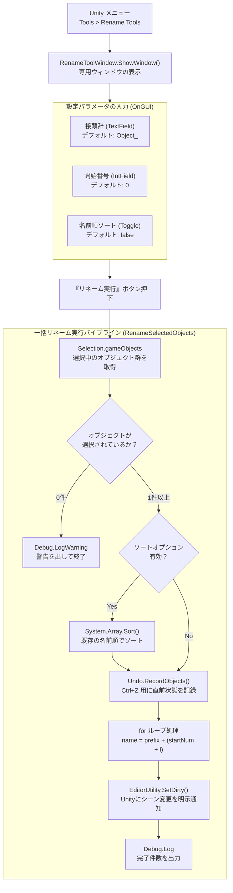
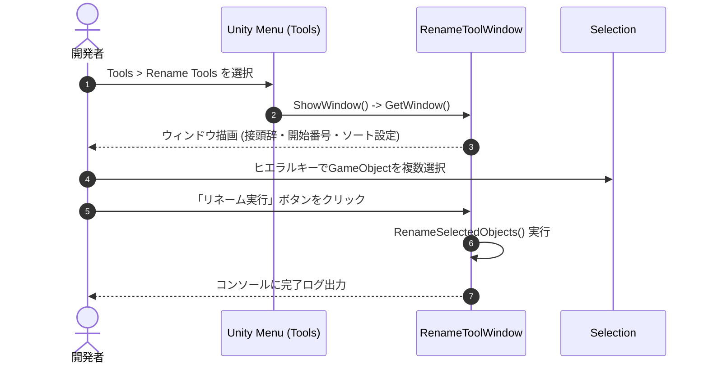
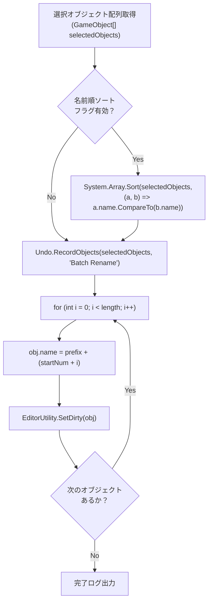
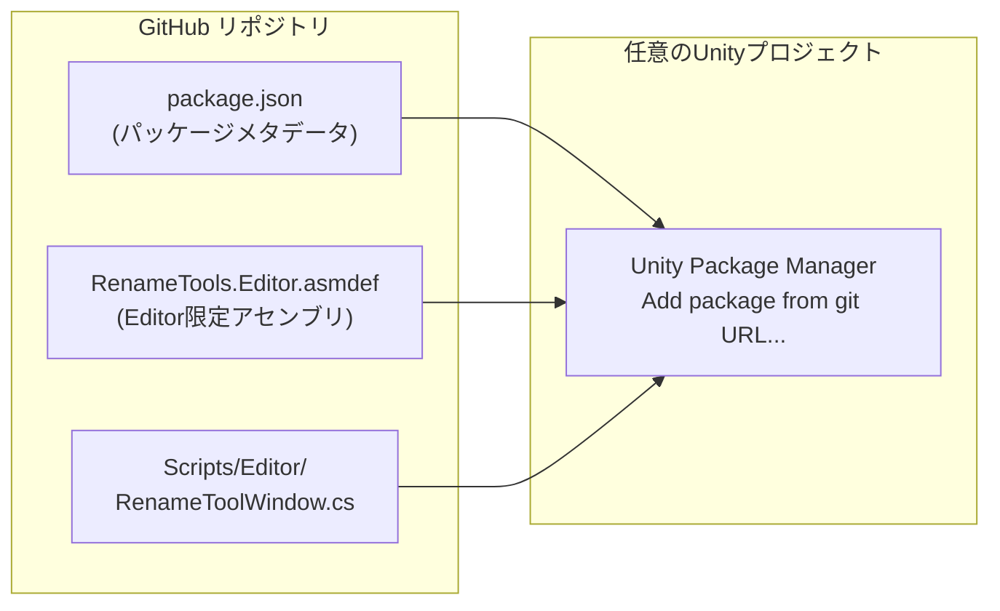
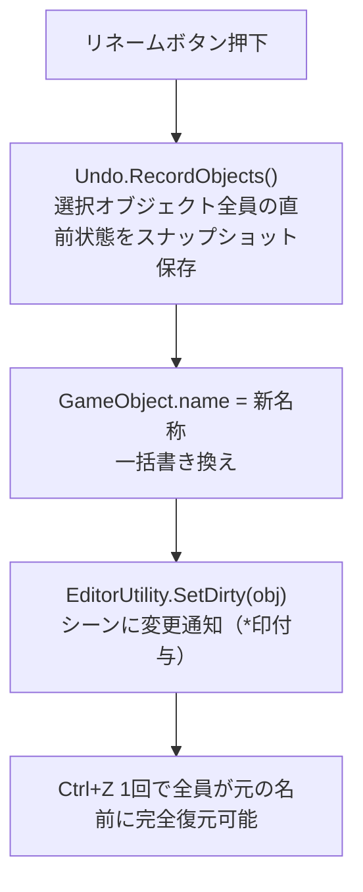
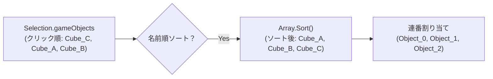

## 1. 作品の概要

### どのような作品か
Unityエディタ内で選択した複数のGameObjectに対して、**指定した接頭辞（Prefix）と開始番号から連番を一括適用できるエディタ拡張ツール**です。
単なる一括リネーム機能にとどまらず、ヒエラルキーの順序性を担保する名前順ソート機能や、誤操作時に一瞬で元に戻せる完全なUndo/Redo対応、シーン保存漏れを防ぐDirty通知など、実務・チーム開発に耐えうる安全性と操作性を備えています。また、Unity Package Manager（UPM）規格に準拠しており、どのプロジェクトにもGit URLからワンタッチで導入可能です。

### 操作方法
1. Unityのトップメニューから **`Tools > Rename Tools`** を選択して専用ウィンドウを開きます。
2. リネームしたいGameObjectをヒエラルキー上で複数選択します。
3. ウィンドウ上で以下のパラメータを設定します：
   - **接頭辞（Prefix）**: 例 `Enemy_`, `Block_`
   - **開始番号**: 例 `0`, `1`
   - **名前順ソートオプション**: チェックを入れると、既存の名前順（昇順）に並び替えてから連番を付与
4. **「リネーム実行」ボタン** をクリックすると、一括でリネームが完了します。
5. もし誤って実行した場合は、**`Ctrl + Z`（Undo）** を押すだけで直前の名称に完全ロールバックできます。

### 開発背景
3D/2Dゲーム制作やレベルデザインの現場では、障害物や敵、ギミックオブジェクトを複製（Duplicate）して大量に配置する作業が日常的に発生します。しかし、Unity標準機能では `GameObject (1)`, `GameObject (2)` ... といった冗長な連番名が付与され、これらを1つずつ手動リネームするのは極めて時間がかかり、命名規則の不統一や管理コストの増大を招いていました。
そこで、**「開発者が作業を中断することなく、直感的操作で安全にアセットやオブジェクトを整理できる実用ツール」**を自作し、作業効率の向上とUPMパッケージ開発のノウハウ習得を目的に制作しました。

### 制作体制と担当範囲
- **制作形態**: 個人研究開発（全工程を単独設計・実装）
- **GitHubリポジトリ**: [junya005/com.junya005.rename-tool](https://github.com/junya005/com.junya005.rename-tool)
- **担当範囲**:
  - `EditorWindow` / `EditorGUILayout` を用いたUnity専用GUIの設計・実装
  - `Undo.RecordObjects` および `EditorUtility.SetDirty` による安全な非破壊リネーム処理
  - ヒエラルキーの順序ブレを防ぐ `System.Array.Sort` ソートアルゴリズム
  - UPMパッケージ規格（`package.json`）およびGitHub Releases配布パイプラインの構築

---

## 2. 選定技術と全体のアーキテクチャ設計

### どの技術を使用したか
- **開発環境**: Unity 2022.3 LTS 以降
- **言語**: C#
- **GUIフレームワーク**: UnityEditor API（`EditorWindow`, `EditorGUILayout`, `EditorStyles`）
- **履歴・状態管理**: `UnityEditor.Undo`, `UnityEditor.EditorUtility`
- **オブジェクト操作**: `UnityEditor.Selection`
- **パッケージ規格**: UPM (Unity Package Manager / `package.json` 準拠)

### どの設計を採用したか

#### 1. フローティングUIによる非同期・非モーダル操作
モーダルダイアログで開発者の作業をブロックするのではなく、シーンビューやヒエラルキーと自由に並行操作できるドッキング可能な `EditorWindow` を採用しました。

#### 2. 非破壊操作と完全なUndo履歴の保証
エディタ拡張において最も重要な「ユーザーの既存データを絶対に破壊しない」という原則に基づき、オブジェクト名書き換えの直前に `Undo.RecordObjects` を実行。Unityエディタの標準Undoスタックに統合しました。

#### 3. シリアライズ通知による保存漏れ防止
名前変更後に `EditorUtility.SetDirty` を呼び出すことで、Unityのシリアライズシステムに「変更あり（*印）」を通知。シーン保存やPrefab保存を促し、エディタ終了時のデータ消失を防ぎました。



---

## 3. 実装した機能の詳細

### 3.1 EditorWindowによる直感的GUI構築
`EditorWindow` を継承し、`[MenuItem("Tools/Rename Tools")]` 属性を付与することで、Unityエディタの標準メニューシステムに統合しました。



#### 主要コード抜粋（RenameToolWindow.cs）
```csharp
// 【RenameToolWindow.cs より抜粋】
// メニュー登録と直感的なEditorGUILayoutレイアウト
[MenuItem("Tools/Rename Tools")]
public static void ShowWindow()
{
    var window = GetWindow<RenameToolWindow>("Rename Tool");
}

private void OnGUI()
{
    GUILayout.Label("一括リネームツール", EditorStyles.boldLabel);

    _prefix = EditorGUILayout.TextField("接頭辞", _prefix);
    _startNumber = EditorGUILayout.IntField("開始番号", _startNumber);
    _isNameSortOption = EditorGUILayout.Toggle("名前順ソート", _isNameSortOption);

    EditorGUILayout.Space(10);

    if (GUILayout.Button("リネーム実行", GUILayout.Height(30)))
    {
        RenameSelectedObjects();
    }
}
```

---

### 3.2 順序性を保証する名前順ソート＆連番リネーム処理
Unityのヒエラルキー選択順序はクリック順に依存するため、意図しない番号割り当てが起こりやすい仕様です。これを防ぐため、選択オブジェクトの名前順ソート機能を組み込みました。



#### 主要コード抜粋（RenameToolWindow.cs）
```csharp
// 【RenameToolWindow.cs より抜粋】
// ソート処理、Undo記録、リネーム、Dirty通知の実行ループ
private void RenameSelectedObjects()
{
    GameObject[] selectedObjects = Selection.gameObjects;

    if (selectedObjects.Length == 0)
    {
        Debug.LogWarning("[Rename Tool] リネーム対象のオブジェクトが選択されていません。");
        return;
    }

    // 1. オプションが有効な場合は既存の名前順に昇順ソート
    if (_isNameSortOption)
    {
        System.Array.Sort(selectedObjects, (a, b) => a.name.CompareTo(b.name));
    }

    // 2. Undoシステムに直前の状態を一括登録（Ctrl+Z対応）
    Undo.RecordObjects(selectedObjects, "Batch Rename Objects");

    // 3. 一括リネームとDirty通知
    for (int i = 0; i < selectedObjects.Length; i++)
    {
        selectedObjects[i].name = $"{_prefix}{_startNumber + i}";
        EditorUtility.SetDirty(selectedObjects[i]);
    }

    Debug.Log($"[Rename Tool] {selectedObjects.Length} 個のオブジェクトを一括リネームしました。");
}
```

---

### 3.3 UPM（Unity Package Manager）規格に準拠したパッケージ設計
単なるプロジェクト内のアセットではなく、他のすべてのUnityプロジェクトからGit URL経由で導入できるよう、UPM規格に準拠したディレクトリ構造とマニフェストを設計しました。



#### 主要コード抜粋（package.json & asmdef）
```json
// 【package.json より抜粋】
{
  "name": "com.junya005.rename-tools",
  "version": "1.0.0",
  "displayName": "Rename Tool",
  "description": "Unityエディタ内で選択した複数オブジェクトの一括リネームを行うエディタ拡張パッケージ",
  "unity": "2022.3",
  "author": {
    "name": "Junya Kobayashi"
  }
}
```

```json
// 【RenameTools.Editor.asmdef より抜粋】
// エディタ専用アセンブリとして定義し、ビルドエラーを防止
{
  "name": "RenameTools.Editor",
  "includePlatforms": [
    "Editor"
  ]
}
```

---

## 4. 解決した課題

### 課題1: 非破壊操作の保証（UndoシステムとシリアライズSetDirtyの完全統合）

#### 背景・課題
自作エディタ拡張で最も重大な事故は「大量のオブジェクト名を誤って書き換え、Ctrl+Zで元に戻せなくなること」です。Unityの `GameObject.name` をスクリプトから直接書き換えると、標準のUndoスタックに登録されず、作業のロールバックが不可能になるリスクがありました。また、シーンのシリアライズ機構に変更が伝わらず、シーン保存を忘れてエディタを閉じると変更内容が消失する問題がありました。

#### 技術的アプローチ
オブジェクト名更新処理の直前に、必ず `Undo.RecordObjects(selectedObjects, "Batch Rename Objects")` を実行するパイプラインを設計しました。さらに、変更を加えた全GameObjectに対して `EditorUtility.SetDirty(obj)` を呼び出し、Unityエディタに変更フラグ（Dirty）を明示通知する構造にしました。

#### 具体的なコードや設計


```csharp
// 【安全性保証ロジック】
Undo.RecordObjects(selectedObjects, "Batch Rename Objects");
for (int i = 0; i < selectedObjects.Length; i++)
{
    selectedObjects[i].name = $"{_prefix}{_startNumber + i}";
    EditorUtility.SetDirty(selectedObjects[i]);
}
```

---

### 課題2: ヒエラルキーの順序性担保（名前順ソートオプションによる意図しない連番崩れの防止）

#### 背景・課題
Unityの `Selection.gameObjects` は、ヒエラルキーの見た目の並び順ではなく「ユーザーがクリックした順序」で配列に格納される内部仕様を持っています。そのため、複数選択してリネームした際に `Enemy_0`, `Enemy_2`, `Enemy_1` のように番号順序が逆転・崩壊してしまう問題がありました。

#### 技術的アプローチ
`System.Array.Sort` とラムダ式を用いた名前順ソート機能（`_isNameSortOption`）を実装しました。アルファベット順・数値順で整列した後に連番を割り振ることで、ヒエラルキーの並び順と一致した直感的な番号割り当てを保証しました。

#### 具体的なコードや設計


```csharp
if (_isNameSortOption)
{
    // 既存オブジェクトの名前順（昇順）に整列
    System.Array.Sort(selectedObjects, (a, b) => a.name.CompareTo(b.name));
}
```

---

## 5. 学びと今後の展望

### 学び
- **UnityエディタAPIのライフサイクルと安全性への配慮**:
  エディタ拡張開発において「Undoの確実な登録」と「SetDirtyによるシリアライズ通知」がいかに重要かを学びました。ユーザーの制作環境を破壊しない堅牢なツール設計の基準を体得しました。
- **UPM（Unity Package Manager）によるモジュール配布設計**:
  単独のUnityプロジェクト内で完結させず、パッケージとして切り出してGitHub経由で配布するパイプラインを設計したことで、再利用性とポータビリティの高いコード設計手法を習得しました。

### 今後の展望
- **正規表現（Regex）による置換・連番パディング機能の追加**:
  連番を `Enemy_01`, `Enemy_001` のように0埋め（Zero Padding）できるフォーマット指定や、特定の文字列パターンのみを部分置換できる高度なリネーム機能の実装。
- **アンドゥプレビュー機能**:
  リネーム実行前に変更前後の名称一覧をウィンドウ内でプレビュー確認できるUIの導入。
