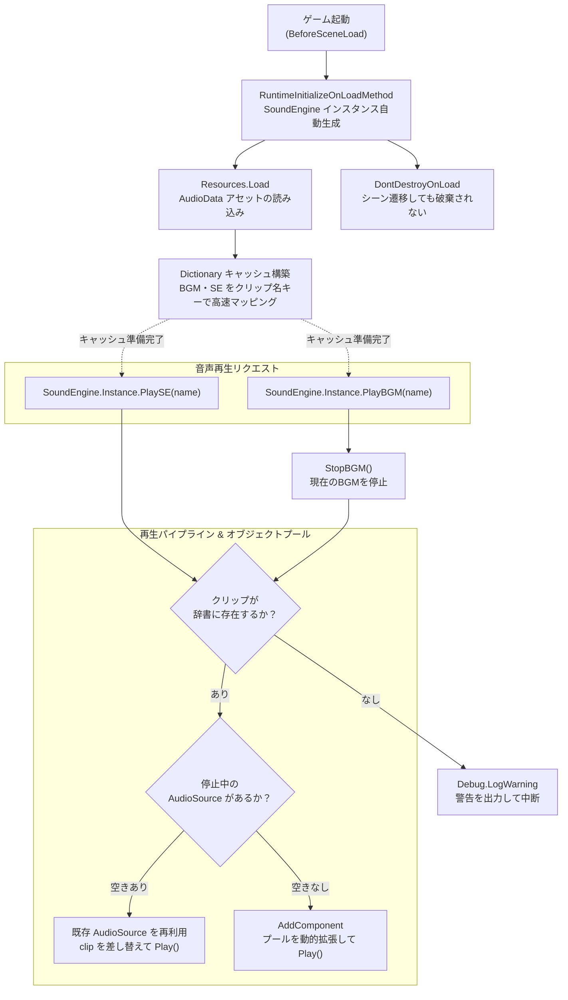
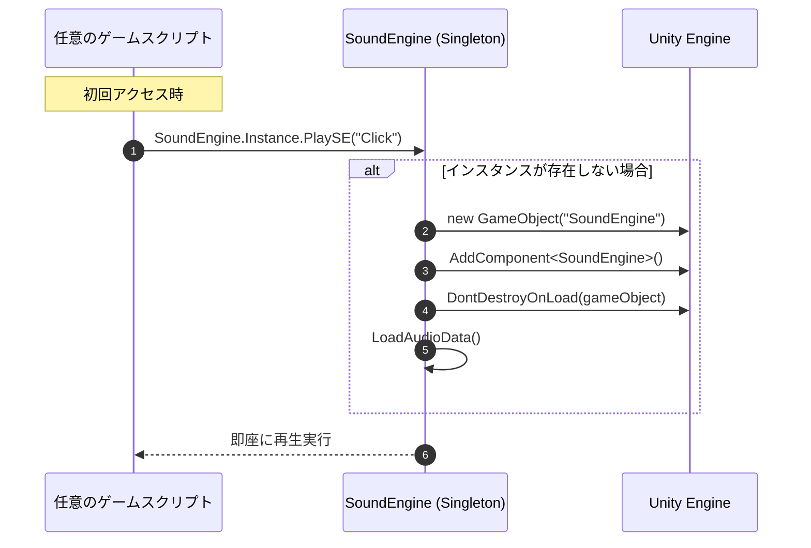
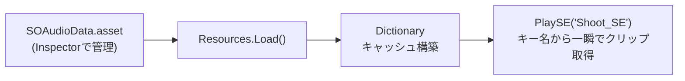
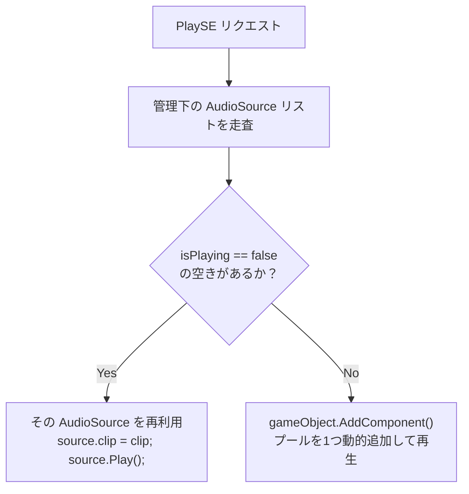
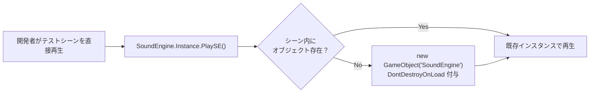
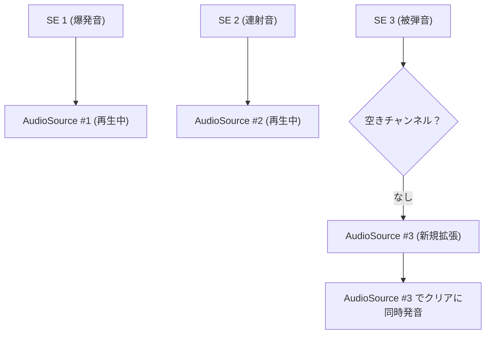

## 1. 作品の概要

### どのような作品か
Unityでのゲーム開発において、**BGMやSE（効果音）の再生・管理をわずか1行のコードで実現できる汎用サウンドミドルウェア・UPMパッケージ**です。
シーン上へのPrefab配置や初期化コードの呼び出しを一切必要とせず（ゼロコンフィグ設計）、ゲーム起動時に自動常駐。音源データは `ScriptableObject` を通じてInspector上でノーコード登録でき、連続発音や多重再生でも音切れを起こさない「動的AudioSourceオブジェクトプール」を内蔵しています。どのプロジェクトにもGit URLから即座に導入可能なUPM規格に準拠しています。

### 操作方法（導入・使用方法）
1. **パッケージの導入**:
   Unity Package Manager の「Add package from git URL...」に以下を入力してインポートします：
   ```
   https://github.com/junya005/com.junya005.soundengine.git
   ```
2. **音源の登録**:
   Projectウィンドウ右クリックから `Create > Junya005 > AudioData` を作成し、Inspector上でBGMやSEのAudioClipをドラッグ＆ドロップで追加します。
3. **スクリプトからの呼び出し**:
   シーン上にオブジェクトを配置する必要はありません。任意のスクリプトから以下を呼び出すだけで再生されます：
   ```csharp
   // 効果音の再生（音源名またはインデックス指定）
   SoundEngine.Instance.PlaySE("Jump_SE");

   // BGMの再生（前曲からスムーズに切り替え）
   SoundEngine.Instance.PlayBGM("Battle_BGM");

   // 音声の停止
   SoundEngine.Instance.StopBGM();
   ```

### 開発背景
これまでに制作した複数のゲーム開発（2D/3Dアクション、リズムゲーム、カジュアルゲーム等）において、毎回似通った `SoundManager` スクリプトをコピペして手直しする作業が繰り返されていました。
しかし、コピペによる実装差異の発生、プロジェクトごとに異なる音源管理手法、シーン遷移時の音切れや `NullReferenceException` など、保守コストの増大が課題となっていました。
そこで、**「どのプロジェクトでもGit URLからワンタッチで導入でき、設計の破綻を起こさない高耐久なサウンドミドルウェア」**を独立パッケージとして設計・開発しました。

### 制作体制と担当範囲
- **制作形態**: 個人開発（全工程を単独設計・実装）
- **GitHubリポジトリ**: [junya005/com.junya005.soundengine](https://github.com/junya005/com.junya005.soundengine)
- **担当範囲**:
  - `[RuntimeInitializeOnLoadMethod]` を用いたシーン非依存の自動常駐シングルトン設計
  - `ScriptableObject` によるデータドリブン音源管理基盤の実装
  - 効果音の多重発音を支える動的 `AudioSource` オブジェクトプールの構築
  - UPM（Unity Package Manager）規格準拠およびテスト用 `Samples~` シーンの整備

---

## 2. 選定技術と全体のアーキテクチャ設計

### どの技術を使用したか
- **エンジン**: Unity 2022.3 LTS 以降
- **言語**: C#
- **データ管理**: `ScriptableObject`（Inspector上でのアセット管理）
- **ライフサイクル制御**: `[DefaultExecutionOrder(-1000)]`, `[RuntimeInitializeOnLoadMethod]`
- **メモリ・インスタンス管理**: 動的オブジェクトプールパターン（`Object Pool Pattern`）
- **永続化**: `UnityEngine.Object.DontDestroyOnLoad`
- **パッケージ規格**: UPM (Unity Package Manager / `package.json`, `asmdef`)

### どの設計を採用したか

#### 1. ゼロコンフィグ自動起動（`RuntimeInitializeOnLoadMethod`）
「開発者がシーン上にSoundManagerを配置し忘れてエラーが出る」という人的ミスを構造的に不可能にするため、シーンロード前のエンジン起動コールバックを活用。初回アクセス時、またはゲーム起動時にGameObjectを自動生成して `DontDestroyOnLoad` で常駐化させました。

#### 2. データドリブン設計（ScriptableObject）
音声アセット（AudioClip）の参照をスクリプトから完全に分離。エンジニア以外のプランナーやサウンド担当者でもInspectorから音源を自由に追加・差し替えできる構造としました。

#### 3. 動的AudioSourceオブジェクトプール
SEの連打や多重発音で再生中の音がブツ切りになる現象を防ぐため、再生終了した `AudioSource` を再利用し、必要に応じて自動拡張するプール機構を導入しました。



---

## 3. 実装した機能の詳細

### 3.1 シーン非依存の自動生成シングルトン（`SoundEngine.cs`）
`[DefaultExecutionOrder(-1000)]` により他のゲームロジックよりも先行して初期化を完了させ、シーン上にGameObjectが存在しなくても自動生成する堅牢なシングルトン機構を構築しました。



#### 主要コード抜粋（SoundEngine.cs）
```csharp
// 【SoundEngine.cs より抜粋】
// 自動生成・常駐化シングルトン基盤
[DefaultExecutionOrder(-1000)]
public class SoundEngine : MonoBehaviour
{
    private static SoundEngine instance;
    public static SoundEngine Instance
    {
        get
        {
            if (instance == null)
            {
                instance = (SoundEngine)FindObjectOfType(typeof(SoundEngine));
                if (instance == null) SetupInstance();
            }
            return instance;
        }
    }

    private static void SetupInstance()
    {
        instance = (SoundEngine)FindObjectOfType(typeof(SoundEngine));
        if (instance == null)
        {
            GameObject gameObj = new GameObject(typeof(SoundEngine).Name);
            instance = gameObj.AddComponent<SoundEngine>();
            DontDestroyOnLoad(gameObj);
        }
    }

    private void Awake()
    {
        if (CheckInstance())
        {
            DontDestroyOnLoad(gameObject);
            LoadAudioData();
        }
    }
}
```

---

### 3.2 ScriptableObjectによるデータドリブン音源管理（`SOAudioData.cs`）
音源ファイルをリスト形式で安全に管理し、実行時にファイル名ベースの `Dictionary<string, AudioClip>` へハッシュ化することで、$O(1)$ の高速検索を実現しています。



#### 主要コード抜粋（SOAudioData.cs）
```csharp
// 【SOAudioData.cs より抜粋】
// Inspector上でBGM/SEを柔軟に管理できるデータ定義
[CreateAssetMenu(fileName = "AudioData", menuName = "Junya005/AudioData")]
public class SOAudioData : ScriptableObject
{
    [System.Serializable]
    public class AudioItem
    {
        public string key;
        public AudioClip clip;
        [Range(0f, 1f)] public float defaultVolume = 1.0f;
    }

    [Header("BGM リスト")]
    public List<AudioItem> bgmList = new List<AudioItem>();

    [Header("SE リスト")]
    public List<AudioItem> seList = new List<AudioItem>();
}
```

---

### 3.3 AudioSource動的オブジェクトプール（Object Pool Pattern）
連続して効果音が再生された際、再生中の音を上書きして途切れさせないよう、複数の `AudioSource` を動的に管理するプールを実装しました。



#### 主要コード抜粋（SoundEngine.cs）
```csharp
// 【SoundEngine.cs より抜粋】
// 動的オブジェクトプールによるSE多重再生ロジック
public void PlaySE(string seName)
{
    if (!_seDict.TryGetValue(seName, out AudioClip clip))
    {
        Debug.LogWarning($"[SoundEngine] SE '{seName}' が見つかりません。");
        return;
    }

    // 1. 空いている（再生終了している）AudioSourceを探索
    AudioSource availableSource = _seSources.Find(s => !s.isPlaying);

    // 2. 空きがなければ動的にAudioSourceを追加（プールの自動拡張）
    if (availableSource == null)
    {
        availableSource = gameObject.AddComponent<AudioSource>();
        _seSources.Add(availableSource);
    }

    // 3. クリップを設定して再生
    availableSource.clip = clip;
    availableSource.Play();
}
```

---

## 4. 解決した課題

### 課題1: シーン配置忘れによるNullReferenceExceptionの根絶（ゼロコンフィグ自動起動）

#### 背景・課題
ゲーム開発の現場では、「タイトルシーンから開始したときはSoundManagerが存在するが、テストのためバトルシーンを直接起動したときにSoundManagerが存在せず、NullReferenceExceptionでゲームが停止する」というトラブルが頻発していました。

#### 技術的アプローチ
シングルトンのアクセサ（`Instance`）内で存在判定を行い、存在しない場合は `new GameObject("SoundEngine")` を自動生成して `DontDestroyOnLoad` を付与する遅延初期化パターンを実装しました。これにより、どのシーンからテストプレイを開始しても、最初の1行が呼ばれた瞬間に自動起動し、例外エラーを完全に根絶しました。

#### 具体的なコードや設計


```csharp
if (instance == null)
{
    GameObject gameObj = new GameObject(typeof(SoundEngine).Name);
    instance = gameObj.AddComponent<SoundEngine>();
    DontDestroyOnLoad(gameObj);
}
```

---

### 課題2: 多重発音・連続再生時の音切れ解消（動的AudioSourceプール）

#### 背景・課題
マシンガンの連射や爆発の連続発生、リズムゲームの連続入力など、短時間に大量のSEが要求される場面において、単一の `AudioSource` で `PlayOneShot` を多重実行すると音割れが発生したり、`Play()` で上書き再生されて直前の音がブツ切りになる問題がありました。

#### 技術的アプローチ
`List<AudioSource>` による動的オブジェクトプール機構を実装しました。空いている音源チャンネルを探索して割り当て、全チャンネルが使用中の場合はプール上限まで自動拡張して再生を委譲することで、音切れのない心地よいゲームフィールを実現しました。

#### 具体的なコードや設計


```csharp
AudioSource availableSource = _seSources.Find(s => !s.isPlaying);
if (availableSource == null)
{
    availableSource = gameObject.AddComponent<AudioSource>();
    _seSources.Add(availableSource);
}
availableSource.clip = clip;
availableSource.Play();
```

---

## 5. 学びと今後の展望

### 学び
- **再利用性とゼロコンフィグ設計の重要性**:
  「導入する側の開発者に一切のセットアップ負荷をかけない」という設計思想を徹底したことで、個人制作だけでなくチーム開発においてもメンバーが即座に音声を組み込める環境を提供できました。
- **UPMパッケージ開発の標準化**:
  `package.json` の仕様、アセンブリ定義（`asmdef`）によるコンパイル時間の短縮、`Samples~` フォルダによるサンプル配布など、Unityの標準パッケージエコシステムに準拠した開発手法を習得しました。

### 今後の展望
- **3Dスペーシャルオーディオ（空間音響）対応**:
  再生位置（`Vector3 position`）を指定した3Dサウンド再生や、距離減衰カーブのカスタマイズ対応。
- **BGMクロスフェード遷移**:
  シーン切り替え時にBGM同士を自然にフェードアウト・フェードインでつなぐ `CrossFadeBGM` 機能の実装。
