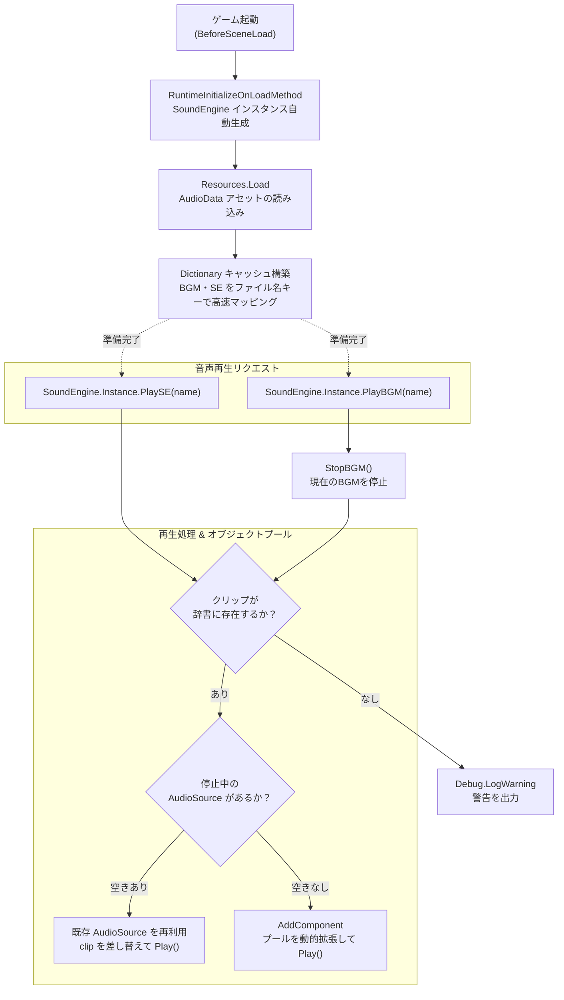

## 1. 企画・開発背景
これまでに制作した複数のゲームプロジェクト（2D/3Dアクション、ミニゲーム、展示向け作品など）において、共通して必要となる**音声再生（BGM・SE管理）ロジックを再利用可能な独立モジュールとしてパッケージ化**することを目的として開発したサウンドミドルウェアです。

従来はプロジェクトごとに `SoundManager` スクリプトを複製・修正して使用していましたが、コピペによる実装の差異や、音源をInspector上で登録する重複作業、シーン遷移時の破綻など、保守・運用コストの増大が課題となっていました。

そこで、**「どのUnityプロジェクトでもGit URLからワンタッチで導入でき、ScriptableObjectで直感的に音源を登録、シーン配置不要で1行のコードから呼び出せる」**汎用サウンドエンジンを設計・開発しました。Unity公式のUPM（Unity Package Manager）規格に準拠させ、実務や個人制作の現場で即座に活用できる再利用性を実現しました。

---

## 2. 技術選定とアーキテクチャ設計
「導入の容易さ（Zero Configuration）」と「実行時パフォーマンス」、「他職種との協調性」を両立するため、以下の設計方針を採用しました。

### 1. ScriptableObject によるデータドリブン設計（`SOAudioData.cs`）
音源ファイル（AudioClip）の参照をC#コードから完全に分離し、UnityのInspectorからドラッグ＆ドロップで追加・一覧化できる `SOAudioData`（ScriptableObject）を導入しました。これにより、エンジニア以外のプランナーやサウンドデザイナーでも音源の追加・差し替えが容易に行える設計としました。

### 2. ゼロコンフィグ自動起動（`[RuntimeInitializeOnLoadMethod]` ＋ シングルトン）
シーン上にPrefabやGameObjectを事前に配置しなくても、ゲーム開始時（シーンロード前）にUnityのエンジンコールバック（`[RuntimeInitializeOnLoadMethod]`）を通じて自動でGameObjectを生成・常駐化。`DontDestroyOnLoad` によりシーン遷移（タイトル → メイン → リザルト等）をまたいでもBGMが途切れない永続性を担保しました。

### 3. AudioSource の動的オブジェクトプール（Object Pool Pattern）
SE（効果音）の連続再生や多重発音時に、再生中の音を遮断することなく自然に重ねて鳴らせるよう、複数の `AudioSource` を動的にプール・管理する仕組みを実装しました。空いている `AudioSource` を探索して再利用し、発音数が増加した場合は自動的にプールを拡張することで、音切れのない心地よいゲームサウンドを実現しました。

### 4. UPM規格準拠と `Samples~` ディレクトリによる導入サポート
`package.json` および `asmdef`（Assembly Definition）による公式パッケージ構成を採用。サンプル音源（BGM・SE）やテストシーンを `Samples~` フォルダに格納し、Package ManagerのUIから必要に応じてワンクリックでインポートできる構成としました。

---

## 3. コア機能の実装詳細

### 3.1 システム構成図（処理フロー）
ゲーム開始時の自動初期化から、音源データの動的ロード、およびSE/BGM再生要求時のオブジェクトプール探索・再生のデータフローです。



---

## 3.2 シーン非依存の自動生成シングルトン（`SoundEngine.cs`）
`[DefaultExecutionOrder(-1000)]` により他のゲームロジックよりも先行して初期化を完了させ、シーン上にGameObjectが存在しなくても自動生成する堅牢なシングルトン機構を構築しました。

```csharp
using System.Collections.Generic;
using UnityEngine;

namespace Junya005.SoundEngine
{
    [DefaultExecutionOrder(-1000)]
    public class SoundEngine : MonoBehaviour
    {
        private static SoundEngine instance;
        public static SoundEngine Instance
        {
            get
            {
                if (instance == null)
                {
                    instance = (SoundEngine)FindObjectOfType(typeof(SoundEngine));
                    if (instance == null) SetupInstance();
                }
                return instance;
            }
        }

        private static void SetupInstance()
        {
            instance = (SoundEngine)FindObjectOfType(typeof(SoundEngine));
            if (instance == null)
            {
                GameObject gameObj = new GameObject(typeof(SoundEngine).Name);
                instance = gameObj.AddComponent<SoundEngine>();
                DontDestroyOnLoad(gameObj);
            }
        }

        // ゲーム起動時にシーン配置不要で自動初期化
        [RuntimeInitializeOnLoadMethod(RuntimeInitializeLoadType.BeforeSceneLoad)]
        private static void Initialize()
        {
            new GameObject("SoundEngine", typeof(SoundEngine));
            SetupInstance();
        }

        private void Awake() => RemoveDuplicates();
        private void Start() => InitializeAudio();
    }
}
```

---

## 3.3 データドリブンな音源定義と高速辞書キャッシュ（`SOAudioData.cs`）
音源リストをScriptableObjectとして管理し、起動時に `Dictionary<string, AudioClip>` へ展開することで、実行時は文字列キーによる $O(1)$ の高速検索を実現しています。

```csharp
namespace Junya005.SoundEngine
{
    [CreateAssetMenu(fileName = "AudioData", menuName = "Junya005/SoundEngine/AudioData")]
    public class SOAudioData : ScriptableObject
    {
        [Header("Set BGM AudioClip Here")]
        public List<AudioClip> BGMList;

        [Header("Set SE AudioClip Here")]
        public List<AudioClip> SEList;
    }
}
```

```csharp
// SoundEngine.cs でのキャッシュ初期化処理
private void InitializeAudio()
{
    if (_isInitialized) return;

    _audioList = Resources.Load<SOAudioData>("AudioData");
    if (_audioList == null)
    {
        Debug.LogWarning("AudioDataが設定されていません");
        return;
    }

    foreach (var clip in _audioList.BGMList) _bgmAudioClips.Add(clip.name, clip);
    foreach (var clip in _audioList.SEList) _seAudioClips.Add(clip.name, clip);

    _isInitialized = true;
}
```

---

## 3.4 AudioSource の動的オブジェクトプール処理
SEが短時間に連続して鳴らされた際、音切れを起こさないよう、空いている `AudioSource` を探し、不足していれば自動的に `AddComponent<AudioSource>()` を行ってプールを拡張します。

```csharp
private void Play(string name, ESoundType soundType)
{
    var audioClips = (soundType == ESoundType.BGM) ? _bgmAudioClips : _seAudioClips;
    var audioSources = (soundType == ESoundType.BGM) ? _bgmAudioSources : _seAudioSources;

    if (audioClips.TryGetValue(name, out var clip))
    {
        // 1. 停止中のAudioSourceを探索して再利用
        foreach (var audioSource in audioSources)
        {
            if (!audioSource.isPlaying)
            {
                if (soundType == ESoundType.BGM) audioSource.loop = true;
                audioSource.clip = clip;
                audioSource.Play();
                return;
            }
        }

        // 2. 空きがなければ新規AudioSourceを動的に生成してプールに追加
        AudioSource newAudioSource = this.gameObject.AddComponent<AudioSource>();
        if (soundType == ESoundType.BGM) newAudioSource.loop = true;
        newAudioSource.clip = clip;
        newAudioSource.Play();

        audioSources.Add(newAudioSource);
    }
    else
    {
        Debug.LogWarning($"指定された音源 '{name}' は存在しませんでした");
    }
}
```

---

## 4. 開発トラブルと解決プロセス

### 課題1: パッケージ同梱サンプルがプロジェクトに自動混入・競合する問題
- **発生した問題・背景**:
  パッケージ内にテストシーンやサンプル音源（BGM・SE）を同梱した際、通常の `Samples` フォルダ名で配置すると、Unityがパッケージ読み込み時に無条件でアセットデータベースに登録してしまい、ユーザープロジェクト側の音源やResourcesと名前競合・アセット肥大化を起こすリスクがありました。
- **解決アプローチ**:
  Unity公式のUPM規約に従い、ディレクトリ名を **`Samples~`（末尾チルダ付与）** に変更。Unityエディタの通常インポート対象から除外させつつ、`package.json` の `samples` フィールドにパスを指定することで、Package ManagerのUIから必要なユーザーだけが任意にインポートできる正規の配信構成を確立しました。

---

### 課題2: シーン遷移時の多重インスタンス化と実行順序の競合
- **発生した問題**:
  シーンのリロードや新しいシーンの読み込み時に、シーン内に配置されたオブジェクトの初期化処理（`Awake`）と `SoundEngine` の生成処理が前後し、`NullReferenceException` が発生したり、BGMが二重に再生されてしまうケースがありました。
- **解決アプローチ**:
  `[DefaultExecutionOrder(-1000)]` を付与して初期化優先順位を最上位に固定。さらに `RemoveDuplicates` による既存インスタンスの重複チェックと即座の破棄（`Destroy`）を組み合わせ、どのシーンから開始しても絶対に1つのインスタンスのみが安全に存在し続ける堅牢性を担保しました。

---

## 5. パッケージ開発・モジュール化を通じて得られた知見

過去のコードをUPMパッケージとして再設計するプロセスを通じて、以下の知見を得ました。

| 開発領域 | 得られた知見・実践力 |
| :--- | :--- |
| **ライブラリ設計思想** | 単発のゲームコードではなく「どのプロジェクトでも1行で動く」疎結合・ゼロコンフィグなAPI設計の重要性 |
| **UPM（Unity Package Manager）規約** | `package.json` のマニフェスト定義、`asmdef` によるアセンブリ分離、`Samples~` フォルダによるサンプル配布の仕組み |
| **データとロジックの分離** | ScriptableObjectを活用し、コードを一切触らずにインスペクターから音源を拡張できるデータドリブンな設計力 |
| **オブジェクトプールによる負荷抑制** | 動的な `AudioSource` プーリングによる音欠けの防止とメモリ・GCアロケーションの最適化 |

---

## 6. 学びと今後の展望
- **学び**:
  「過去に作ったコードを使い回す」という段階から一歩進め、「誰でも・どこでも使えるようにパッケージ化する」という視点を持つことで、APIのシンプルさやエラーハンドリング、ドキュメント（README）の丁寧さがいかに重要であるかを深く学びました。
- **今後の展望**:
  - **BGMのクロスフェード機能**: シーン遷移時やBGM切り替え時に音量を滑らかに補間する機能の実装
  - **AudioMixer 連携**: Master / BGM / SE ごとの音量調整やリバーブ等のエフェクト適用への拡張
  - **UniTask 対応**: 非同期読み込み（Addressables）や再生終了待機に対応した非同期APIの拡充

---

## 7. ツール概要・仕様まとめ

| 項目 | 内容 |
| :--- | :--- |
| **パッケージ名** | Sound Engine for Unity |
| **パッケージ識別子** | `com.junya005.soundengine` |
| **種別** | Unity サウンドミドルウェア / UPMパッケージ |
| **開発形態** | 個人開発・自作ライブラリパッケージ化プロジェクト |
| **開発環境** | Unity 2022.3 LTS 以降 / C# |
| **主な機能** | ・`[RuntimeInitializeOnLoadMethod]` によるシーン配置不要の自動起動<br/>・ScriptableObject（`SOAudioData`）による音源データ管理<br/>・$O(1)$ 辞書キャッシュによる高速な音源検索<br/>・AudioSource の動的オブジェクトプール（音切れ・重複防止）<br/>・BGMの一括停止、音量の一括変更<br/>・`Samples~` 同梱によるテストシーン・サンプル音源の提供 |
