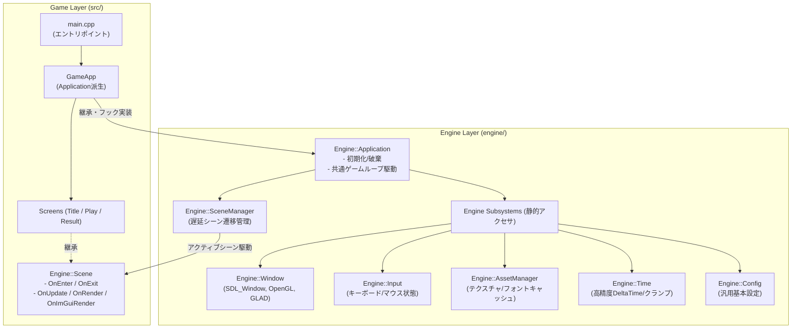
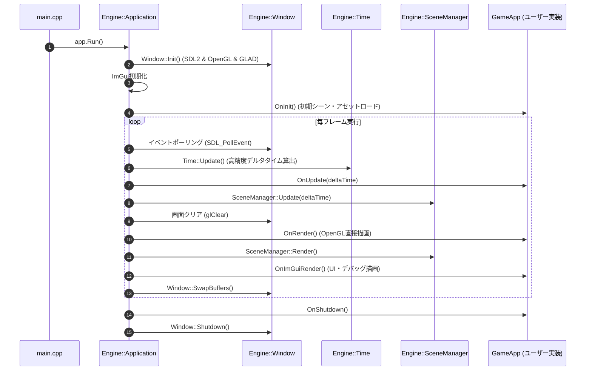
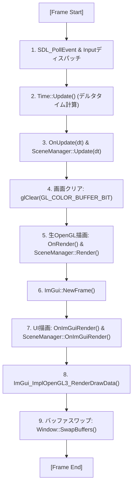
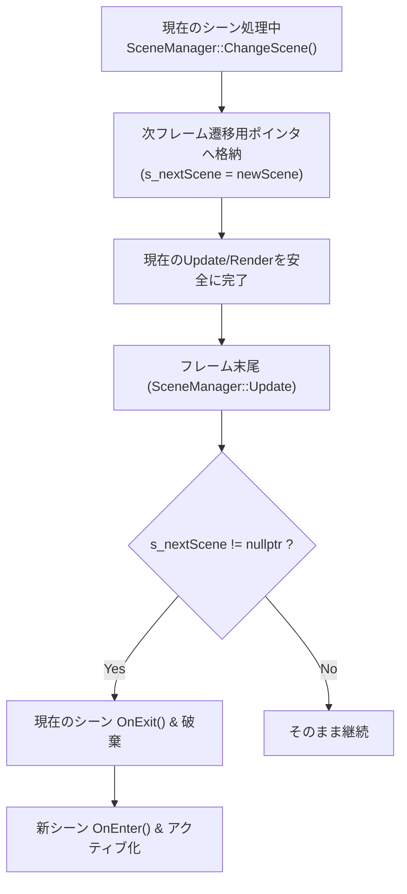
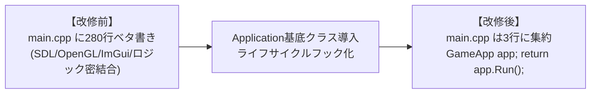
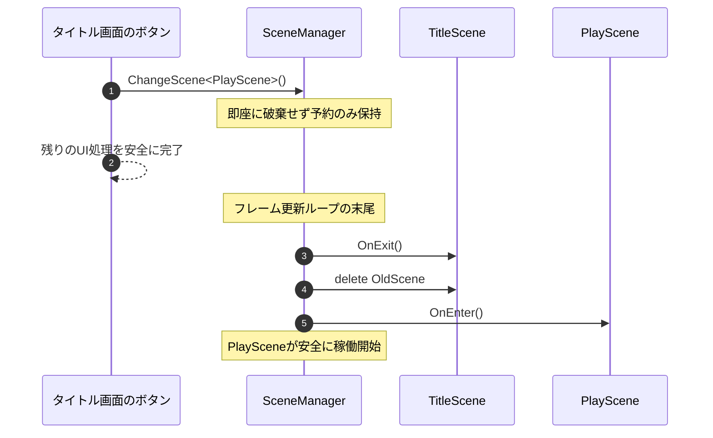

## 1. 作品の概要

### どのような作品か
SDL2 と OpenGL 3.2 Core を用いた **C++ 製のゲーム開発テンプレートリポジトリ・軽量ゲームエンジン** です。
商用ゲームエンジンをブラックボックスとして利用するだけでなく、OSのウィンドウ生成・入力ハンドリングから、プログラマブルシェーダー描画パイプライン（GLAD / OpenGL）、デバッグ・UI環境（Dear ImGui）、高精度時間管理（`Engine::Time`）、テクスチャキャッシュ（`Engine::AssetManager`）、遅延シーン遷移機構（`Engine::SceneManager`）に至るまで、ゲームエンジンの最深部で動作する仕組みをオブジェクト指向とモダンC++設計でゼロから構築しています。

### セットアップ・使用方法
CMake および vcpkg によるマニフェストモード構成を採用しており、クローン後に複雑な環境構築を行うことなく開発を開始できます。

1. **リポジトリのクローン**:
   ```bat
   git clone https://github.com/junya005/yamaneko-engine.git
   cd yamaneko-engine
   ```
2. **vcpkgのセットアップと依存解決**:
   ```bat
   git clone https://github.com/microsoft/vcpkg.git
   .\vcpkg\bootstrap-vcpkg.bat
   .\vcpkg\vcpkg install
   ```
3. **Visual Studio 2022 で起動**:
   「ローカルフォルダーを開く」でプロジェクトルートフォルダーを選択。`CMakeSettings.json` が自動認識され、**F5キー** を押すだけでビルドと実行が行われます。
   - エントリポイント（`src/main.cpp`）は `GameApp app; return app.Run();` の数行で構成されており、エンジン基底クラスを派生させて即座にゲームロジックの実装へ移ることができます。

### 開発背景
C++低レイヤー技術およびグラフィックスパイプラインの深い理解を目的に開発しました。
過去に制作したC++ゲーム『Parabolic Bomber』をはじめ、ゲーム制作サイクル（1作目『tobasu』、2作目『erabu』）を通じて、プロダクト固有コードとエンジン共通コードを徹底的にリファクタリング。**「ゲームロジックから低レベルAPI呼び出しを完全に隠蔽し、誰でもクローンして数行でゲーム開発を開始できる独立エンジン基盤」**として完成させました。

### 制作体制と担当範囲
- **制作形態**: 個人研究開発（全工程を単独設計・実装）
- **GitHubリポジトリ**: [junya005/yamaneko-engine](https://github.com/junya005/yamaneko-engine)
- **担当範囲**:
  - `Engine::Application` による初期化・ゲームループのカプセル化とライフサイクルフック設計
  - SDL2 / GLAD / OpenGL 3.2 Core による描画パイプラインおよびバッファスワップ管理
  - `Engine::Time` による `SDL_GetPerformanceCounter` を用いた高精度デルタタイム計測・クランプ制御
  - `Engine::AssetManager` によるテクスチャの重複ロード防止・VRAMキャッシュ機構
  - `Engine::SceneManager` による安全な遅延シーン遷移アーキテクチャの構築
  - Dear ImGuiの描画フェーズ統合およびUI・デバッグ画面基盤の実装
  - CMakeおよびvcpkg（マニフェストモード）によるクロス環境ビルド定義

---

## 2. 選定技術と全体のアーキテクチャ設計

### どの技術を使用したか
| 技術・ライブラリ | バージョン/区分 | 選定理由・役割 |
|---|---|---|
| **C++** | C++17 / C++20 | 低レイヤーメモリ制御と高速なゲームループ実行 |
| **SDL2 / SDL2_image / SDL2_ttf** | v2.x | OS固有処理の抽象化、ウィンドウ・高精度入力・フォント管理 |
| **OpenGL / GLAD** | OpenGL 3.2 Core | プログラマブルシェーダーによるクロスプラットフォーム描画 |
| **Dear ImGui** | Docking branch | ゲーム実行中のUI構築およびリアルタイムデバッグGUI |
| **vcpkg** | Manifest mode | `vcpkg.json` によるC++依存ライブラリの自動解決・バージョン固定 |
| **CMake** | 3.15+ | Visual Studio 2022 (MSVC) と連携したクロス環境ビルド定義 |

### どの設計を採用したか

#### 1. `Engine::Application` によるゲームループと初期化のカプセル化
低レベルライブラリ（SDL2, OpenGL, GLAD, ImGui）の初期化やメインループを基底クラス `Engine::Application` に集約。`OnInit()`, `OnUpdate(dt)`, `OnRender()`, `OnImGuiRender()`, `OnShutdown()` の仮想フックを提供することで、ゲーム層は `Application` を継承するだけで動作し、`main.cpp` を極限までスリム化しました。

#### 2. サブシステム群の静的クラス化・シングルトン化
`Window`, `Input`, `AssetManager`, `Time`, `Config`, `SceneManager` を静的アクセサを持つサブシステムとして設計。コンテキストのバケツリレーを排除し、必要なモジュールから安全かつ直接アクセスできる構造としました。

#### 3. 描画パイプラインの3層分離
画面クリア → 生OpenGL直接描画（`OnRender()`） → Dear ImGui UI描画（`OnImGuiRender()`） → バッファスワップ（`Window::SwapBuffers()`）という厳格な描画フェーズを確立しました。



---

## 3. 実装した機能の詳細

### 3.1 `Engine::Application` によるゲームループの抽象化
`main.cpp` に約280行以上ベタ書きされていた初期化処理とループを `Application` 基底クラスへカプセル化しました。



#### 主要コード抜粋（Application.h & main.cpp）
```cpp
// 【main.cpp】
// 極限までスリム化されたエントリポイント
#include "GameApp.h"

int main(int argc, char* argv[])
{
    GameApp app;
    return app.Run();
}
```

```cpp
// 【Application.h より抜粋】
// ゲーム側がオーバーライド可能なライフサイクルフック
namespace Engine {
    class Application {
    public:
        virtual ~Application() = default;
        int Run();

    protected:
        virtual bool OnInit() { return true; }
        virtual void OnShutdown() {}
        virtual void OnUpdate(float deltaTime) {}
        virtual void OnRender() {}
        virtual void OnImGuiRender() {}
    };
}
```

---

### 3.2 厳格な描画パイプラインの3層分離
毎フレームの描画順序を「生OpenGL描画」と「ImGui UI描画」に明確に分離することで、描画ステートの衝突を排除しました。



---

### 3.3 `Engine::Time` による高精度時間計測とスパイク防止クランプ
`SDL_GetPerformanceCounter` を使用してミリ秒以下の高精度なフレーム経過時間（DeltaTime）を算出。ブレークポイントによるデバッグ停止時などに巨大なDeltaTimeが発生してオブジェクトが壁を突き抜ける現象を防ぐため、最大時間クランプ処理を実装しました。

#### 主要コード抜粋（Time.cpp）
```cpp
// 【Time.cpp より抜粋】
void Time::Update()
{
    Uint64 currentCounter = SDL_GetPerformanceCounter();
    float rawDelta = (float)(currentCounter - s_lastCounter) / (float)s_frequency;
    s_lastCounter = currentCounter;

    // デバッグ停止等による巨大なスパイク（すり抜け）を防ぐクランプ処理
    if (rawDelta > MAX_DELTA_TIME) {
        rawDelta = MAX_DELTA_TIME;
    }

    s_deltaTime = rawDelta;
    s_totalTime += s_deltaTime;
}
```

---

### 3.4 `Engine::SceneManager` による安全な遅延シーン遷移
フレーム更新の処理中にシーンが即座に破棄・生成されると、イテレータの無効化やヌルポインタ参照が発生します。これを防ぐため、遷移要求をキューイングし、フレーム境界で安全に切り替える「遅延シーン遷移」を実装しました。



---

## 4. 解決した課題

### 課題1: 低レベル初期化・ゲームループとゲームロジックの密結合解消

#### 背景・課題
改修前は `main.cpp` 内に SDL2/OpenGL/GLAD/ImGui の初期化、各種パラメータ設定、テクスチャロード、ゲームループ、描画処理が280行以上にわたって手続き型でベタ書きされており、新しいゲームを制作するたびにコードをコピー＆ペーストして修正する必要がありました。初期化手順のミスやリソース解放漏れが多発し、保守性が著しく低い状態でした。

#### 技術的アプローチ
オブジェクト指向設計に基づき、エンジン層とゲーム層を明確に分離しました。
低レイヤーの初期化・終了処理、イベントループ、フレーム同期を `Engine::Application` に集約し、ゲーム側には `OnInit()`, `OnUpdate()`, `OnRender()`, `OnImGuiRender()` のライフサイクルフックのみを公開する構造へ刷新しました。

#### 具体的なコードや設計


```cpp
// 【改修後: GameApp.h】
class GameApp : public Engine::Application {
protected:
    bool OnInit() override {
        Engine::SceneManager::ChangeScene<TitleScene>();
        return true;
    }
};
```

---

### 課題2: 手動画面切り替えによるフレーム跨ぎクラッシュの根絶

#### 背景・課題
初期実装では `switch (ScreenState)` による手動画面分岐を行っており、ボタン押下などのイベント処理の途中で画面状態が切り替わると、直前の画面が保持していたUIリソースやポインタへ後続の処理がアクセスしてしまい、未定義動作やクラッシュを引き起こしていました。

#### 技術的アプローチ
抽象基底クラス `Engine::Scene` と遅延遷移管理を行う `Engine::SceneManager` を設計しました。
シーン遷移リクエストが発行された際、即時破棄を行わずに `s_nextScene` へ保持。すべてのUpdate処理が完了したフレーム境界でのみ安全に `OnExit()` → インスタンス破棄 → `OnEnter()` を順次実行するライフサイクルを構築し、フレーム途中破棄によるクラッシュを完全に根絶しました。

#### 具体的なコードや設計


---

## 5. 学びと今後の展望

### 学び
- **ゲームエンジンとゲームロジックの境界線設計**:
  単にゲームが動くだけのコードから、「何がエンジンの責任で、何がゲーム側の責任か」を明確に切り分け、フレームワークとして共通化する抽象化・モジュール化技術を深く習得しました。
- **低レイヤー描画パイプラインの厳密な制御**:
  生OpenGLによる描画パスとImGuiによる即時UI描画が混在する中で、深度バッファ・描画ステートの破壊を防ぐ3層分離パイプラインの設計手法を体得しました。

### 今後の展望
- **Assimpの本格統合による3Dメッシュローダー実装**:
  現在はOpenGL 3.2 Coreによる描画基盤が整った段階であるため、Assimpを正式にパイプラインへ統合し、OBJ/FBX等の3Dモデル読み込みと頂点属性バッファへの自動変換に対応させる予定です。
- **Entity Component System (ECS) の自作・統合**:
  データ指向設計（DOD）に基づくコンポーネント管理を構築し、大量のオブジェクトをキャッシュ効率高く処理できる設計へ拡張することを目指しています。
